<div align="center">

# BlinkStay

**A full-stack hotel and stay booking platform built with Spring Boot and React.**

Guests discover, book and review stays, hosts manage listings and reservations, and admins moderate the platform.

### 🔗 Live demo: [blinkstay.netlify.app](https://blinkstay.netlify.app/)

<!-- Replace YOUR_GITHUB_USERNAME/YOUR_REPO_NAME in the CI badge below with your repo, e.g. qutubuddin/blinkstay -->

[](https://github.com/qutubuddinkhan07/blinkstay-modular-monolith/actions/workflows/ci.yml)


</div>

## Demo

<!--
  HOW TO MAKE THE VIDEO PLAY HERE:
  1. On github.com, open this README and click the pencil (Edit) icon.
  2. Delete the line PASTE_VIDEO_LINK_HERE below.
  3. Drag docs/screenshots/demo.mp4 from your computer into the editor at that spot.
  4. GitHub uploads it and inserts a link like https://github.com/user-attachments/assets/...
  5. Commit. The video now plays inside the README.
-->

[DEMO_VIDEO_LINK_HERE](https://github.com/user-attachments/assets/6e0ace0b-c67c-47ad-9766-521ee323b3ad)

> Can't see the player? [Download the demo video](docs/screenshots/demo.mp4)

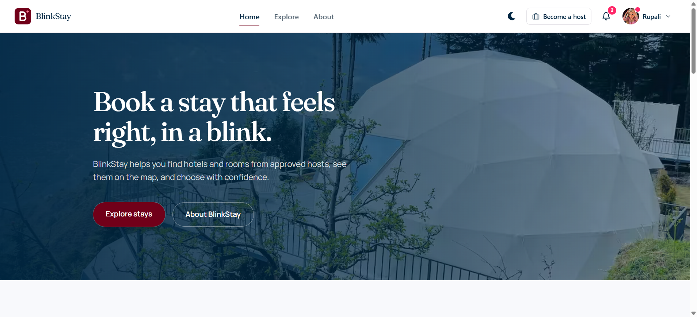

---

## Table of contents

- [Demo](#demo)
- [Overview](#overview)
- [Features](#features)
- [Screenshots](#screenshots)
- [Tech stack](#tech-stack)
- [Architecture](#architecture)
- [Deployment and CI/CD](#deployment-and-cicd)
- [Testing](#testing)
- [Project structure](#project-structure)
- [Getting started](#getting-started)
- [API overview](#api-overview)
- [Design documents](#design-documents)
- [Roadmap](#roadmap)
- [Author](#author)

---

## Overview

BlinkStay is a booking platform with three roles:

| Role                     | What they can do                                                                                                                          |
| ------------------------ | ----------------------------------------------------------------------------------------------------------------------------------------- |
| **USER** (guest)         | Browse and search listings on a map, save favorites, book rooms, pay, cancel, review stays and get notifications                          |
| **HOTEL_MANAGER** (host) | Apply to become a host, create and manage listings and rooms, publish or pause listings, view reservations and earnings, reply to reviews |
| **ADMIN**                | Review host requests, block or unblock users, suspend listings, remove reviews, and view all bookings and payments                        |

The backend is a **modular monolith**: each business area (auth, listing, room, booking, payment, earnings, review, notification) lives in its own package. Modules talk to each other through **domain events** and small shared interfaces instead of calling each other's internals, so the system can later be split into microservices.

---

## Features

### Authentication and accounts

- Sign-up with **email OTP verification**
- **JWT stored in HttpOnly cookies** with **CSRF protection** (`X-XSRF-TOKEN` header)
- Logout with **token revocation** (blocked-token table plus a scheduled cleanup job)
- **Forgot password** flow with OTP and resend cooldown (HTTP 429 on rate limit)
- Profile: edit details, upload or remove profile photo (Cloudinary), change password
- **Delete account** with a 30-day window before the data is purged; an admin can restore the account within that window
- Role-based access with Spring method security

### Hosts

- **Become a host** request flow: user applies, admin approves or rejects
- Separate **host business profile** (`HotelManagerProfile`)
- Create listings with **image upload** (Cloudinary) and a **location picker** (Mapbox geocoding)
- Listing lifecycle: `DRAFT → PUBLISHED ⇄ PAUSED`, plus `SUSPENDED` by admin or when the owner is blocked
- Manage rooms for each listing
- **Reservations** view and host-side booking cancellation
- **Earnings dashboard** with an event-driven earnings ledger

### Booking and payments

- **Instant booking**, no host approval needed
- Availability is **computed per night** from existing bookings (no counters to drift out of sync)
- **15-minute payment hold**: unpaid bookings expire automatically
- **48-hour free cancellation** policy with refund handling
- Maximum stay of 30 nights
- **Razorpay (test mode)** checkout with signature verification and webhooks; the **webhook is the source of truth** for payment status
- A **mock payment gateway** for development, off in production unless explicitly enabled for demos
- Scheduled timers for booking completion, payment expiry and refunds
- Safe under concurrency (for example, a cancel racing a payment, or two cancels at once)

### Reviews and ratings

- Only a guest with a **completed stay** can review, **one review per booking**, so nobody can review a place they never stayed in
- **1 to 5 stars** with an optional comment (up to 1,000 characters)
- Guests can **edit or delete** their review; edited reviews are marked as edited
- Hosts can **reply** to a review (one reply per review); the guest gets an in-app notification
- Admins can remove abusive or fake reviews
- Each listing stores its **average rating and review count**, recalculated under a row lock so two reviews at the same time can't produce a wrong average
- Public, paged review list on the listing page (newest first)

### Discovery

- Explore page with categories, pagination and skeleton loading
- Listing detail page with gallery, map, rooms, reviews and date-range picker
- **Favorites**

### Administration

- Users table with search and filters, plus block or unblock with a reason
- Blocking a host **suspends all their listings**; unblocking **restores** the ones that were live
- Listing moderation: suspend or unsuspend with a reason
- Host request queue with a pending-count badge
- Admin overview, all bookings, and payments needing attention
- Cache admin endpoint

### Notifications

- **Email notifications** (OTP, booking and account events), sent asynchronously
- **In-app notification bell** with read and delete actions (bookings, payments, refunds, reviews and replies)

---

## Screenshots

### Explore and listings

| Explore                                       | Favorites                                                    |
| --------------------------------------------- | ------------------------------------------------------------ |
| 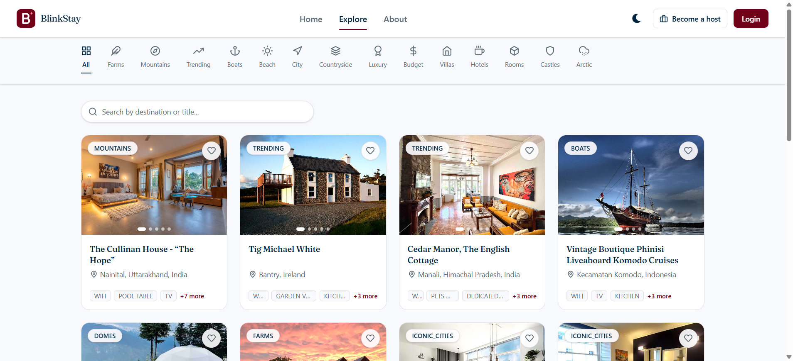 | 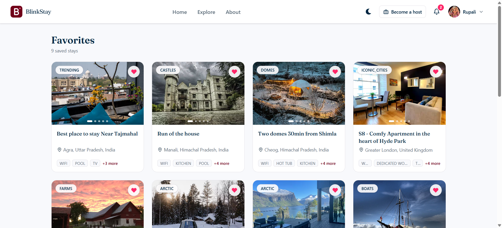 |

| Listing details                                                  | Rooms and booking card                                              | Location map                                                        |
| ---------------------------------------------------------------- | ------------------------------------------------------------------- | ------------------------------------------------------------------- |
| 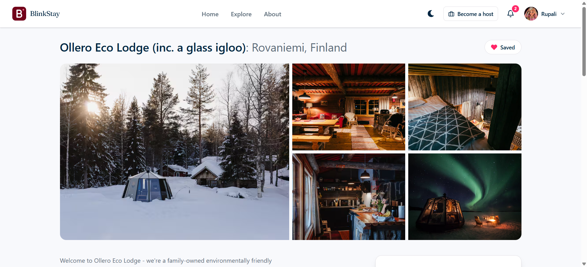 | 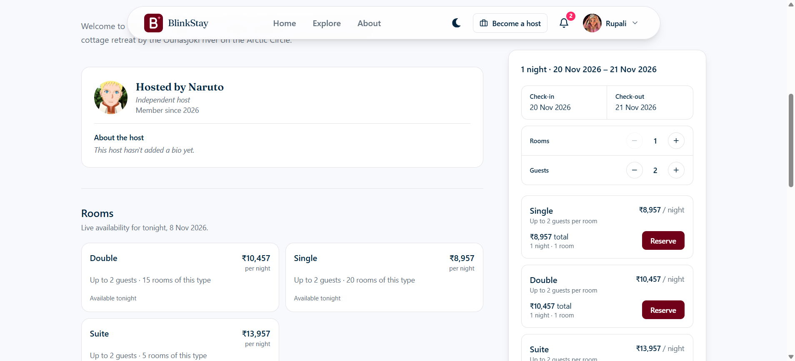 | 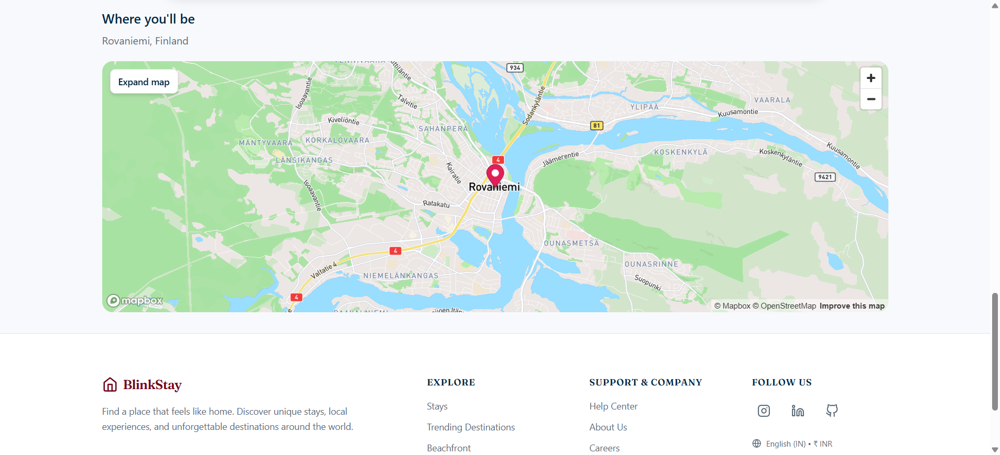 |

### Booking and payment

| Booking and payment                                              | My bookings                                              |
| ---------------------------------------------------------------- | -------------------------------------------------------- |
| 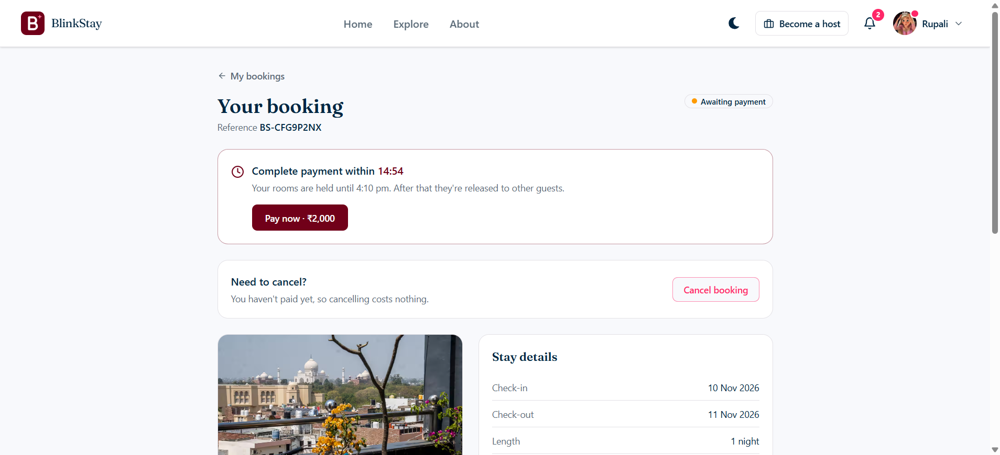 | 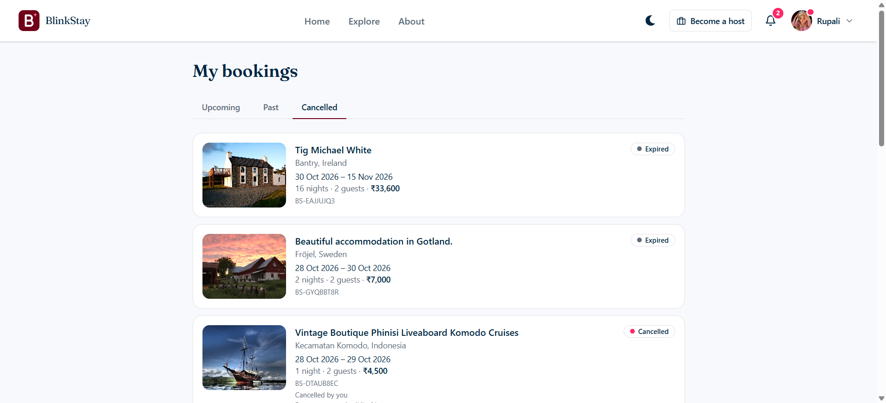 |

### Host

| Earnings dashboard                                             | Earnings by listing                                           |
| -------------------------------------------------------------- | ------------------------------------------------------------- |
| 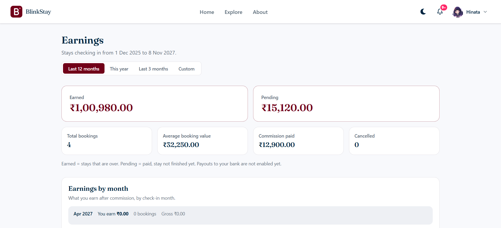 | 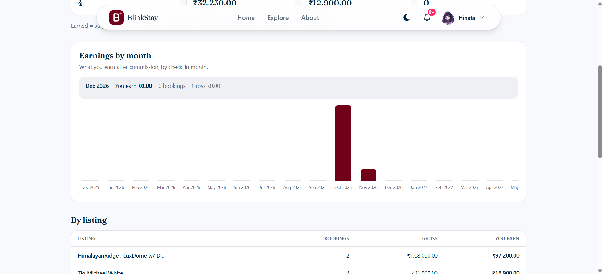 |

| My listings                                           | Reservations                                            |
| ----------------------------------------------------- | ------------------------------------------------------- |
| 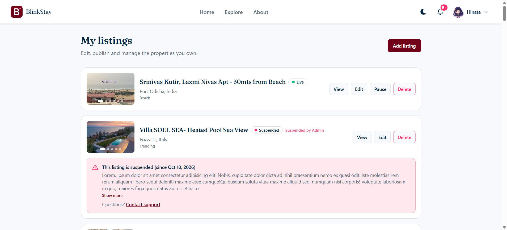 | 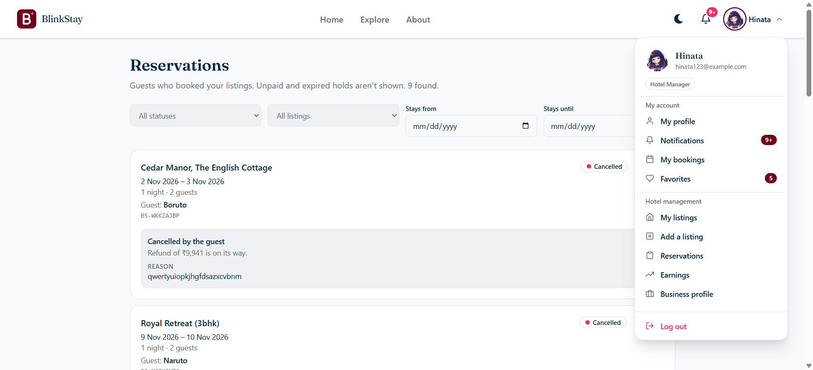 |

### Admin

| Overview                                               | Users and blocking                                               | Payments needing attention                                                          |
| ------------------------------------------------------ | ---------------------------------------------------------------- | ----------------------------------------------------------------------------------- |
| 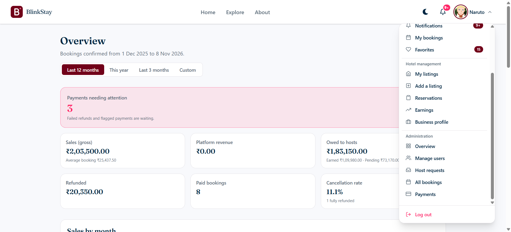 | 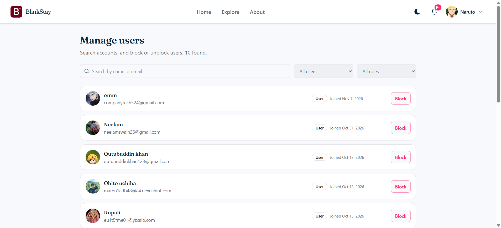 | 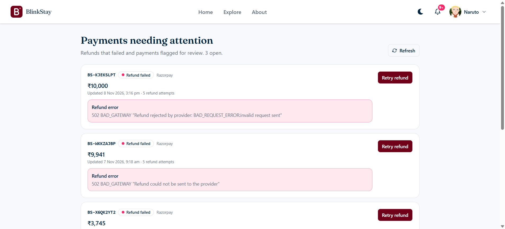 |

### Profile

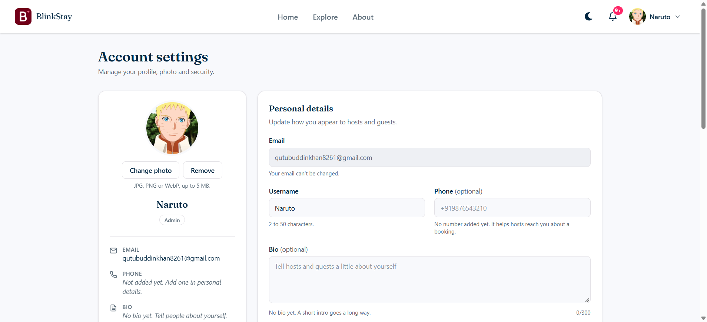

---

## Tech stack

**Backend**

- Java 25, Spring Boot 4, Spring Security, Spring Data JPA (Hibernate)
- PostgreSQL (migrated from MySQL)
- JWT (cookie-based) and CSRF protection
- Caffeine cache
- Spring application events and `@Async` listeners
- Cloudinary (images), Mapbox (geocoding), Razorpay (payments, test mode), Zoho Mail API (emails)
- Swagger / OpenAPI (disabled in production)
- Maven (wrapper included)

**Frontend**

- React with Vite
- React Router
- Axios with global error-handling interceptors
- Redux Toolkit / RTK Query (notifications and listings)
- Tailwind CSS v4, Motion (animations)
- Sonner (toasts)

**Testing, CI/CD and hosting**

- JUnit 5, Mockito, AssertJ, Spring Boot test slices
- Testcontainers (real PostgreSQL in Docker for integration tests)
- GitHub Actions
- Docker, Render (backend), Netlify (frontend), Aiven (managed PostgreSQL), UptimeRobot (uptime monitoring)

---

## Architecture

```
                ┌───────────────────────────────┐
                │     React frontend (Netlify)   │
                └──────────────┬────────────────┘
                               │  HTTPS, JWT cookie + CSRF header
                ┌──────────────▼────────────────┐
                │ Spring Boot modular monolith   │
                │          (Render)              │
                │  auth  listing  room  booking  │
                │  payment  earnings  review     │
                │  notification                  │
                │          ▲         │           │
                │          └─ events ┘           │
                └───┬────────┬────────┬──────────┘
                    │        │        │
            PostgreSQL   Cloudinary  Mapbox / Razorpay / Zoho Mail
             (Aiven)
```

- **`common`** holds what modules share: domain events (`UserBlockedEvent`, `ListingSuspendEvent`, `BookingConfirmedEvent`, ...), small contracts (`HostDirectory`, `UserDirectory`, `BookingGuard`, `BookingPayments`, `PaymentRefunds`, `ReviewableBookings`, `ListingRatings`), the global exception handler and a hotel clock.
- Modules **publish events** instead of calling each other. For example, blocking a user publishes `UserBlockedEvent`; the listing module listens and suspends that host's listings, and the notification module sends an email.
- Cache evictions run **after the transaction commits** (`AfterCommitCacheEvictor`) so the cache never holds data that was rolled back.

Diagrams are in [`docs/diagrams`](docs/diagrams):

| Diagram                     | File                                                                               |
| --------------------------- | ---------------------------------------------------------------------------------- |
| Use cases                   | [01-use-cases.png](docs/diagrams/01-use-cases.png)                                 |
| Modules and event bus       | [02-modules-event-bus.png](docs/diagrams/02-modules-event-bus.png)                 |
| Blocking a host (sequence)  | [03-block-host-sequence.png](docs/diagrams/03-block-host-sequence.png)             |
| Blocked user's next request | [04-blocked-user-next-request.png](docs/diagrams/04-blocked-user-next-request.png) |
| Listing statuses            | [05-listing-statuses.png](docs/diagrams/05-listing-statuses.png)                   |
| Target microservices split  | [06-microservices-target.png](docs/diagrams/06-microservices-target.png)           |
| Booking and payment         | [booking-and-payment.puml](docs/diagrams/booking-and-payment.puml)                 |
| Booking statuses            | [booking-statuses.puml](docs/diagrams/booking-statuses.puml)                       |

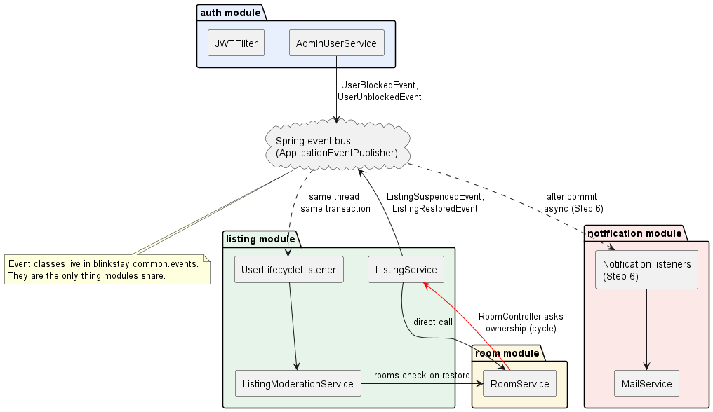

---

## Deployment and CI/CD

| Part     | Hosted on                                       |
| -------- | ----------------------------------------------- |
| Frontend | **Netlify**                                     |
| Backend  | **Render** (Docker image built from `backend/`) |
| Database | **Aiven** managed PostgreSQL                    |
| Uptime   | **UptimeRobot** pings the API every 5 minutes   |

Every change goes through a branch and a pull request:

```
 feature branch ──► Pull request ──► GitHub Actions CI
                        │              ├─ Backend tests  (./mvnw verify: unit + integration tests)
                        │              └─ Frontend build (npm ci, lint, npm run build)
                        │
                        └─► Netlify deploy preview (for frontend changes)

 merge to main ──► CI runs again on main
                     │
                     ├─► Render deploys the backend ONLY after CI is green
                     │   (and only when files under backend/ changed)
                     └─► Netlify deploys the frontend
```

- The workflow lives in [`.github/workflows/ci.yml`](.github/workflows/ci.yml).
- Render's auto-deploy is set to **"After CI checks pass"**, so a failing test means no deploy.
- Render's build filter only watches `backend/**`, so frontend or docs changes don't restart the backend.
- Netlify builds from `frontend/` and creates a preview site for each frontend pull request.

---

## Testing

| Type              | Naming  | What it covers                                                                         | Runs with       |
| ----------------- | ------- | -------------------------------------------------------------------------------------- | --------------- |
| Unit tests        | `*Test` | Business rules in plain Java with Mockito, no Spring or database, runs in milliseconds | `./mvnw test`   |
| Integration tests | `*IT`   | The whole Spring app against a **real PostgreSQL** started by Testcontainers           | `./mvnw verify` |

- Integration tests use the same PostgreSQL major version as production, not an in-memory database, so SQL and locking behave the same as in production.
- A shared container and Spring's context caching keep the integration tests fast.
- Test data builders keep each test short and focused on what matters.
- CI runs the full `./mvnw verify` on every pull request and on `main`.

---

## Project structure

```
blinkstay/
├── .github/workflows/ci.yml  GitHub Actions pipeline
│
├── backend/                  Spring Boot application
│   ├── src/main/java/blinkstay/
│   │   ├── auth/             users, JWT, OTP, host requests, admin users
│   │   ├── listing/          listings, images, geocoding, favorites, moderation
│   │   ├── room/             rooms per listing
│   │   ├── booking/          availability, bookings, cancellation, timers
│   │   ├── payment/          payment gateways (mock, Razorpay), webhooks, refunds
│   │   ├── earnings/         host earnings ledger and dashboard
│   │   ├── review/           reviews, ratings and host replies
│   │   ├── notification/     email and in-app notifications
│   │   ├── common/           shared events, contracts, exceptions
│   │   ├── seed/             sample data loader
│   │   └── BackendApplication.java
│   ├── src/main/resources/
│   │   ├── application.properties
│   │   ├── application-dev.properties
│   │   ├── application-prod.properties
│   │   └── seed/             sample listings and reviews (JSON)
│   ├── src/test/java/        unit (*Test) and integration (*IT) tests
│   ├── db/                   database schema scripts
│   ├── Dockerfile
│   └── pom.xml
│
├── frontend/                 React + Vite application
│   └── src/
│       ├── api/              axios instance, interceptors, error helpers
│       ├── components/       shared UI and layouts
│       ├── context/          auth, favorites, theme
│       ├── features/         about, admin, auth, bookings, favorites,
│       │                     home, host, listings, notifications, user
│       ├── routes/           app routes, guest and protected (role-based) routes
│       ├── store/            Redux store and RTK Query API
│       └── utils/            formatting, notifications, roles, hooks
│
├── system-design/            requirements, database, API, caching,
│                             concurrency, scalability and flow write-ups
└── docs/
    ├── diagrams/             PlantUML sources and rendered PNGs
    └── screenshots/          README images and demo video
```

Each backend module follows the same layout: `controller`, `dto`, `entities`, `enums`, `repository`, `service`, `serviceImpl`, and where needed `listener`, `timer` or `scheduler`.

---

## Getting started

### Prerequisites

- JDK 25
- Node.js 22 and npm
- PostgreSQL (local install or Docker)
- Docker Desktop (needed for the integration tests)
- Free accounts for Cloudinary, Mapbox and Razorpay (test mode) if you want those features

### 1. Start PostgreSQL

Use a local PostgreSQL install, or run it in Docker:

```bash
docker run -d --name blinkstay-postgres \
  -e POSTGRES_PASSWORD=your_password \
  -e POSTGRES_DB=blinkstay \
  -p 5432:5432 postgres:18
```

### 2. Configure the backend

Create `backend/.env` (it is not committed) and fill in the values that `application-dev.properties` reads, such as:

- database URL, username and password
- JWT secret
- Cloudinary cloud name, API key and secret
- Mapbox access token
- Razorpay key ID, key secret and webhook secret
- mail settings (with mail disabled, emails are printed to the console)

### 3. Run the backend

```bash
cd backend
./mvnw spring-boot:run -Dspring-boot.run.profiles=dev
```

On Windows use `mvnw.cmd`. Sample listings (and, if enabled, sample reviews) are seeded on first start.

### 4. Run the frontend

Create `frontend/.env`:

```env
VITE_API_BASE_URL=http://localhost:8080
```

Then:

```bash
cd frontend
npm install
npm run dev
```

Open http://localhost:5173.

### 5. Run the tests

```bash
cd backend
./mvnw test      # unit tests only (no Docker needed)
./mvnw verify    # unit + integration tests (Docker Desktop must be running)

cd ../frontend
npm run lint
npm run build
```

> **Testing the API with Postman:** every non-GET request needs the `X-XSRF-TOKEN` header, copied from the `XSRF-TOKEN` cookie.

---

## API overview

The API is versioned by area. Full request and response details are in Swagger (local only) and in [`system-design/05-api-design.md`](system-design/05-api-design.md).

| Area                                                       | Base path                              |
| ---------------------------------------------------------- | -------------------------------------- |
| Auth (register, OTP, login, logout, forgot/reset password) | `/api/v1/auth`                         |
| Admin users (list, block, unblock)                         | `/api/v2/admin/users`                  |
| Listings, publish/pause/resume, my listings                | `/api/v3/listings`                     |
| Admin listing moderation                                   | `/api/v3/admin/listings`               |
| Favorites                                                  | `/api/v3/favorites`                    |
| Availability and bookings                                  | `/api/v5/bookings`                     |
| Host reservations                                          | `/api/v5/host/bookings`                |
| Admin bookings                                             | `/api/v5/admin/bookings`               |
| Public reviews of a listing                                | `/api/v5/listings/{listingId}/reviews` |
| Write, edit, delete and reply to reviews                   | `/api/v5/reviews`                      |
| Admin review removal                                       | `/api/v5/admin/reviews`                |

---

## Design documents

The [`system-design`](system-design) folder holds the planning behind the project:

- [Requirements](system-design/01-requirements.md), [entities](system-design/03-entities.md), [database design](system-design/04-database-design.md), [API design](system-design/05-api-design.md)
- [Booking flow](system-design/06-booking-flow.md), [concurrency](system-design/07-concurrency.md), [caching](system-design/08-caching.md)
- [Scalability](system-design/09-scalability.md), [microservices plan](system-design/10-microservices.md), [frontend design](system-design/11-frontend-design.md)
- [Authentication architecture](system-design/authentication-architecture.md), [events and module boundaries](system-design/EVENTS_AND_MODULE_BOUNDARIES.md)
- Workflow notes in [`blinkstay-workflows`](system-design/blinkstay-workflows) and sign-up/login sequence diagrams in [`signup-login-flow`](system-design/signup-login-flow)

---

## Roadmap

- [x] Authentication, OTP sign-up, forgot password, profile
- [x] Host request flow and host business profile
- [x] Listings, rooms, statuses and admin moderation
- [x] Block/unblock users with event-driven listing suspension
- [x] Email and in-app notifications
- [x] Favorites
- [x] Booking with payment hold, cancellation and refunds
- [x] Razorpay test-mode payments with webhooks
- [x] Host earnings dashboard
- [x] Reviews and ratings
- [x] Migration from MySQL to PostgreSQL
- [x] Live deployment (Netlify, Render, Aiven)
- [x] Automated tests and CI/CD with GitHub Actions
- [ ] Short-lived access tokens with rotating refresh tokens
- [ ] Monitoring with Prometheus and Grafana
- [ ] Split into microservices

---

## Author

**Qutubuddin Khan** · Java Full-Stack Developer · Bengaluru, India

Feedback and suggestions are welcome. Feel free to open an issue.
