<div align="center">

# BlinkStay

**A full-stack hotel and stay booking platform built with Spring Boot and React.**

Guests discover and book stays, hosts manage listings and reservations, and admins moderate the platform.


</div>

## Demo

<!--
  HOW TO MAKE THE VIDEO PLAY HERE:
  1. On github.com, open this README and click the pencil (Edit) icon.
  2. Delete the line PASTE_VIDEO_LINK_HERE below.
  3. Drag docs/screenshots/demo.mp4 from your computer into the editor at that spot.
  4. GitHub uploads it and inserts a link like https://github.com/user-attachments/assets/...
  5. Commit. The video now plays inside the README.
-->

[PASTE_VIDEO_LINK_HERE](https://github.com/user-attachments/assets/6e0ace0b-c67c-47ad-9766-521ee323b3ad)

> Can't see the player? [Download the demo video](docs/screenshots/demo.mp4)

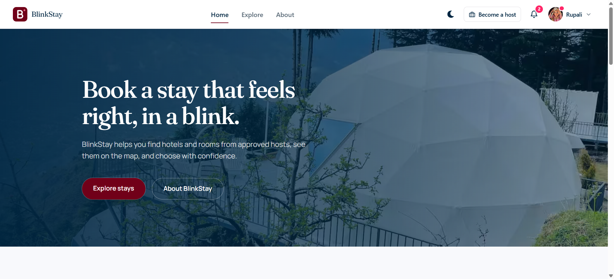

---

## Table of contents

- [Demo](#demo)
- [Overview](#overview)
- [Features](#features)
- [Screenshots](#screenshots)
- [Tech stack](#tech-stack)
- [Architecture](#architecture)
- [Project structure](#project-structure)
- [Getting started](#getting-started)
- [API overview](#api-overview)
- [Design documents](#design-documents)
- [Roadmap](#roadmap)
- [Author](#author)

---

## Overview

BlinkStay is a booking platform with three roles:

| Role | What they can do |
|------|------------------|
| **USER** (guest) | Browse and search listings on a map, save favorites, book rooms, pay, cancel, and get notifications |
| **HOTEL_MANAGER** (host) | Apply to become a host, create and manage listings and rooms, publish or pause listings, view reservations and earnings |
| **ADMIN** | Review host requests, block or unblock users, suspend listings, and view all bookings and payments |

The backend is a **modular monolith**: each business area (auth, listing, room, booking, payment, earnings, notification) lives in its own package. Modules talk to each other through **domain events** and small shared interfaces instead of calling each other's internals, so the system can later be split into microservices.

---

## Features

### Authentication and accounts
- Sign-up with **email OTP verification**
- **JWT stored in HttpOnly cookies** with **CSRF protection** (`X-XSRF-TOKEN` header)
- Logout with **token revocation** (blocked-token table plus a scheduled cleanup job)
- **Forgot password** flow with OTP and resend cooldown (HTTP 429 on rate limit)
- Profile: edit details, upload or remove profile photo (Cloudinary), change password, delete account
- Role-based access with Spring method security

### Hosts
- **Become a host** request flow: user applies, admin approves or rejects
- Separate **host business profile** (`HotelManagerProfile`)
- Create listings with **image upload** (Cloudinary) and a **location picker** (Mapbox geocoding)
- Listing lifecycle: `DRAFT → PUBLISHED ⇄ PAUSED`, plus `SUSPENDED` by admin or when the owner is blocked
- Manage rooms for each listing
- **Reservations** view and host-side booking cancellation
- **Earnings dashboard** with an event-driven earnings ledger

### Booking and payments
- **Instant booking**, no host approval needed
- Availability is **computed per night** from existing bookings (no counters to drift out of sync)
- **15-minute payment hold**: unpaid bookings expire automatically
- **48-hour free cancellation** policy with refund handling
- Maximum stay of 30 nights
- **Razorpay (test mode)** checkout with signature verification and webhooks; the **webhook is the source of truth** for payment status
- A **mock payment gateway** for local development, guarded so it cannot run in production
- Scheduled timers for booking completion, payment expiry and refunds
- Safe under concurrency (for example, a cancel racing a payment, or two cancels at once)

### Discovery
- Explore page with categories, pagination and skeleton loading
- Listing detail page with gallery, map, rooms and date-range picker
- **Favorites**

### Administration
- Users table with search and filters, plus block or unblock with a reason
- Blocking a host **suspends all their listings**; unblocking **restores** the ones that were live
- Listing moderation: suspend or unsuspend with a reason
- Host request queue with a pending-count badge
- All bookings and payments views
- Cache admin endpoint

### Notifications
- **Email notifications** (OTP, booking and account events), sent asynchronously
- **In-app notification bell** with read and delete actions

---

## Screenshots

### Explore and listings

| Explore | Favorites |
|---------|-----------|
| 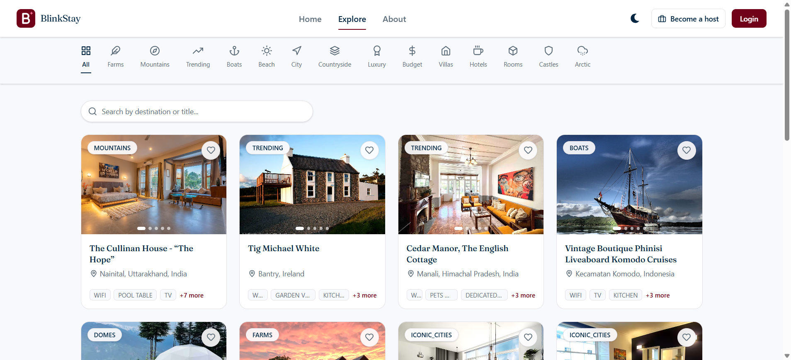 | 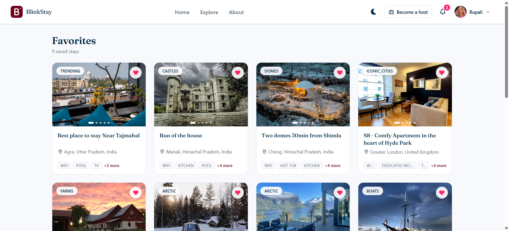 |

| Listing details | Rooms and booking card | Location map |
|-----------------|------------------------|--------------|
| 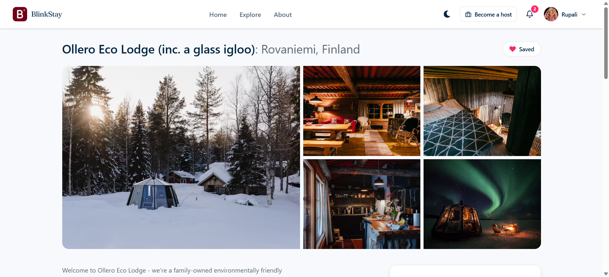 | 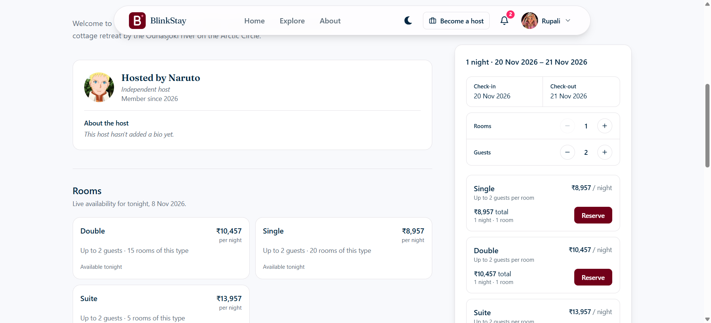 | 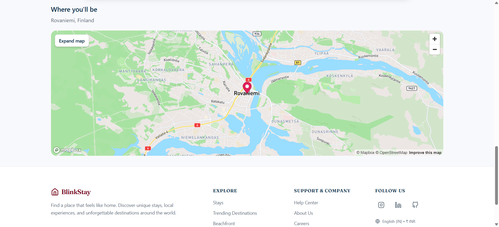 |

### Booking and payment

| Booking and payment | My bookings |
|---------------------|-------------|
| 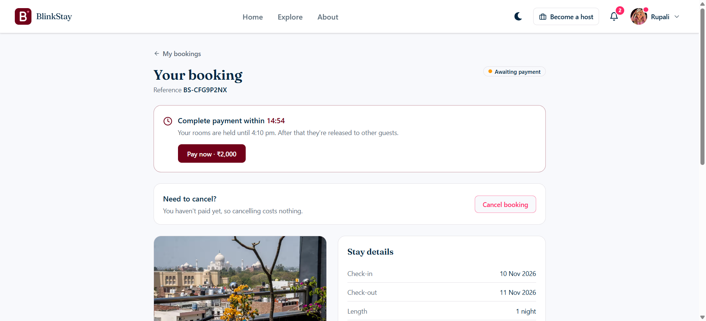 | 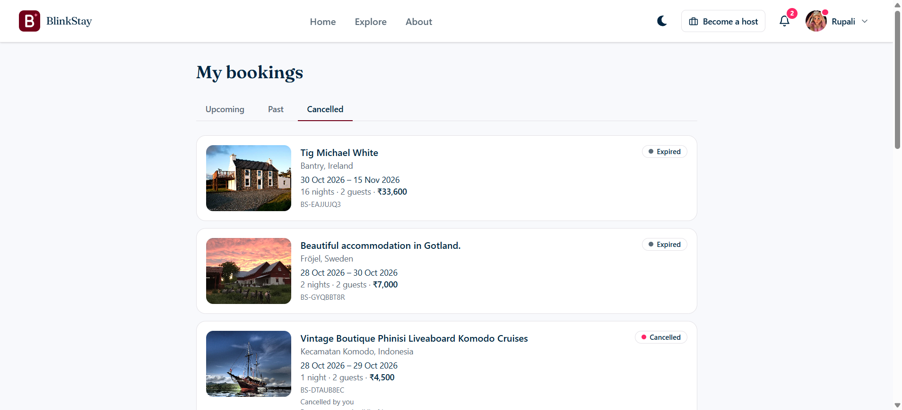 |

### Host

| Earnings dashboard | Earnings by listing |
|--------------------|---------------------|
| 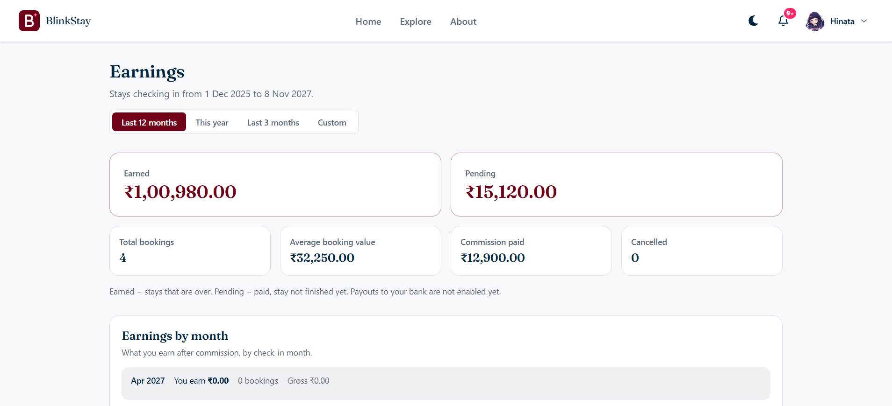 | 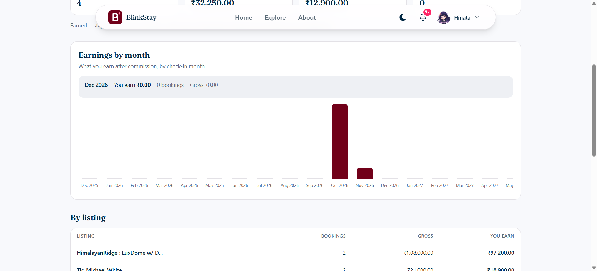 |

| My listings | Reservations |
|-------------|--------------|
| 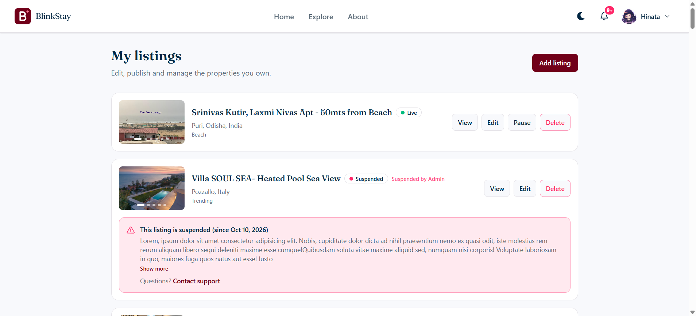 | 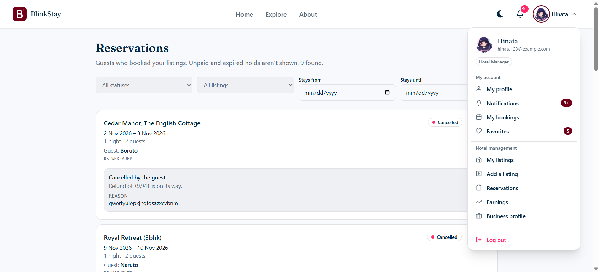 |

### Admin

| Overview | Users and blocking | Payments needing attention |
|----------|--------------------|----------------------------|
| 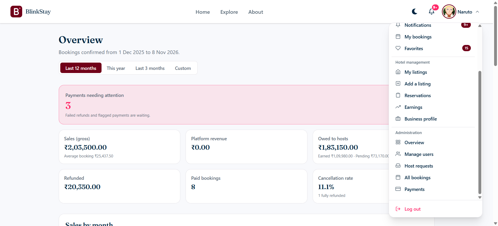 | 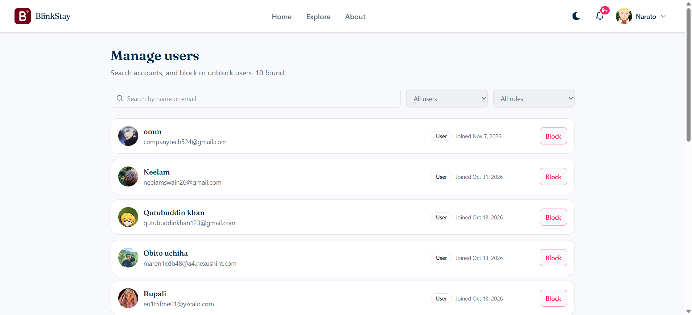 | 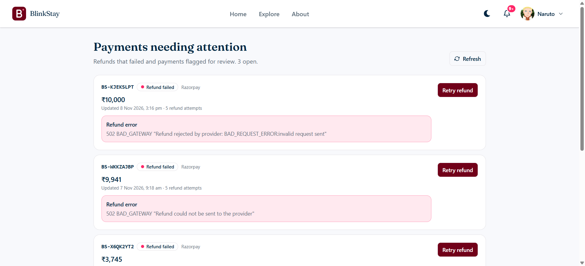 |

### Profile

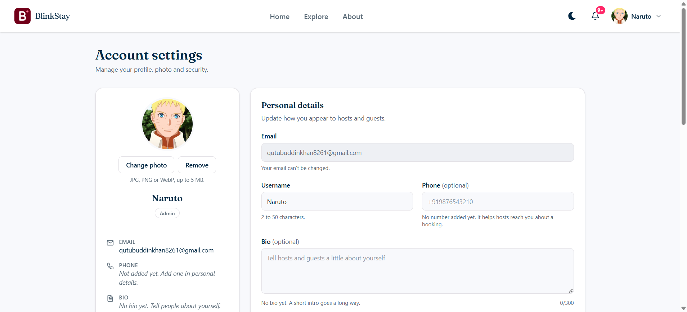

---

## Tech stack

**Backend**
- Java, Spring Boot, Spring Security, Spring Data JPA (Hibernate)
- MySQL (run in Docker)
- JWT (cookie-based) and CSRF protection
- Caffeine cache
- Spring application events and `@Async` listeners
- Cloudinary (images), Mapbox (geocoding), Razorpay (payments, test mode)
- Swagger / OpenAPI
- Maven (wrapper included)

**Frontend**
- React with Vite
- React Router
- Axios with global error-handling interceptors
- Redux Toolkit / RTK Query (notifications and listings)
- Tailwind CSS v4, Motion (animations)
- Sonner (toasts)

---

## Architecture

```
                ┌──────────────────────────────┐
                │     React frontend (Vite)    │
                └──────────────┬───────────────┘
                               │ HTTPS, JWT cookie + CSRF header
                ┌──────────────▼───────────────┐
                │ Spring Boot modular monolith │
                │                              │
                │ auth  listing  room  booking │
                │ payment  earnings  notif.    │
                │          ▲         │         │
                │          └─ events ┘         │
                └──────┬────────┬────────┬─────┘
                       │        │        │
                     MySQL  Cloudinary  Mapbox / Razorpay
```

- **`common`** holds what modules share: domain events (`UserBlockedEvent`, `ListingSuspendEvent`, `BookingConfirmedEvent`, ...), small contracts (`HostDirectory`, `UserDirectory`, `BookingGuard`, `BookingPayments`, `PaymentRefunds`), the global exception handler and a hotel clock.
- Modules **publish events** instead of calling each other. For example, blocking a user publishes `UserBlockedEvent`; the listing module listens and suspends that host's listings, and the notification module sends an email.
- Cache evictions run **after the transaction commits** (`AfterCommitCacheEvictor`) so the cache never holds data that was rolled back.

Diagrams are in [`docs/diagrams`](docs/diagrams):

| Diagram | File |
|---------|------|
| Use cases | [01-use-cases.png](docs/diagrams/01-use-cases.png) |
| Modules and event bus | [02-modules-event-bus.png](docs/diagrams/02-modules-event-bus.png) |
| Blocking a host (sequence) | [03-block-host-sequence.png](docs/diagrams/03-block-host-sequence.png) |
| Blocked user's next request | [04-blocked-user-next-request.png](docs/diagrams/04-blocked-user-next-request.png) |
| Listing statuses | [05-listing-statuses.png](docs/diagrams/05-listing-statuses.png) |
| Target microservices split | [06-microservices-target.png](docs/diagrams/06-microservices-target.png) |
| Booking and payment | [booking-and-payment.puml](docs/diagrams/booking-and-payment.puml) |
| Booking statuses | [booking-statuses.puml](docs/diagrams/booking-statuses.puml) |

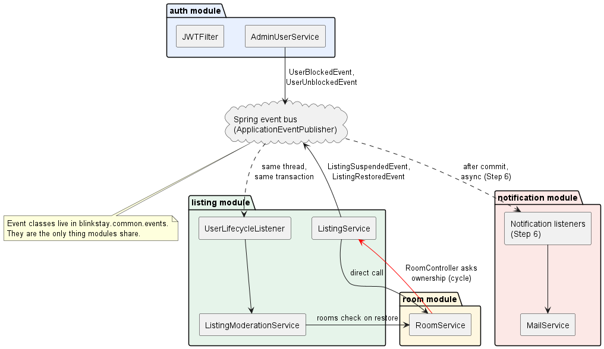

---

## Project structure

```
blinkstay/
├── backend/                  Spring Boot application
│   ├── src/main/java/blinkstay/
│   │   ├── auth/             users, JWT, OTP, host requests, admin users
│   │   ├── listing/          listings, images, geocoding, favorites, moderation
│   │   ├── room/             rooms per listing
│   │   ├── booking/          availability, bookings, cancellation, timers
│   │   ├── payment/          payment gateways (mock, Razorpay), webhooks, refunds
│   │   ├── earnings/         host earnings ledger and dashboard
│   │   ├── notification/     email and in-app notifications
│   │   ├── review/           reviews (in progress)
│   │   ├── common/           shared events, contracts, exceptions
│   │   ├── seed/             sample data loader
│   │   └── BackendApplication.java
│   ├── src/main/resources/
│   │   ├── application.properties
│   │   ├── application-dev.properties
│   │   ├── application-prod.properties
│   │   └── seed/BlinkStay.listings.json
│   └── pom.xml
│
├── frontend/                 React + Vite application
│   └── src/
│       ├── api/              axios instance, interceptors, error helpers
│       ├── components/       shared UI and layouts
│       ├── context/          auth, favorites, theme
│       ├── features/         about, admin, auth, bookings, favorites,
│       │                     home, host, listings, notifications, user
│       ├── routes/           app routes, guest and protected (role-based) routes
│       ├── store/            Redux store and RTK Query API
│       └── utils/            formatting, notifications, roles, hooks
│
├── system-design/            requirements, database, API, caching,
│                             concurrency, scalability and flow write-ups
└── docs/diagrams/            PlantUML sources and rendered PNGs
```

Each backend module follows the same layout: `controller`, `dto`, `entities`, `enums`, `repository`, `service`, `serviceImpl`, and where needed `listener`, `timer` or `scheduler`.

---

## Getting started

### Prerequisites
- JDK (version as set in `backend/pom.xml`)
- Node.js 18 or newer and npm
- Docker (for MySQL)
- Free accounts for Cloudinary, Mapbox and Razorpay (test mode) if you want those features

### 1. Start MySQL

```bash
docker run -d --name blinkstay-mysql \
  -e MYSQL_ROOT_PASSWORD=your_password \
  -e MYSQL_DATABASE=blinkstay \
  -p 3306:3306 mysql:8
```

### 2. Configure the backend

Create `backend/.env` (it is not committed) and fill in the values that `application-dev.properties` reads, such as:

- database URL, username and password
- JWT secret
- Cloudinary cloud name, API key and secret
- Mapbox access token
- Razorpay key ID, key secret and webhook secret
- mail (SMTP) settings

### 3. Run the backend

```bash
cd backend
./mvnw spring-boot:run -Dspring-boot.run.profiles=dev
```

On Windows use `mvnw.cmd`. Sample listings are seeded on first start from `resources/seed/BlinkStay.listings.json`.

### 4. Run the frontend

Create `frontend/.env`:

```env
VITE_API_BASE_URL=http://localhost:8080
```

Then:

```bash
cd frontend
npm install
npm run dev
```

Open http://localhost:5173.

> **Testing the API with Postman:** every non-GET request needs the `X-XSRF-TOKEN` header, copied from the `XSRF-TOKEN` cookie.

---

## API overview

The API is versioned by area. Full request and response details are in Swagger and in [`system-design/05-api-design.md`](system-design/05-api-design.md).

| Area | Base path |
|------|-----------|
| Auth (register, OTP, login, logout, forgot/reset password) | `/api/v1/auth` |
| Admin users (list, block, unblock) | `/api/v2/admin/users` |
| Listings, publish/pause/resume, my listings | `/api/v3/listings` |
| Admin listing moderation | `/api/v3/admin/listings` |
| Favorites | `/api/v3/favorites` |
| Availability and bookings | `/api/v5/bookings` |
| Host reservations | `/api/v5/host/bookings` |
| Admin bookings | `/api/v5/admin/bookings` |

---

## Design documents

The [`system-design`](system-design) folder holds the planning behind the project:

- [Requirements](system-design/01-requirements.md), [entities](system-design/03-entities.md), [database design](system-design/04-database-design.md), [API design](system-design/05-api-design.md)
- [Booking flow](system-design/06-booking-flow.md), [concurrency](system-design/07-concurrency.md), [caching](system-design/08-caching.md)
- [Scalability](system-design/09-scalability.md), [microservices plan](system-design/10-microservices.md), [frontend design](system-design/11-frontend-design.md)
- [Authentication architecture](system-design/authentication-architecture.md), [events and module boundaries](system-design/EVENTS_AND_MODULE_BOUNDARIES.md)
- Workflow notes in [`blinkstay-workflows`](system-design/blinkstay-workflows) and sign-up/login sequence diagrams in [`signup-login-flow`](system-design/signup-login-flow)

---

## Roadmap

- [x] Authentication, OTP sign-up, forgot password, profile
- [x] Host request flow and host business profile
- [x] Listings, rooms, statuses and admin moderation
- [x] Block/unblock users with event-driven listing suspension
- [x] Email and in-app notifications
- [x] Favorites
- [x] Booking with payment hold, cancellation and refunds
- [x] Razorpay test-mode payments with webhooks
- [x] Host earnings dashboard
- [ ] Reviews and ratings
- [ ] Monitoring with Prometheus and Grafana
- [ ] Live deployment
- [ ] Split into microservices

---

## Author

**Qutubuddin Khan** · Java Full-Stack Developer · Bengaluru, India

Feedback and suggestions are welcome. Feel free to open an issue.
