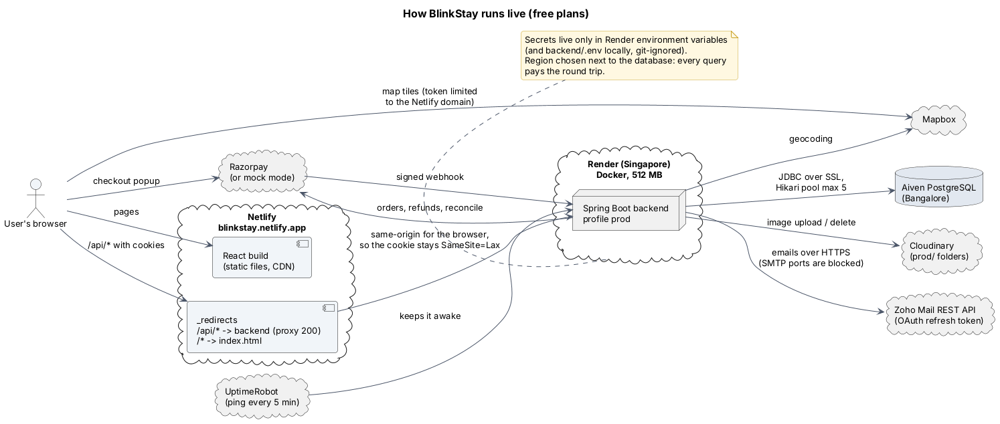
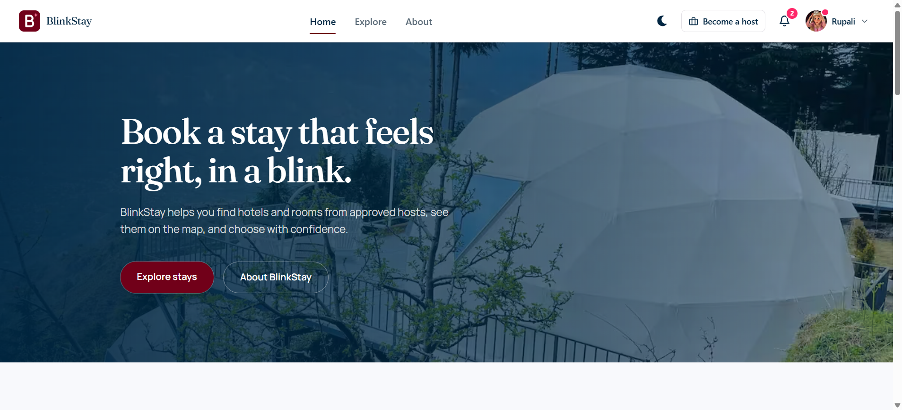

# 1. Overview

## What BlinkStay is

A stay-booking platform with three kinds of users:

- **Guests** search published listings, check availability per night, book rooms instantly (no host approval), pay, cancel under a refund policy, and review completed stays.
- **Hosts** (`HOTEL_MANAGER`, after an admin approves their request) create listings with photos, a map location and room types, publish or pause them, see reservations, a monthly room calendar and an earnings dashboard, and reply to reviews.
- **Admins** approve hosts, block or restore users, suspend listings, search and cancel any booking, handle payments that need a person, and see a platform overview.

The hard parts it solves: two guests booking the last room at the same moment, payments that arrive twice or never, refunds that must not be lost or sent twice, and modules that stay independent.

## Tech stack

| Layer | Choice |
|---|---|
| Backend | Java 25, Spring Boot 4 (Web, Security, Data JPA / Hibernate, Validation, Cache), Lombok, springdoc (Swagger, dev only) |
| Database | PostgreSQL 18 (moved from MySQL in Nov 2026). Schema by `ddl-auto=update` |
| Cache | Caffeine (in process) |
| Images | Cloudinary (separate `dev/` and `prod/` folders) |
| Maps | Mapbox (geocoding on the backend, tiles in the browser) |
| Payments | Razorpay (Test Mode) or a mock gateway, chosen by `app.payment.provider` |
| Email | Zoho Mail REST API in production, SMTP or console locally |
| Frontend | React + Vite, react-router, axios, Redux Toolkit (RTK Query for listings and notifications), Tailwind v4, motion, Sonner |

## Repository layout

```
blinkstay/
├── backend/            Spring Boot app (see 03-architecture.md for packages)
│   ├── src/main/java/blinkstay/{auth,listing,room,booking,payment,review,earnings,notification,seed,common}
│   ├── src/main/resources/   application*.properties, seed/*.json
│   ├── db/              schema command files (no secrets)
│   ├── docs/seed-source/ original CSV exports (not packaged)
│   └── Dockerfile
├── frontend/           React app (see frontend/FRONTEND_ARCHITECTURE.md)
└── docs/               this folder
```

## How it runs live



- **Netlify** serves the React build and **proxies `/api/*`** to the backend, so the browser sees one origin and the login cookie stays first-party (`SameSite=Lax`, `Secure`).
- **Render** (Singapore, free plan) runs the backend as a Docker image with the `prod` profile. Singapore is the nearest region to the database; every query pays that round trip.
- **Aiven** (Bangalore, free plan) hosts PostgreSQL over SSL. The app keeps at most 5 connections.
- **UptimeRobot** calls the API every 5 minutes so the free instance does not sleep.
- Secrets exist only as environment variables (Render, and a git-ignored `backend/.env` locally).

## Build steps (history)

| Step | What was added |
|---|---|
| Backend steps 1 to 6 | Profile endpoints, listing statuses, domain events, block/unblock, host requests, notifications (bell + email) |
| Extras | Forgot password, favorites, delete notification |
| B1 | Availability and booking creation (15-minute hold, room lock) |
| B2 | Payments with a mock gateway, one event processor |
| B3 | Cancellation with refunds, host and admin booking lists |
| B4 | Completion timer, rooms free tonight |
| B5 | Razorpay, refunds after commit with retries, reconcile, admin payment queue |
| B6a / B6b | Earnings ledger, host dashboard, admin overview |
| B6c | Reviews and ratings, account delete with 30-day restore and purge |
| B6d | Host calendar, pre-deployment cleanup |
| Deploy | Netlify + Render + Aiven, Zoho Mail API, Cloudinary per-environment folders, demo review seeding |

## Screenshots

| Area | Files (in `docs/screenshots/`) |
|---|---|
| Public | `home.png`, `explore.png`, `demo.mp4` |
| Listing | `listing/listing-details.png`, `listing-details2.png`, `listing-details3.png`, `listing-favorites.png` |
| Booking | `booking/booking-pay.png`, `booking/my-bookings.png` |
| Host | `host/my-listings.png`, `host/reservations.png`, `host/earnings-page.png`, `host/earnings-page2.png` |
| Admin | `admin/overview.png`, `admin/users-blocking.png`, `admin/payment-needing-attention.png` |
| User | `user/profile-page.png` |


