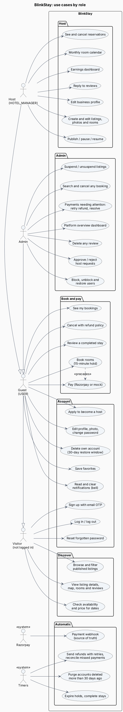

# 2. Requirements and business rules

## Roles

| Role | How you get it | Can do |
|---|---|---|
| Visitor | not logged in | browse published listings, see details, reviews and availability, sign up, log in, reset a password |
| `USER` (guest) | verified sign-up | everything above, plus book, pay, cancel, review, favorites, notifications, apply to become a host |
| `HOTEL_MANAGER` (host) | admin approves a host request | manage own listings, rooms and photos, reservations, calendar, earnings, reply to reviews |
| `ADMIN` | seeded / granted | moderate users, hosts, listings, bookings, payments and reviews; platform overview |

A user can hold several roles (stored in `user_roles`). Roles are checked with `hasAuthority('ADMIN')` etc. (no `ROLE_` prefix).

## Functional requirements by area

### Account (auth)

1. Sign up with username, email, password and an optional photo. A 6-digit code is emailed; the account exists only after the code is verified. Resend cooldown 60 s (429), 5 wrong codes (429), code valid 6 minutes.
2. Log in with email (any case) and password. The session is a 24-hour JWT in an HttpOnly cookie.
3. Forgot password: request a code with username and email (same reply whether or not the account exists), then reset with email, code and new password. Code hashed, 10 minutes, 5 tries. A reset logs out every device.
4. Change password while logged in: other devices are logged out, the current one gets a fresh cookie.
5. Edit profile and photo. Delete own account: refused while the user has upcoming bookings (as guest or host) or is the last active admin. Soft delete, restorable by an admin for 30 days, then purged.

### Hosts

6. A user applies with business details; only one pending request at a time (409). Admins are notified.
7. An admin approves (role + host profile created) or rejects with a reason. An admin cannot review their own request.

### Listings and rooms

8. A host creates a listing (title, description, category, amenities, location geocoded with Mapbox, photos on Cloudinary) and room types (price, quantity, max guests).
9. Statuses: `DRAFT`, `PUBLISHED`, `PAUSED`, `SUSPENDED` (see [diagram 05](diagrams/05-listing-statuses.png)). Publishing needs at least one room. Only published listings are public; others answer 404 except to the owner and admins.
10. An admin suspends a listing with a reason. A blocked or deleted host's listings are suspended automatically and restored when the block or delete is undone. Suspend, delete and block are refused while active bookings exist.
11. Guests can save favorites.

### Bookings

12. Availability is computed per night: free rooms = total rooms minus the busiest night's use. Check-out day is exclusive. At most 30 nights.
13. Booking is instant: `PENDING_PAYMENT` with a 15-minute hold. A guest may hold at most 2 unpaid bookings. Price and listing details are snapshotted.
14. A guest cannot book their own listing.
15. Cancellation:

| Who | Unpaid booking | Paid booking |
|---|---|---|
| Guest | any time, nothing to refund | full refund until 48 h before the start of the check-in day (hotel time zone); after that allowed with no refund; not after the check-in day starts |
| Host | not allowed | always a full refund, reason required, until the stay ends |
| Admin | allowed | same as host |

16. After check-out the booking becomes `COMPLETED` (hourly timer).
17. Hosts see reservations of their own listings (paid ones only, guest name only) and a monthly calendar per room type. Admins search all bookings.

### Payments

18. Razorpay checkout or a mock gateway. The server owns the amount. A payment is confirmed through the browser (verify), the signed webhook, or the reconcile job; all three use one processor.
19. Late payments revive an expired booking if rooms are still free; otherwise they are refunded. A second payment for the same booking is refunded.
20. Refunds are full only, sent after the commit, retried 5 times with back-off, then shown to admins.

### Reviews

21. Only the guest of a `COMPLETED` booking can review it, once (rating 1 to 5, comment up to 1,000 characters). The guest can edit or delete it; the host can reply once (replace or delete the reply); an admin can delete any review.
22. The listing keeps `averageRating` and `reviewCount`, updated under a listing row lock.

### Notifications

23. In-app bell and email for: account blocked/unblocked/deleted/restored, host request submitted/approved/rejected, listing suspended/restored, booking confirmed/received/cancelled, payment refunded, review received/replied. Emails also for OTPs, welcome and password changed. Bell rows are removed after 90 days.

### Earnings and dashboards

24. Every confirmed booking creates one earnings entry: commission 10% (config), host share = base minus commission. A full refund reverses it. Hosts see their own totals by month and listing; admins see platform sales, refunds, commission, bookings by status, users, listings, payments needing attention and top hosts.

## Non-functional requirements

| Concern | Decision |
|---|---|
| Consistency | Bookings, payments and ledger in one database; row locks for the last room, the payment and the rating |
| Idempotency | Every payment event is stored once; refunds check for an existing refund first |
| Security | HttpOnly cookie, CSRF token, BCrypt, signed webhooks, 404 for things you may not see |
| Time | Instants stored in UTC; calendar rules use the hotel time zone (`HotelClock`) |
| Failure | Email and bell never undo an action (after commit, background); provider calls never inside a transaction |
| Cost | Free hosting; one instance; in-process cache |
