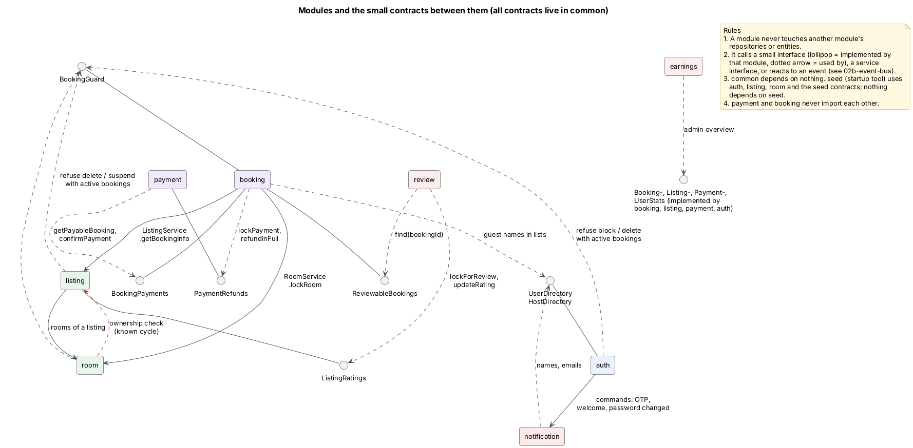
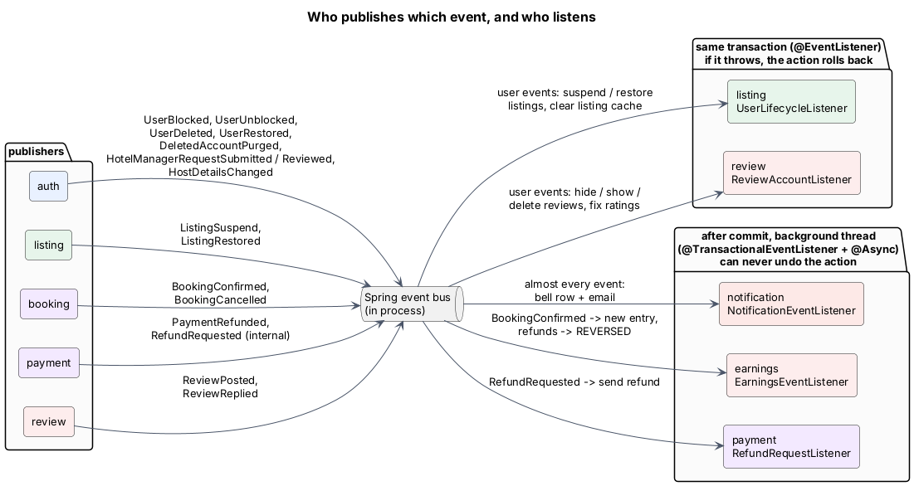

# 3. Architecture

BlinkStay is a **modular monolith**: one Spring Boot application, one database, split into business modules with strict rules about who may call whom. It keeps bookings, payments and earnings in one transaction and runs on one free instance, while the module seams leave a later split open ([09](09-scaling-and-microservices.md)).

## Packages

```
blinkstay/
├── auth          users, roles, login, OTP, host requests, host profile, admin users, caches admin
├── listing       listings, photos, geometry (Mapbox), favorites, moderation, ratings column
├── room          room types of a listing (price, quantity, max guests), room lock
├── booking       availability, bookings, cancellation, host/admin lists, host calendar, timers
├── payment       gateways (Mock, Razorpay), event processor, webhook, refunds, reconcile, admin queue
├── review        reviews, host replies, hide/show on account changes
├── earnings      earnings ledger, host dashboard, admin overview
├── notification  bell (notifications table) and email pipeline
├── seed          startup seeding of listings and demo reviews (dev, or by flag)
└── common        contracts shared by modules: events, small interfaces, shared DTOs, helpers
```

Inside each module the same layer folders repeat ("package by module, layers inside"):

| Folder | Holds |
|---|---|
| `controller` | HTTP only: read request, call a service, return a response |
| `dto` | request and response shapes, never entities |
| `entities`, `enums`, `repository` | the module's own tables and queries |
| `mapper` | entity to DTO |
| `service` | interfaces: what the module offers |
| `serviceImpl` | the logic behind them, and implementations of `common` contracts |
| `eventListeners` / `listener`, `timer` / `scheduler`, `config`, `gateway`, `guard`, `util`, `runners` | extras for that module |

## Rules between modules



1. A module **never** uses another module's repositories or entities.
2. It talks through (a) a small interface in `common` implemented by the module that owns the data, (b) another module's `service` interface, or (c) an event.
3. Other modules refer to rows by **UUID columns** (`bookings.guest_id`, `listings.manager_id`), not JPA relations.
4. `common` depends on nothing. Nothing depends on `seed`.
5. `payment` and `booking` never import each other.

### Contracts in `common`

| Package | Contract | Implemented by | Used by | Purpose |
|---|---|---|---|---|
| `common.directory` | `UserDirectory`, `HostDirectory` | auth | notification, booking, listing | names, emails, host summary without reading `users` |
| `common.booking` | `BookingGuard` | booking | listing, room, auth | "does this listing / room / host / guest have active bookings?" |
| `common.booking` | `BookingPayments` (+ `PayableBooking`, `PaymentConfirmation`) | booking | payment | is it payable; confirm a payment |
| `common.payment` | `PaymentRefunds` | payment | booking | lock the payment row; request a full refund |
| `common.review` | `ListingRatings` (+ `ListingRatingTarget`) | listing | review | lock a listing for a rating update; write the average |
| `common.review` | `ReviewableBookings` (+ `ReviewableBooking`) | booking | review | may this booking be reviewed |
| `common.review` | `ReviewCleanup` | review | listing | delete reviews of a deleted listing |
| `common.stats` | `BookingStats`, `ListingStats`, `PaymentStats`, `UserStats` (+ `UserCounts`) | booking, listing, payment, auth | earnings | numbers for the admin overview |
| `common.seed` | `DemoGuestAccounts`, `PastStayWriter`, `SeedListingSource`, `SeedReviewWriter` | auth, booking, listing, review | seed | each module writes its own tables during seeding |
| `common.time` | `HotelClock` | | booking, earnings | "today" in the hotel time zone |
| `common.cache` | `AfterCommitCacheEvictor` | | auth, listing, room, review | clear caches only after the commit |
| `common.cloudinary` | `CloudinaryFolders` | | auth, listing | `dev/` or `prod/` folder prefix |
| `common.dto` | `PageResult` | | booking and others | page wrapper |
| `common.exception*` | shared exceptions, `GlobalExceptionHandler` | | all | one JSON error shape |

Direct service calls that remain: booking uses `ListingService.getBookingInfo` and `RoomService.lockRoom`; listing and room call each other (a **known cycle**, see [09](09-scaling-and-microservices.md)); auth calls `NotificationService` for one-receiver emails (OTP, welcome, password changed).

## Events

An event is a Java **record** saying "this happened", carrying only IDs and strings.



| Event | Published by | Listeners |
|---|---|---|
| `UserBlockedEvent` | auth `AdminUserServiceImpl.blockUser` | listing (sync): suspend listings · review (sync): hide reviews · notification |
| `UserUnblockedEvent` | auth `unblockUser` | listing (sync): restore · review (sync): show · notification |
| `UserDeletedEvent` | auth `UserServiceImpl.deleteUserById` | listing (sync): suspend with `OWNER_DELETED` · review (sync): hide · notification (email only) |
| `UserRestoredEvent` | auth admin restore | listing, review, notification |
| `DeletedAccountPurgedEvent` | auth `DeletedAccountPurger` | review: delete · listing: delete host listings and user favorites |
| `HotelManagerRequestSubmittedEvent` / `...ReviewedEvent` | auth `HostRequestServiceImpl` | notification |
| `HostDetailsChangedEvent` | auth (profile, host profile) | listing: clear `listingById` |
| `ListingSuspendEvent` / `ListingRestoredEvent` | listing | notification |
| `BookingConfirmedEvent` | booking `BookingPaymentsImpl.confirmPayment` | notification (guest and host), earnings (new entry) |
| `BookingCancelledEvent` | booking `BookingCancellationServiceImpl` | notification, earnings |
| `PaymentRefundedEvent` | payment `RefundProcessor` (refunds it started) | notification, earnings |
| `ReviewPostedEvent` / `ReviewRepliedEvent` | review | notification (bell) |
| `RefundRequestedEvent` (payment-internal) | payment `PaymentRefundsImpl`, admin retry | payment `RefundRequestListener` |
| `SimpleMessageEvent` (notification-internal) | `NotificationServiceImpl` | `EmailEventListeners` |

*Earnings listener: confirm the exact events it handles in `EarningsEventListener`.*

### Two kinds of listener

| | `@EventListener` | `@TransactionalEventListener(AFTER_COMMIT)` + `@Async` |
|---|---|---|
| Runs | immediately, same thread, same transaction | after a successful commit, background thread |
| If it fails | the whole action rolls back | the action stays done; failure is logged |
| Used for | must-happen-together work: suspend listings, hide reviews | emails, bell rows, earnings entry, sending refunds |
| Notes | never add `@Async` here | needs `fallbackExecution = true`, `@EnableAsync` (`AsyncConfig`); database writes need `REQUIRES_NEW` |

Example of the first kind: [03-block-host-sequence](diagrams/03-block-host-sequence.png).

### Adding an event

1. Record in `common.events` (or the contract package it belongs to), IDs and strings only.
2. Publish `new XEvent(...)` from the owning service, inside the transaction, after the state change.
3. Listen in the module that cares, choosing the listener kind above.
4. For a notification: message in `EmailMessageBuilderUtil`, method on `NotificationService`, value in `NotificationType`, handler in `NotificationEventListener`.

## Scheduled jobs

| Class | Module | Does |
|---|---|---|
| `BookingTimers` | booking | relabel expired holds every minute; mark stays `COMPLETED` hourly |
| `RefundTimers` | payment | send due refunds every 30 s; reconcile `CREATED` payments every 2 min |
| `EarningsTimers` | earnings | move ledger entries on (see the class for the rule) |
| `TokenCleanup` | auth | nightly: delete expired logged-out tokens |
| `DeletedAccountPurgeJob` / `DeletedAccountPurger` | auth | nightly: purge accounts deleted more than 30 days ago |
| `CloudinaryCleanupScheduler` | listing | orphan images: off unless enabled, dry run by default, safety stop at 20 |
| notification cleanup | notification | remove bell rows older than 90 days |

Startup runners: `UserDumping` (dev users, `@Order(1)`), `AdminBootstrap`, `SeedDataInitializer` (`@Order(10)`), `ReviewSeedInitializer` (`@Order(20)`), and dev-only Cloudinary wipes (`UserCloudinaryCleanup`, `ListingCloudinaryCleanupRunner`), each behind a profile or property.

## Lock order

Every path that takes several row locks takes them in this order: **payment → booking → room** (and **listing** alone for ratings). Two transactions may wait for each other but never deadlock. Details in [07](07-bookings-and-payments.md#locks-and-lock-order).

## Errors

Every response uses the module's `{ success, message, data }` wrapper. `GlobalExceptionHandler` maps exceptions to 400, 404, 405, 409 and a generic 500; security errors carry a `code` (see [06](06-security.md#error-codes)).
