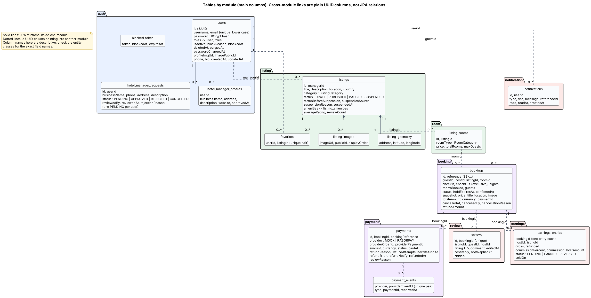

# 4. Data model

PostgreSQL, tables created by Hibernate (`ddl-auto=update`). All ids are UUIDs (native `uuid` on Postgres). Inside a module, JPA relations are used (a listing owns its images and geometry). **Across modules there are only UUID columns**, so no module needs another module's entity.

> Column names in this page and the diagram are descriptive. The entity classes are the source of truth.

| Table | Module | Holds | Notable constraints |
|---|---|---|---|
| `users` | auth | account, BCrypt hash, active/blocked/deleted/purged state, `passwordChangedAt`, photo, phone, bio | email unique, stored lower case; deleted accounts keep their email |
| `user_roles` | auth | one row per role | |
| `hotel_manager_requests` | auth | host applications, status, reviewer, rejection reason | one `PENDING` per user |
| `hotel_manager_profiles` | auth | approved host's business details | |
| `blocked_token` | auth | logged-out JWTs until they expire | cleaned nightly |
| `listings` | listing | listing, status, suspension source and reason, `averageRating`, `reviewCount` | |
| `listing_amenities` | listing | amenity names | |
| `listing_geometry` | listing | address, latitude, longitude | |
| `listing_images` | listing | Cloudinary URL, public id, display order | |
| `favorites` | listing | saved listings | unique (user, listing) |
| `listing_rooms` | room | room type, price, `totalRooms`, `maxGuests` | locked `FOR UPDATE` when booking or editing |
| `bookings` | booking | stay, status, hold expiry, snapshot, totals, cancellation and refund | locked `FOR UPDATE` on confirm and cancel |
| `payments` | payment | provider order and payment ids, amount, status, refund retry fields, review note | locked `FOR UPDATE` first on every payment path |
| `payment_events` | payment | provider events already processed | unique (provider, event id): this is the idempotency key |
| `reviews` | review | rating, comment, host reply, hidden flag | unique booking id (`uk_review_booking`) |
| `earnings_entries` | earnings | ledger entry per confirmed booking | one per booking |
| `notifications` | notification | bell rows: type, title, message, `referenceId`, read state | removed after 90 days |

## Status enums

| Enum | Values |
|---|---|
| `UserRole` | `USER`, `HOTEL_MANAGER`, `ADMIN` |
| `RequestStatus` | `PENDING`, `APPROVED`, `REJECTED`, `CANCELLED` |
| `ListingStatus` | `DRAFT`, `PUBLISHED`, `PAUSED`, `SUSPENDED` |
| `SuspensionSource` | `ADMIN`, `OWNER_BLOCKED`, `OWNER_DELETED` |
| `BookingStatus` | `PENDING_PAYMENT`, `CONFIRMED`, `EXPIRED`, `CANCELLED`, `COMPLETED` |
| `CancelActor` | `GUEST`, `HOST`, `ADMIN` |
| `PaymentStatus` | `CREATED`, `SUCCEEDED`, `FAILED`, `REFUND_PENDING`, `REFUNDED`, `REFUND_FAILED` |
| `EarningsStatus` | `PENDING`, `EARNED`, `REVERSED` |
| `ListingCategory`, `RoomCategory`, `NotificationType`, `ProviderEventType`, `MockOutcome` | see the enum classes |

State diagrams: [listing](diagrams/05-listing-statuses.png) · [booking](diagrams/13-booking-statuses.png) · [payment](diagrams/15-payment-statuses.png) · [earnings](diagrams/23-earnings-ledger.png) · [account](diagrams/08-user-lifecycle.png)

## Things to know

- **Enum columns and `ddl-auto`.** Hibernate never alters an existing CHECK constraint, so a new enum value can be rejected by an old database. Fix once with `ALTER TABLE ... DROP CONSTRAINT ...` and map the field as a plain string (`@JdbcTypeCode(SqlTypes.VARCHAR)`). This happened for `payments.status` and `notifications.type`.
- **New columns use wrapper types** (`Integer`, `Boolean`), because existing rows get `NULL`.
- **Time.** Instants are UTC. `checkIn` / `checkOut` are `LocalDate`. A booking time that looks 5 h 30 min behind in the database is correct.
- **Snapshots.** Bookings copy price, title, location and cover image, so later edits do not change past bookings.
- **The `users` row is never deleted**: bookings, payments and earnings point at it.
- **Next step:** versioned migrations (Flyway) instead of `ddl-auto=update`.
