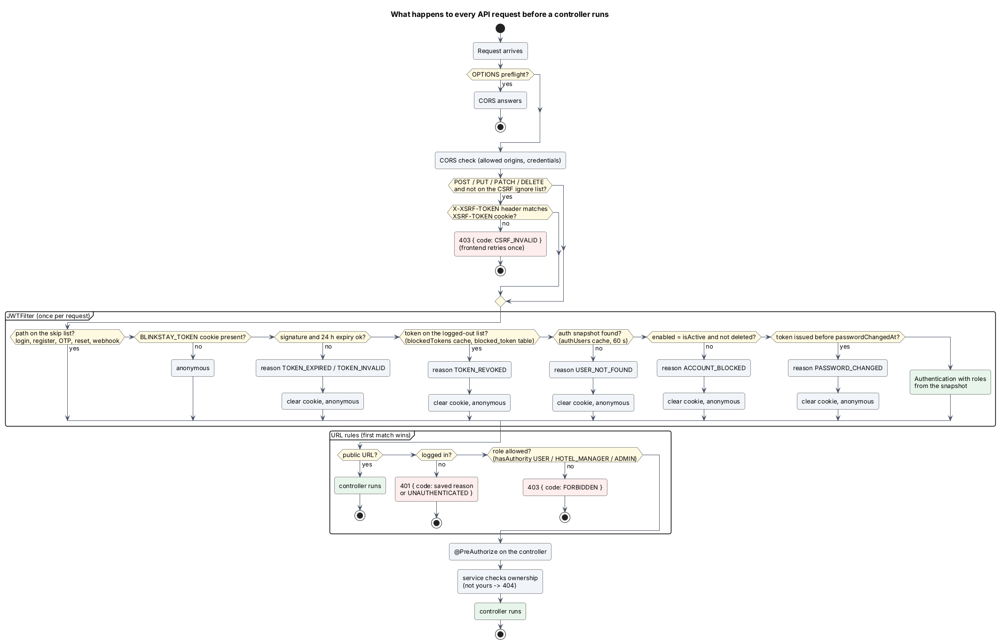
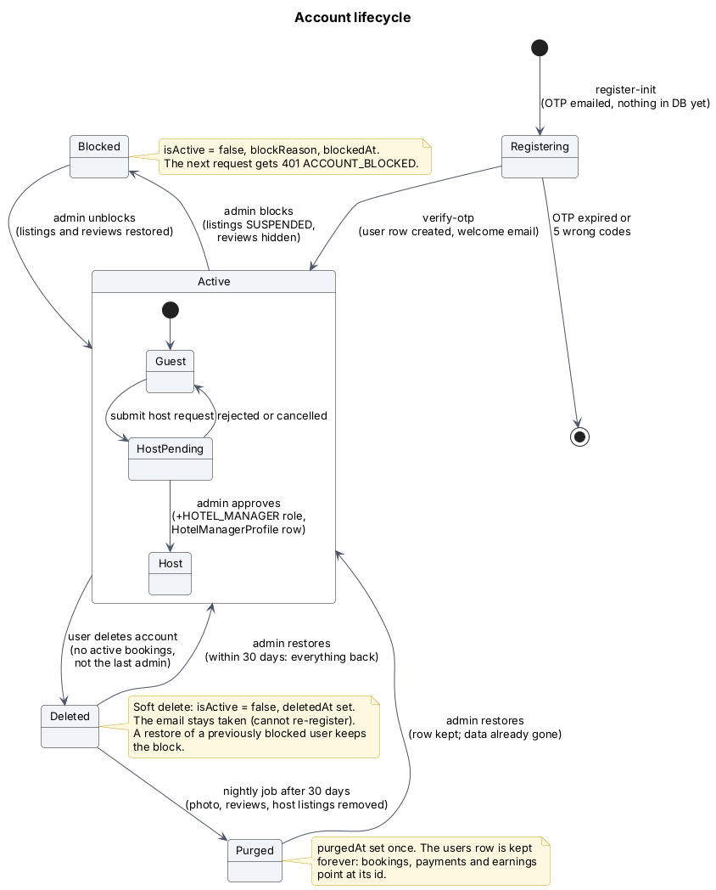

# 6. Security and the account lifecycle

## Two cookies

| Cookie | HttpOnly | Read by JavaScript | Purpose |
|---|---|---|---|
| `BLINKSTAY_TOKEN` | yes | no | the login (a JWT). XSS cannot steal it |
| `XSRF-TOKEN` | no | yes | CSRF token. The frontend copies it into the `X-XSRF-TOKEN` header |

- The JWT holds `sub` = user id, roles, `iat`, and expires after **24 hours**. Signed with HMAC; the secret comes from the environment. There is no refresh token: when it expires, the user logs in again.
- Cookie flags come from the environment: `COOKIE_SECURE`, `COOKIE_SAME_SITE`, `MAX_AGE`. Production: `Secure=true`, `SameSite=Lax`, which works because Netlify proxies `/api` (same origin for the browser).
- Logout and every rejection send the cookie back with `Max-Age=0` and the **same flags** (a browser only replaces a cookie whose flags match).
- The response body of login never contains the token.

## Every request

Order: CORS → CSRF → `JWTFilter` → URL rules → `@PreAuthorize` → ownership check in the service.

`JWTFilter` (once per request, before `UsernamePasswordAuthenticationFilter`):

1. Skips preflight, login, register-init, verify-otp, forgot/reset password and the webhook.
2. Reads `BLINKSTAY_TOKEN`; none → anonymous.
3. Verifies signature and expiry.
4. Checks the logged-out list (`blockedTokens` cache over the `blocked_token` table).
5. Loads the **auth snapshot** (id, roles, enabled, `passwordChangedAt`) from the `authUsers` cache (60 s), the database on a miss.
6. Rejects a disabled account (`enabled = isActive && deletedAt == null`) and a token issued before `passwordChangedAt`.
7. Otherwise builds the `Authentication` with roles **from the snapshot**, so a role change works on the next request.

A rejection does **not** answer by itself: the filter stores the reason, clears the cookie and lets the request continue as anonymous. Public pages still work; a protected URL gets 401 with that reason.

Because every user change (block, unblock, delete, restore, role change, password change or reset) clears `authUsers` after the commit, a block takes effect on the user's next request ([diagram 04](diagrams/04-blocked-user-next-request.png)).

## URL rules

First match wins (`SpringSecurityConfiguration`):

| # | URL | Who |
|---|---|---|
| 1 | `OPTIONS /**` | everyone |
| 2 | login, csrf, forgot/reset password, register-init, verify-otp, Swagger (dev) | everyone |
| 3 | `POST /api/v1/auth/logout` | everyone |
| 4 | `GET /api/v3/listings/all` | everyone |
| 5 | `GET /api/v3/listings/my-listings` | `HOTEL_MANAGER` (must stay above rule 6) |
| 6 | `GET /api/v3/listings/{listingId}` | everyone |
| 7 | other `/api/v3/listings/**` | `HOTEL_MANAGER` or `ADMIN` |
| 8 | `/api/v2/user/**` | logged in |
| 9 | `/api/v2/admin/**`, `/api/v3/admin/**`, `/api/v5/admin/**` | `ADMIN` |
| 10 | `GET /api/v5/availability/**` | everyone |
| 11 | `GET /api/v5/listings/*/reviews` | everyone |
| 12 | `POST /api/v5/payments/webhook/**` | everyone (signature protects it) |
| 13 | `/api/v5/host/**` | `HOTEL_MANAGER` |
| 14 | anything else | logged in |

`@EnableMethodSecurity` is on, and controllers repeat the role with `@PreAuthorize`. Ownership (whose booking, listing, notification, review) is checked in services and answered with **404**, so nobody learns which ids exist.

The webhook path appears in three places: CSRF-ignored, `permitAll`, and skipped by the JWT filter. Its only protection is the HMAC check on the raw body.

## CSRF and CORS

- CSRF uses Spring's `.spa()` setup: token in the readable `XSRF-TOKEN` cookie, sent back as `X-XSRF-TOKEN`. Missing or wrong on a non-GET call → 403 `CSRF_INVALID`; the axios interceptor retries once.
- Ignored for: login, logout, csrf, forgot/reset password, register-init, verify-otp, webhook.
- CORS allows credentials for the configured origins. With the Netlify proxy the browser calls are same-origin, so CORS matters mainly for local development. **To tighten:** read allowed origins from a property and drop the wildcard and tunnel entries.

## Error codes

| HTTP | `code` | Meaning | Frontend reaction |
|---|---|---|---|
| 401 | `UNAUTHENTICATED` | no cookie on a protected URL | go to login |
| 401 | `TOKEN_EXPIRED` | 24 h passed | go to login |
| 401 | `TOKEN_INVALID` | malformed or bad signature | go to login |
| 401 | `TOKEN_REVOKED` | logged out | go to login |
| 401 | `USER_NOT_FOUND` | user no longer exists | go to login |
| 401 | `PASSWORD_CHANGED` | issued before the last password change | go to login |
| 401 | `ACCOUNT_BLOCKED` | blocked or deleted | "account blocked" page |
| 403 | `CSRF_INVALID` | missing or wrong CSRF header | retry once |
| 403 | `FORBIDDEN` | wrong role | show message |

## Auth flows

| Flow | Diagram | Key rules |
|---|---|---|
| Sign up | [09-signup-with-otp](diagrams/09-signup-with-otp.png) | data and code wait in memory (`otpHolder`, 10 min cap, 1,000 entries); password hashed immediately; email checked again on verify; deleted accounts keep their email |
| Login and session | [10-login-session-logout](diagrams/10-login-session-logout.png) | email lower-cased; a blocked or deleted account sees the reason only if the password is right, otherwise the same 401 "Invalid credentials" |
| Forgot password | [11-forgot-password](diagrams/11-forgot-password.png) | same reply whether the account exists; code BCrypt-hashed in `PasswordResetOtpStore`; reset logs out every device |

| | Registration code | Reset code |
|---|---|---|
| Stored | in memory with the form data | Caffeine cache, BCrypt hash |
| Lifetime | 6 minutes | 10 minutes |
| Resend within 60 s | 429 | silently ignored |
| Wrong guesses | 5, then 429 and start again | 5, then the code is removed |

## Account lifecycle

- **Block** (admin, reason required): not yourself, not an admin, not with active bookings. Suspends the host's listings and hides the user's reviews in the same transaction ([diagram 03](diagrams/03-block-host-sequence.png)).
- **Delete** (user): soft delete; refused with upcoming bookings or for the last active admin. Listings suspended with `OWNER_DELETED`, reviews hidden, email sent.
- **Restore** (admin): within 30 days everything comes back; a previously blocked user stays blocked.
- **Purge** (nightly, after 30 days): photo, reviews and host listings removed, `purgedAt` set; Cloudinary images deleted after the commit.

## Passwords and secrets

- BCrypt (`BCryptPasswordEncoder`) for passwords and reset codes. Login comparison is done by Spring's `AuthenticationManager` with `CustomUserDetailsDaoService`.
- Secrets only from the environment: JWT secret (32+ chars), database, Zoho, Cloudinary, Mapbox, Razorpay. Never in the repo or docs.
- Dev-only users (`UserDumping`) and Swagger exist only in the dev profile; production refuses to start with mock payments unless `ALLOW_MOCK_PAYMENTS=true` (`MockPaymentProdGuard`).

## Known weak spots

1. No rate limit or lockout on login; OTP limits are per account, not per IP.
2. OTPs, cooldowns and caches are in one server's memory (see [09](09-scaling-and-microservices.md)).
3. One 24-hour token, no refresh token. Next step: 15-minute access token + rotating refresh cookie.
4. CORS origin list is wider than needed.
5. The Swagger annotation still says "Bearer" although the app uses a cookie.
