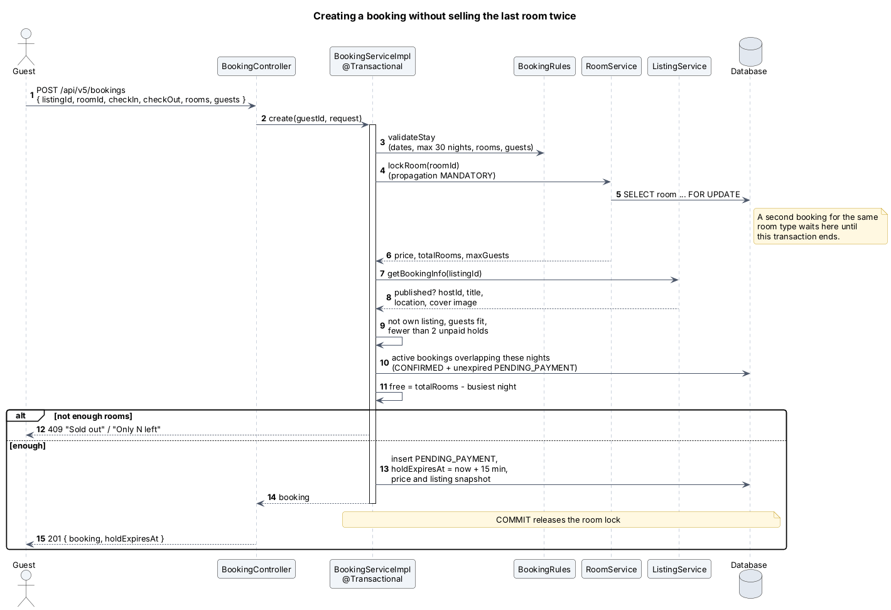
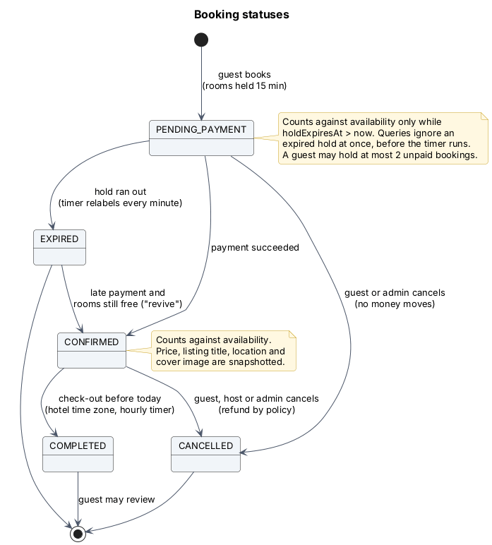
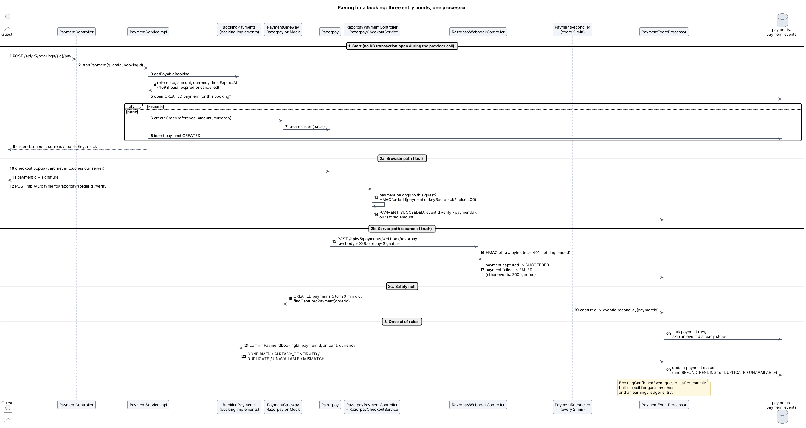
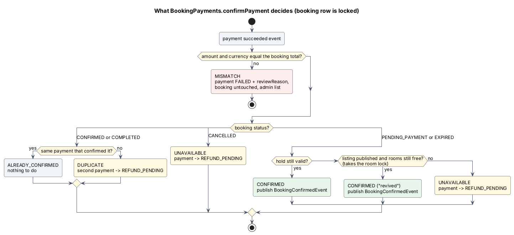
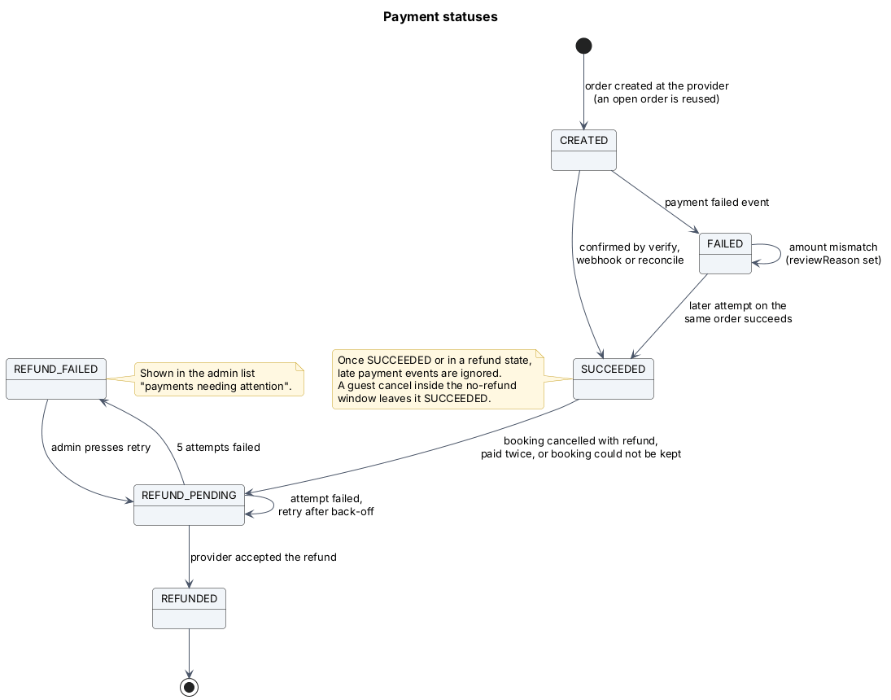
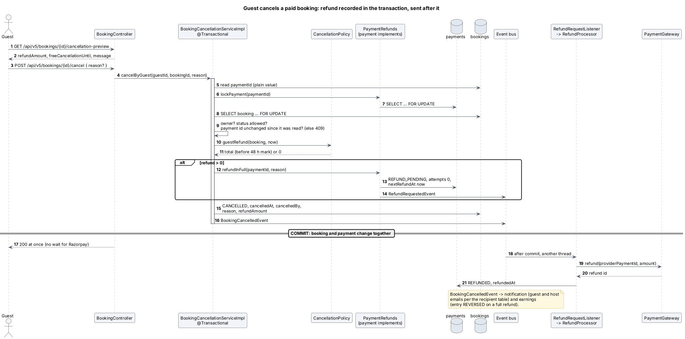
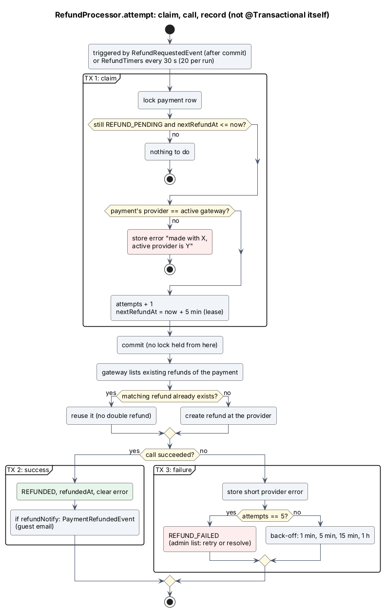
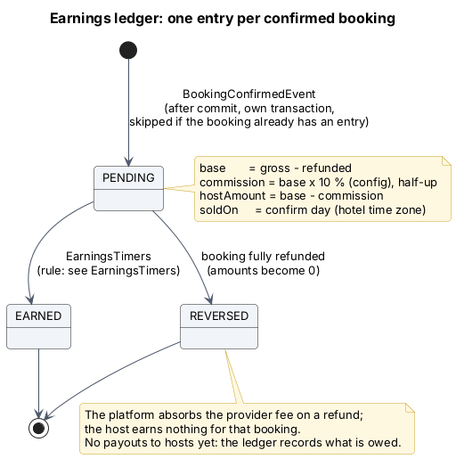

# 7. Bookings, payments and refunds

The short version. Full design records: [B1/B2](architecture/b1-b2-booking-and-payment.md), [B3](architecture/b3-cancellation.md), [B5](architecture/b5-payments-razorpay.md).

## Availability

- No "rooms left" counter. For each night: **free = `totalRooms` − rooms used that night**. A stay is bookable if its **busiest night** has enough.
- Rooms "used" = `CONFIRMED` bookings + `PENDING_PAYMENT` bookings whose `holdExpiresAt` is still in the future. An expired hold stops counting at once, before the timer relabels it.
- Check-out is exclusive (leaving on the 12th and arriving on the 12th never clash). Max 30 nights.
- A "room" is a **room type with a quantity** (Deluxe × 5), not a numbered room.
- Availability and "free tonight" are never cached.

Example, 3 rooms: A books 10→12 for 2 rooms, B books 11→13 for 1. Used per night: 10th = 2, 11th = 3, 12th = 1. A request for 10→13 gets 0; for 12→13 gets 2.

## Creating a booking



The room row lock (`SELECT ... FOR UPDATE` via `RoomService.lockRoom`, propagation `MANDATORY`) makes "count free rooms" and "insert booking" one step for that room type. A second guest waits a few milliseconds, then counts again including the first booking. Other room types and read-only screens are not blocked.

Known gap: the 2-unpaid-holds limit can be passed by two simultaneous requests for **different** room types (different locks). Fix: also lock the guest row.

## Booking statuses



## Paying



- `app.payment.provider` = `mock` (default) or `razorpay` picks the `PaymentGateway` (`@ConditionalOnProperty`). Controllers that exist per mode: `PaymentController` always; `MockPaymentController` in mock; `RazorpayPaymentController` and `RazorpayWebhookController` in razorpay. The frontend branches on `session.mock`.
- **Three entry points, one processor:** browser `verify`, signed webhook, reconcile job. All call `PaymentEventProcessor.process`, which locks the payment row, skips an event id it has already stored, then asks booking `confirmPayment`.
- **The server owns the amount.** Verify uses the stored order amount; webhook and reconcile use Razorpay's; `confirmPayment` compares with the booking total.
- **Signatures:** webhook = HMAC-SHA256 of the raw body bytes with the webhook secret (checked before parsing, constant time); verify = HMAC of `orderId|paymentId` with the key secret.
- Webhook answers: 200 handled or ignored, 401 bad signature, 500 on a processing error (so Razorpay retries).





## Cancelling and refunding



- Rules per actor: [02-requirements](02-requirements.md#bookings).
- **Refunds are recorded inside the transaction and sent after it.** `refundInFull` only marks the payment `REFUND_PENDING`. So a slow or failing provider can neither hold locks nor roll back a cancel, and the database can never say "confirmed" while the money was returned.
- Full refunds only. A guest cancel in the no-refund window leaves the payment `SUCCEEDED` and the booking `CANCELLED` with `refundAmount = 0`.



| Setting | Value |
|---|---|
| Retry timer | every 30 s, first after 45 s, 20 payments per run |
| Lease per attempt | 5 minutes |
| Back-off | 1 min, 5 min, 15 min, 1 h |
| Max attempts | 5, then `REFUND_FAILED` → admin "payments needing attention" |
| Double-refund guard | list the payment's refunds first and reuse a matching one |
| Wrong-provider guard | a payment made with another provider is never sent to the active one |
| Reconcile | every 2 min: `CREATED` payments 5–120 min old (`app.payment.reconcile.*`) |

## Locks and lock order

| Lock | Taken by |
|---|---|
| room row | create booking, revive an expired booking, edit or delete a room |
| payment row | payment processor, cancel (first), refund worker, admin retry |
| booking row | `confirmPayment`, cancel |
| listing row | review create / edit / delete (rating), account hide / show of reviews (sorted ids) |

**Order: payment → booking → room.** Every path follows it, so transactions can wait but never deadlock. A cancel racing a payment: whoever locks the payment first wins; the other sees the new state (payment finds `CANCELLED` → refund; cancel sees `CONFIRMED` → normal refund, or 409 if the payment changed in between).

## Idempotency

| Repeated thing | Protection |
|---|---|
| Same webhook or verify twice | payment row lock + unique `(provider, providerEventId)` in `payment_events` |
| Verify and webhook for one payment | second sees `SUCCEEDED` and stops |
| Reconcile and webhook | stable event id `reconcile_{paymentId}` / already `SUCCEEDED` |
| Two refund workers | row lock + 5-minute lease |
| Crash after the provider accepted a refund | existing refund is found and reused |
| Two cancels at once | row locks; second gets 409 or the same amount |
| Second payment for one booking | `DUPLICATE` → refunded |
| Repeated `BookingConfirmedEvent` | ledger checks the booking already has an entry |
| Repeated "Pay" clicks | an open `CREATED` order is reused |

## Earnings



One `earnings_entries` row per confirmed booking. Dashboards are sums over the ledger: the host dashboard filters by check-in date, the admin overview by the confirm day (`soldOn`). Cancellation rate = fully refunded paid bookings / all paid bookings. No payouts to hosts yet; Razorpay's fee on a refund is absorbed by the platform.

## Configuration

```properties
app.payment.provider=mock            # or razorpay
app.payment.razorpay.key-id=${RAZORPAY_KEY_ID:}
app.payment.razorpay.key-secret=${RAZORPAY_KEY_SECRET:}
app.payment.razorpay.webhook-secret=${RAZORPAY_WEBHOOK_SECRET:}
app.payment.reconcile.min-age-minutes=5
app.payment.reconcile.max-age-minutes=120
app.payment.allow-mock-in-prod=${ALLOW_MOCK_PAYMENTS:false}
app.booking.max-pending-per-guest=2
```

Switch providers only when no refunds are pending: a payment can only be refunded by the provider that took it.
