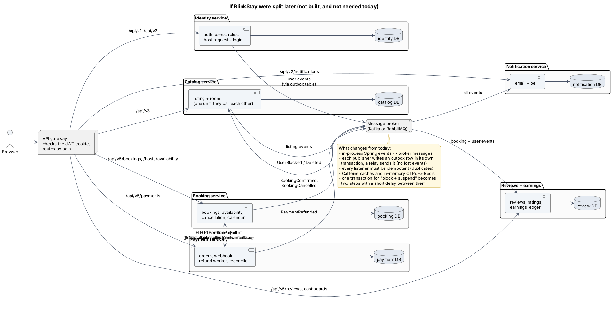

# 9. Scaling and a possible split into services

## Today: one instance, by choice

Logins are stateless (`SessionCreationPolicy.STATELESS`, the JWT cookie carries identity), and everything that must be correct lives in the database: room locks, payment idempotency, refund state, the ledger. What is **not** shared between instances:

| In one JVM's memory | Breaks with 2 instances | Fix when scaling |
|---|---|---|
| Registration OTP + form data, reset OTP | a code sent by A cannot be verified on B | Redis with TTL |
| Resend cooldown, wrong-guess counts | limits apply per server | Redis, plus a per-IP limit (Bucket4j or gateway) |
| Caffeine caches | eviction on A does not reach B | Redis cache, or short TTLs |
| `@Scheduled` jobs | every instance runs them | ShedLock or one scheduler instance (row locks and the refund lease already prevent double work) |

Order of scaling steps: indexes and batch fetching (done: `default_batch_fetch_size=50` took the feed from 4.6 s to 2.0 s) → keep the app next to the database (done: Singapore ↔ Bangalore) → Redis → several instances behind a load balancer → read replicas → outbox + broker for events and email retries.

## Why not microservices now

- Confirming a booking, recording the payment and writing the ledger entry commit together. Across services that becomes a saga with retries.
- Free hosting allows one small always-on instance; several sleeping services would be slow.
- More operations work (per-service auth, tracing, network failures) with no new features.

## What a split would look like

The module seams are the service seams: an interface in `common` becomes an HTTP call, and a Spring event becomes a broker message. Changes needed:

1. **Outbox table** per publisher, written in the same transaction, relayed to the broker, so no event is lost.
2. **Idempotent listeners** (the payment processor already is), because a broker can deliver twice.
3. **No cross-service transaction.** "Block host + suspend listings" becomes two steps with a short window in between.
4. **Blocked-user check** at the gateway, or a local copy of blocked users fed by events.
5. Each service owns its tables; UUID references already make that possible.

First candidates: **notification** (already event-driven and async), then **payment** (own scaling and security needs).

## Do now so a split stays cheap

- Keep the module rules ([03](03-architecture.md#rules-between-modules)).
- **Break the listing ↔ room cycle**: put the ownership check on the listing side (a small `ListingOwnership` contract in `common`) so `RoomController` stops calling `ListingService`.
- Consider **Spring Modulith**: it checks module boundaries at build time and has an event publication log that works like an outbox.
