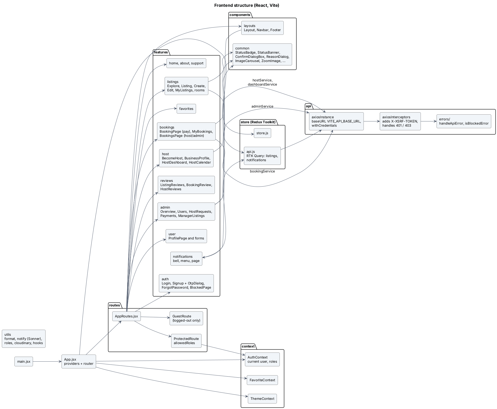

# Frontend architecture

React + Vite app in `frontend/`. Design tokens and colours: `frontend/THEME.md`. Setup: `frontend/README.md`.



## Folders

```
src/
├── api/            axiosInstance (baseURL, withCredentials), axiosInterceptors, errors/{handleApiError,isBlockedError}
├── components/
│   ├── common/     StatusBadge, StatusBanner, ConfirmDialogBox, ReasonDialog, ImageCarousel, ZoomImage,
│   │               PasswordInput, ClampedText, BlockedNotice, ErrorPage, PageNotFound, Loading, Logo, ...
│   └── layouts/    Layout, Navbar, Footer
├── context/        AuthContext, FavoriteContext, ThemeContext
├── features/       one folder per area: pages/, components/, <area>Service.js
│   ├── auth  home  about  support  user
│   ├── listings    explore, detail (map, gallery, rooms, booking card), create, edit, my listings
│   ├── bookings    BookingPage (pay: Razorpay or mock), MyBookings, BookingsPage (host + admin)
│   ├── favorites  reviews  notifications
│   ├── host        BecomeHost, BusinessProfile, HostDashboard, HostCalendar
│   └── admin       AdminOverview, AdminUsers, AdminHostRequests, AdminPayments, ManagerListings
├── routes/         AppRoutes, ProtectedRoute (allowedRoles), GuestRoute
├── store/          store.js, api.js (Redux Toolkit / RTK Query)
└── utils/          format, notify (Sonner), roles, cloudinary, authRedirect, support, useCooldown, useLoad, usePageTitle
```

## Conventions

- **One axios instance** with `withCredentials: true`. The interceptor copies the `XSRF-TOKEN` cookie into `X-XSRF-TOKEN` on non-GET calls.
- **Global error handling** in the interceptor, driven by the backend `code` ([../06-security.md](../06-security.md#error-codes)): auth codes → clear the user and go to login; `ACCOUNT_BLOCKED` → blocked page; `CSRF_INVALID` → retry once; 400/404/409 → toast or inline message.
- **Roles in the UI:** `ProtectedRoute allowedRoles={[...]}`; the navbar shows links per role. Hiding a link is convenience only; the backend enforces every rule.
- **Redux:** RTK Query is used for listings and notifications only. Other features call their service file directly.
- **Notifications:** poll `unread-count`, load the list only when the bell opens. A notification stores a type and `referenceId`; the frontend decides which page it opens.
- **Payments:** branch on `session.mock`: mock → test screen with success/failure buttons; otherwise load Razorpay `checkout.js`, open the popup with `publicKey` and `orderId`, then call `verify` in the handler. Closing the popup shows nothing; paying again reuses the order.
- **Bookings:** `bookingService` exports `BOOKING_STATUS`, `effectiveStatus` (treats an expired hold as expired before the timer runs) and a `BOOKINGS_CHANGED` signal. One `BookingsPage` serves host reservations and the admin list.
- **Formatting:** `utils/format` (`formatDateLabel`, `formatINR`, `formatTime`, `plural`); toasts through `utils/notify`.
- **Images:** `utils/cloudinary` builds delivery URLs (`q_auto:best`, 2× width, `c_limit`).
- **Netlify:** `public/_redirects` proxies `/api/*` to the backend and ends with `/*  /index.html  200` for client-side routes.
