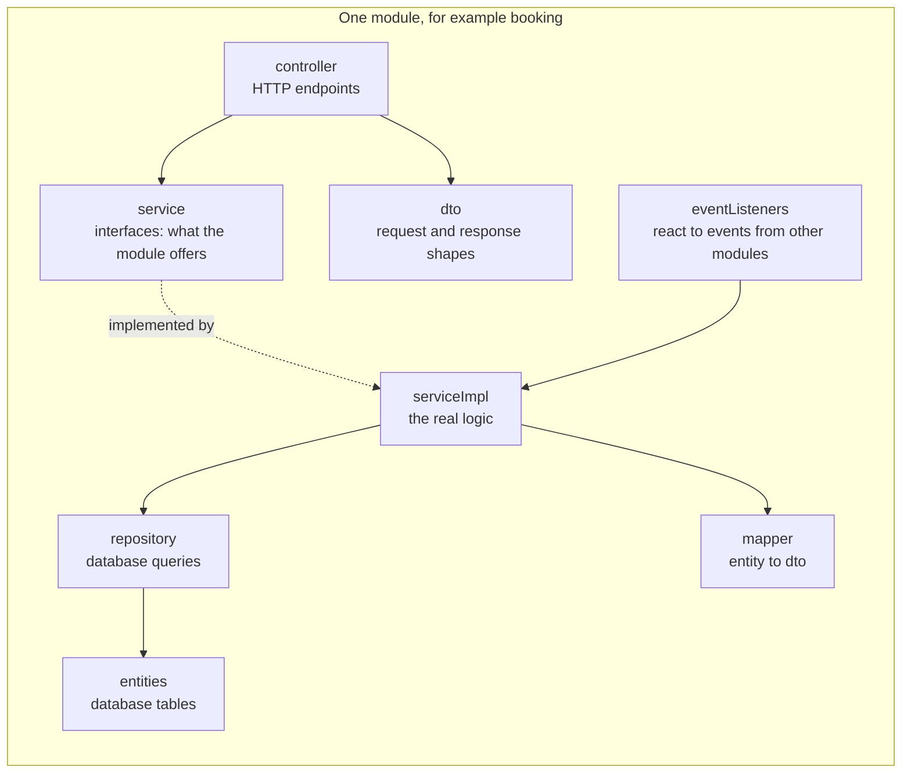
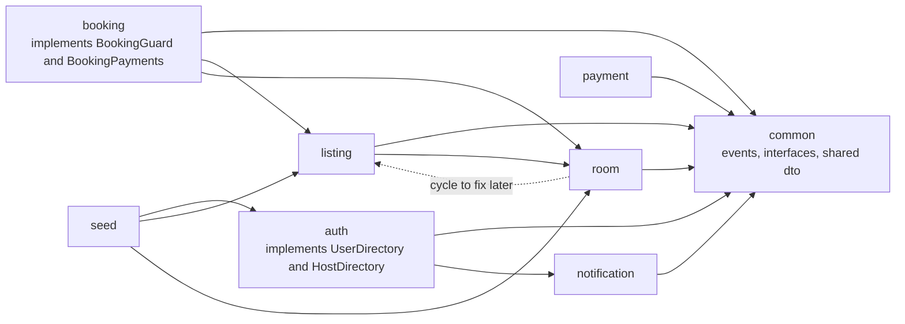
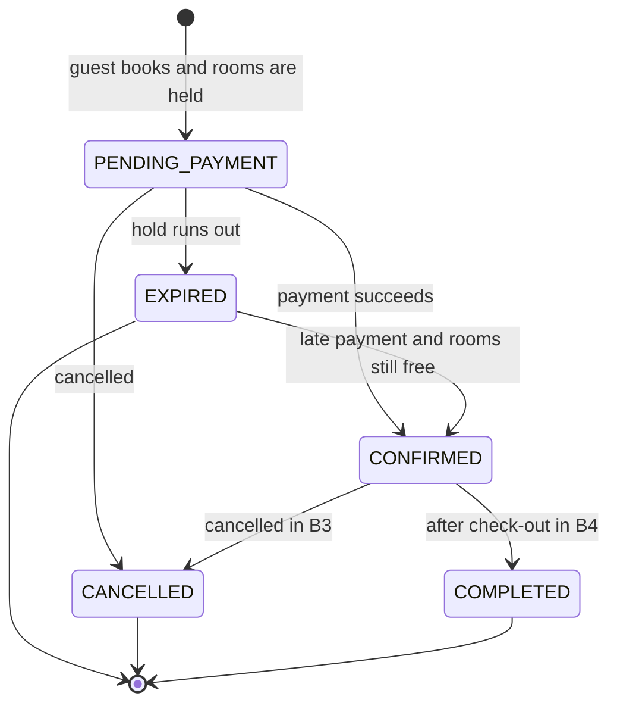
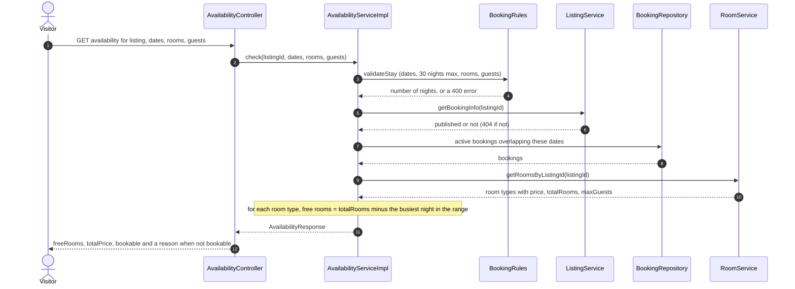
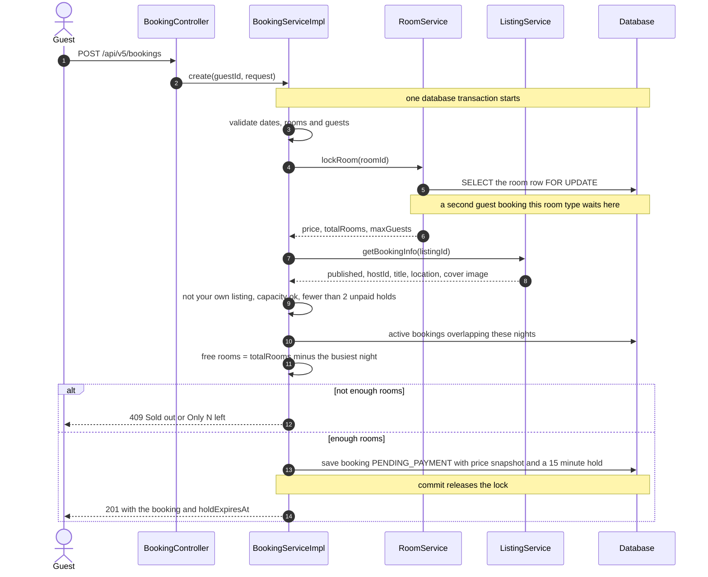
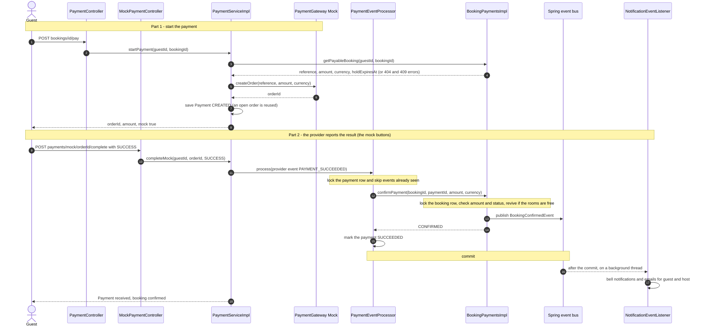
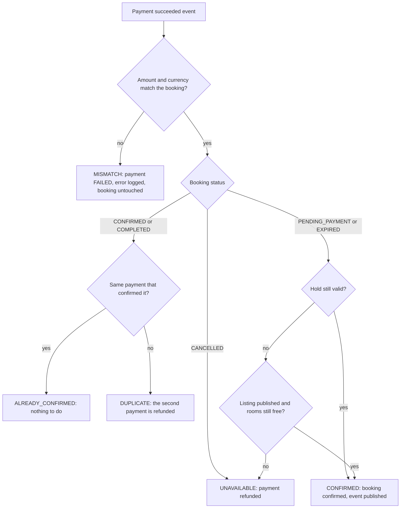
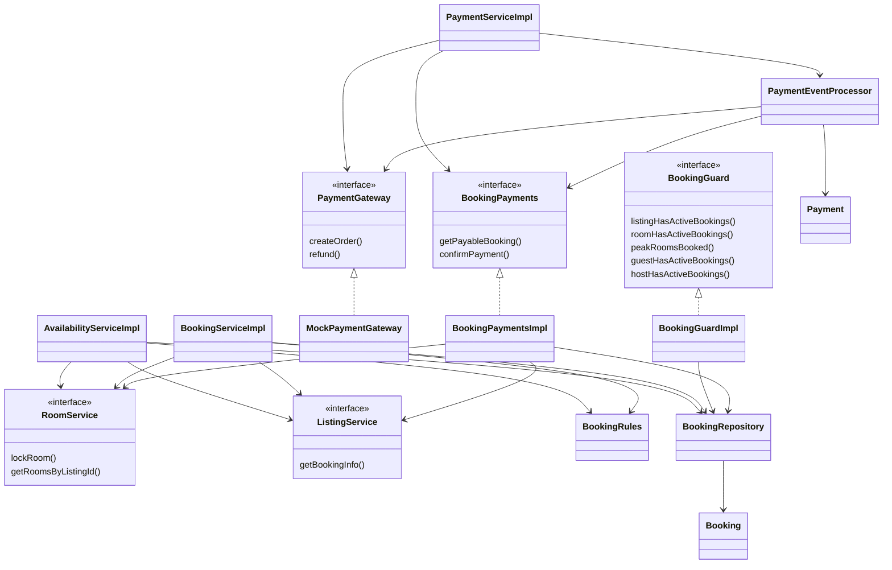
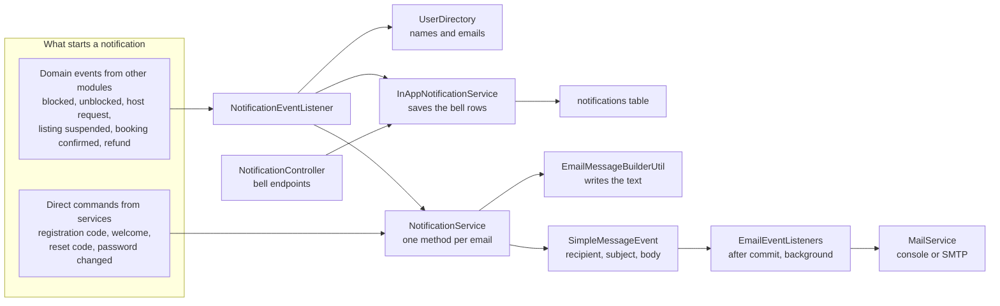
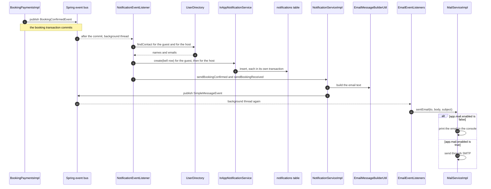

# BlinkStay Architecture Guide: Modules, Booking (B1), Payment (B2) and Notifications

> **How to view the diagrams:** open this file on GitHub, in VS Code with a Mermaid preview extension, or in Obsidian, or paste any single `mermaid` block into https://mermaid.live. If a diagram does not render, copy the error text and ask for a fix.

## Contents

1. [The folder pattern](#1-the-folder-pattern)
2. [B1: availability and booking](#2-b1-availability-and-booking)
3. [B2: payment](#3-b2-payment)
4. [The notification module](#4-the-notification-module)
5. [Reading order for the code](#5-reading-order-for-the-code)

---

## 1. The folder pattern

It is called **package by module, with layers inside each module**. The top-level folders (`auth`, `listing`, `room`, `booking`, `payment`, `notification`, `seed`, `common`) are the business modules. Inside each one the same layer folders repeat.

### Layer folders

| Folder | What lives there |
|---|---|
| `controller` | HTTP endpoints only: read the request, call a service, return the response |
| `dto` | the shapes of requests and responses, never database objects |
| `entities` | the classes that map to database tables |
| `enums` | fixed lists of values (statuses, roles) |
| `mapper` | converts entities to DTOs |
| `repository` | database queries |
| `service` | **interfaces**: what the module offers to everyone else |
| `serviceImpl` | the real logic behind those interfaces |
| `eventListeners`, `config`, `scheduler`, `util` | extras for that module |

The `service` and `serviceImpl` split matters. Another module should depend on the interface only, so the logic behind it can change freely.

### The rules that make it a modular monolith

1. Inside a module, calls go downward: controller, service, repository.
2. A module never touches another module's repositories or entities.
3. Modules talk through **service interfaces**, or through `common`, which holds shared events, small interfaces and shared DTOs.
4. `common` depends on nothing. Seed may depend on others, but nothing depends on seed.

Payment and booking never import each other. They meet only at `BookingPayments`, which lives in `common`. The dotted arrow is the listing and room cycle that should be untangled later.

---

## 2. B1: availability and booking

### Design decisions

- **No "rooms left" counter.** Free rooms on a night equal `totalRooms` minus the rooms booked that night. A stay is bookable if its **busiest night** still has enough rooms.
- **Check-out is exclusive,** so a stay ending on the 6th and one starting on the 6th never conflict.
- **A 15-minute hold.** A new booking is `PENDING_PAYMENT` and counts against availability only while its hold has not expired. Queries ignore expired holds immediately, and a timer relabels them as `EXPIRED` once a minute.
- **A database lock on the room row** stops two guests booking the last room at the same moment.
- **Snapshots.** The booking stores the price and the listing's title, location and image, so later edits or deletions do not change it.

### Booking statuses

### Availability check (public, no login)

### Creating a booking (the part with the lock)

---

## 3. B2: payment

### Design decisions

- **The payment module does not know the booking module.** It asks `BookingPayments`, an interface in `common`, and booking implements it.
- **One event processor decides every payment outcome.** The mock endpoint calls it today, and the real provider's webhook will call the same code in B5.
- **The server is the source of truth for the amount.** The amount comes from the booking, and a payment whose amount differs is never confirmed.
- **Every provider event is recorded once** (a unique key), so duplicates are ignored. The payment row and then the booking row are locked while processing, so parallel events run one at a time.
- **A money-back path instead of silent loss.** A payment for a booking that cannot be kept is refunded.

### Start the payment and confirm it

### What `confirmPayment` decides

### The classes and who uses whom

`BookingGuard` is used by `ListingServiceImpl`, `RoomServiceImpl` and `UserServiceImpl` to refuse deletions and edits that would break upcoming bookings. They depend on the interface only.

---

## 4. The notification module

There are **two entry points** and one shared email pipeline.

### Classes and their jobs

| Class | Folder | Job |
|---|---|---|
| `NotificationEventListener` | `eventListeners` | Listens to domain events from other modules (blocked, unblocked, host request, listing suspended, booking confirmed, refunded). It decides who gets a notification and runs after the commit, in the background. |
| `UserDirectory` (an interface in `common`, implemented by `UserDirectoryImpl` in auth) | | Gives names and emails. Notification never reads the users table. |
| `InAppNotificationService` and `Impl` | `service`, `serviceImpl` | Saves, lists, counts, marks read and deletes the bell rows, and cleans up after 90 days. Each save is its own transaction. |
| `Notification`, `NotificationType`, `NotificationRepository` | `entities`, `enums`, `repository` | The `notifications` table. |
| `NotificationController` | `controller` | The bell endpoints. A user only ever sees their own rows. |
| `NotificationService` and `Impl` | `service`, `serviceImpl` | One method per kind of email. It builds the text, then publishes a `SimpleMessageEvent`. |
| `EmailMessageBuilderUtil` | `util` | All email texts in one place. |
| `SimpleMessageEvent` | `event` | A small message: recipient, subject, body. |
| `EmailEventListeners` | `eventListeners` | Receives that message after the commit, in the background, and calls `MailService`. |
| `MailService` and `MailServiceImpl` | `service`, `serviceImpl` | Prints the email to the console, or sends through SMTP when `app.mail.enabled=true`. It never throws. |
| `AsyncConfig` | `config` | Turns on `@Async` and scheduling, so those listeners run on background threads. |

### Overview

### One full example: a confirmed booking

### Why they stay in sync without breaking each other

- **After the commit.** Nothing is announced for an action that rolled back. A failed email can never undo a block or a payment.
- **Background threads.** The user's request does not wait for emails.
- **`fallbackExecution = true` on both listeners.** `EmailEventListeners` receives its event while no transaction is open, because it is published from an after-commit callback. Without this flag Spring would silently skip it.
- **The bell save is wrapped in try and catch.** If the database refuses a row, the email still goes out.
- **Two hops for email on purpose.** `NotificationService` writes the text and `EmailEventListeners` and `MailService` send it. To switch to a real mail provider, only `MailServiceImpl` changes.

### To add a new notification

1. Add the event to `common.events`, and publish it from the module where it happens.
2. Add a message to `EmailMessageBuilderUtil`, and a method to `NotificationService` and its implementation.
3. Add a type to `NotificationType`.
4. Add a method in `NotificationEventListener` that saves the bell row and calls the new method. Use the same two annotations as the others.

---

## 5. Reading order for the code

`BookingRules`, then `AvailabilityServiceImpl`, then `BookingServiceImpl.create`, then `BookingPaymentsImpl.confirmPayment`, then `PaymentEventProcessor.process`, then `NotificationEventListener`. The diagrams above follow that same path.
