# BlinkStay B3: Cancellation, Refunds and Host/Admin Booking Lists

B3 builds on B1 (availability and booking creation) and B2 (payment and confirmation). It adds:

- cancellation by the guest, the host and the admin, with a refund policy
- a full refund through the same payment gateway used in B2
- a cancellation notification for the people involved
- booking lists for hosts and for admins

---

## Contents

1. [Rules](#1-rules)
2. [Use cases](#2-use-cases)
3. [Where B3 sits in the modules](#3-where-b3-sits-in-the-modules)
4. [Class diagram](#4-class-diagram)
5. [Booking status after B3](#5-booking-status-after-b3)
6. [Decision flow for a cancel](#6-decision-flow-for-a-cancel)
7. [Sequence: guest cancels a paid booking](#7-sequence-guest-cancels-a-paid-booking)
8. [Sequence: host or admin cancels](#8-sequence-host-or-admin-cancels)
9. [Sequence: cancel racing with a payment](#9-sequence-cancel-racing-with-a-payment)
10. [Lock order (why there is no deadlock)](#10-lock-order-why-there-is-no-deadlock)
11. [Sequence: notifications after a cancel](#11-sequence-notifications-after-a-cancel)
12. [Sequence: host and admin lists](#12-sequence-host-and-admin-lists)
13. [Endpoints](#13-endpoints)
14. [Files added and changed](#14-files-added-and-changed)
15. [Design decisions and limits](#15-design-decisions-and-limits)
16. [Test checklist](#16-test-checklist)

---

## 1. Rules

| Who | Unpaid booking (`PENDING_PAYMENT`) | Paid booking (`CONFIRMED`) |
|---|---|---|
| Guest | Can cancel any time. No money moves. | Full refund until 48 hours before check-in (measured from the start of the check-in day in the hotel time zone). After that the cancel is still allowed, but no refund is due. Not allowed once the check-in day has started. |
| Host | Cannot cancel | Always a full refund. A reason is required. Allowed until the stay ends. |
| Admin | Can cancel | Same as host. |

Other statuses (`CANCELLED`, `EXPIRED`, `COMPLETED`) return **409**.

A cancelled booking stops counting against availability right away, so the rooms are free again at once.

---

## 2. Use cases

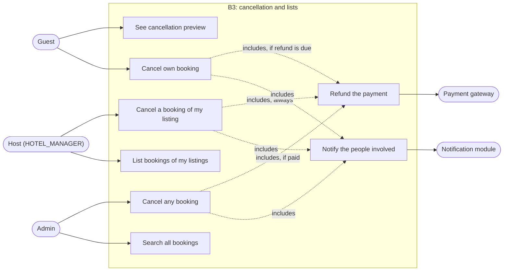

---

## 3. Where B3 sits in the modules

Booking never imports payment. Payment never imports booking. They meet only through interfaces and events in `common`.

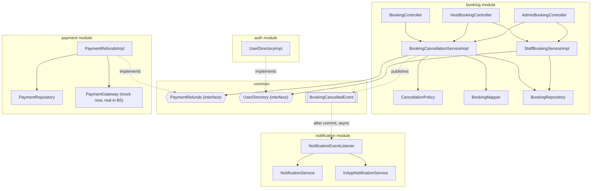

---

## 4. Class diagram

### 4.1 Cancellation core

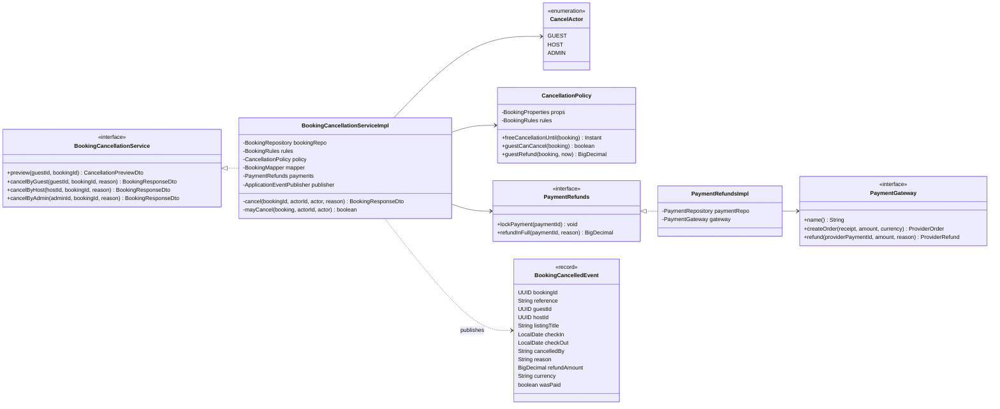

### 4.2 Lists and DTOs

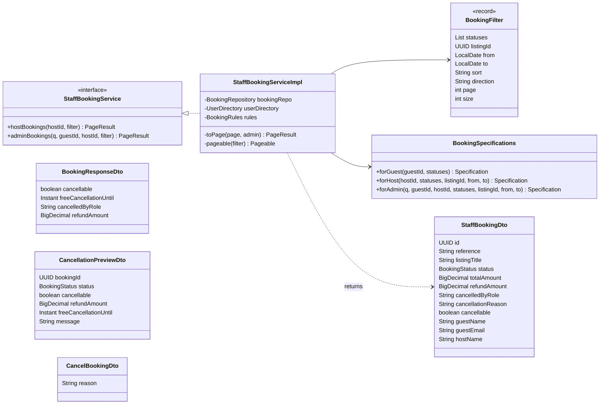

### 4.3 Controllers

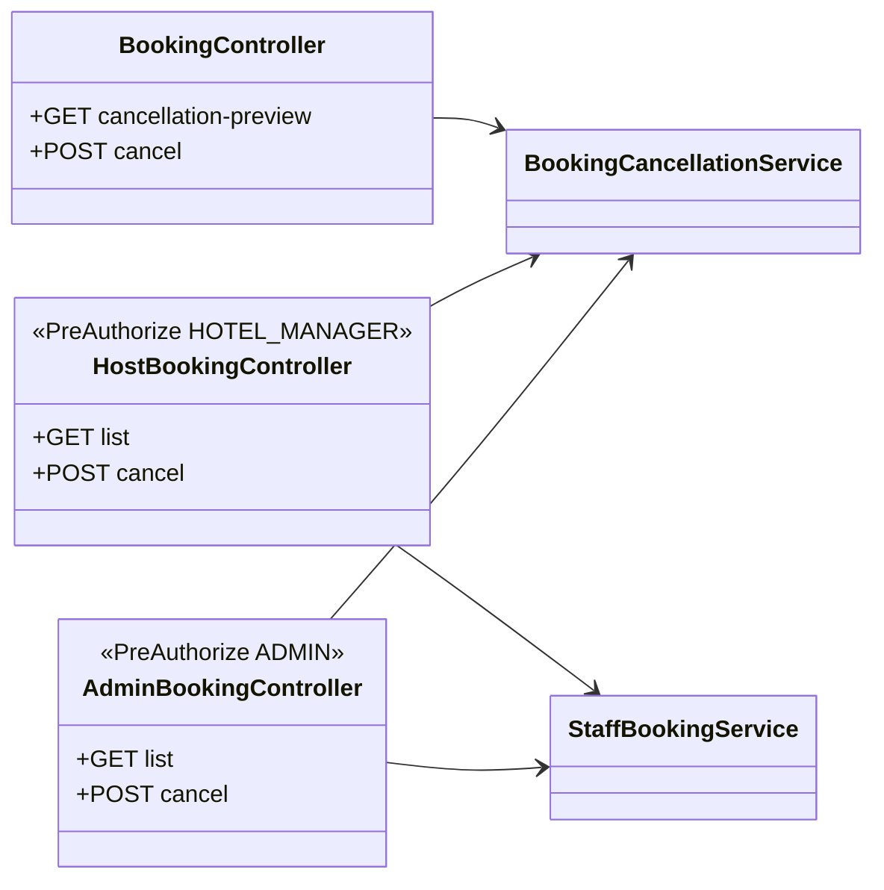

---

## 5. Booking status after B3

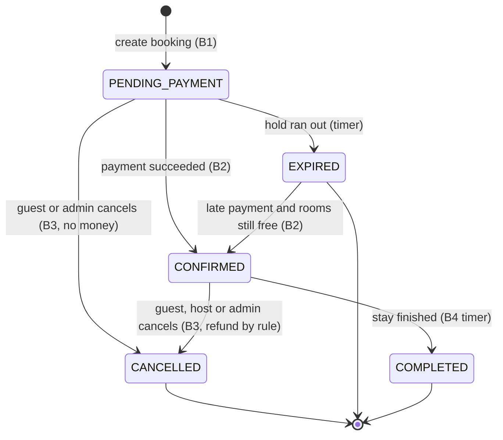

Payment status stays in step with it:

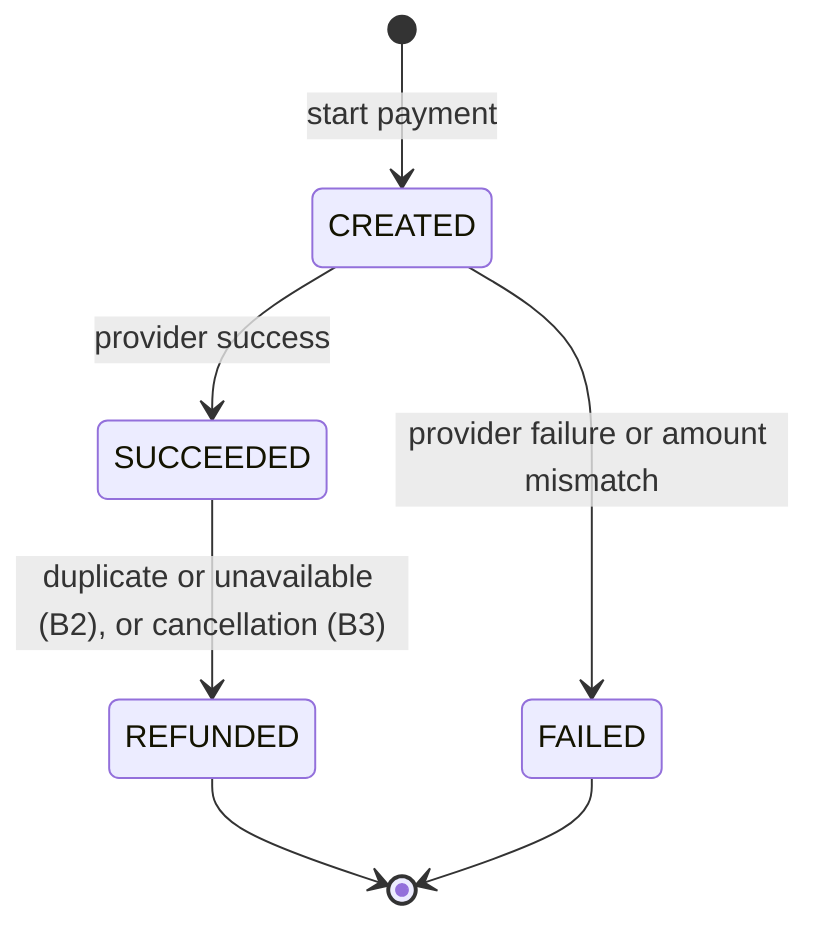

A guest cancel inside the no-refund period leaves the payment `SUCCEEDED`. The booking is `CANCELLED` with `refundAmount = 0`.

---

## 6. Decision flow for a cancel

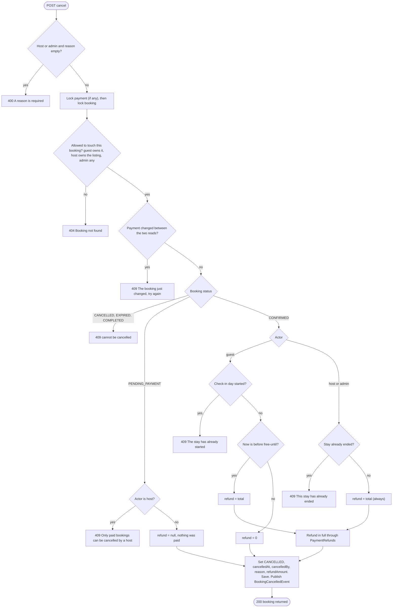

---

## 7. Sequence: guest cancels a paid booking

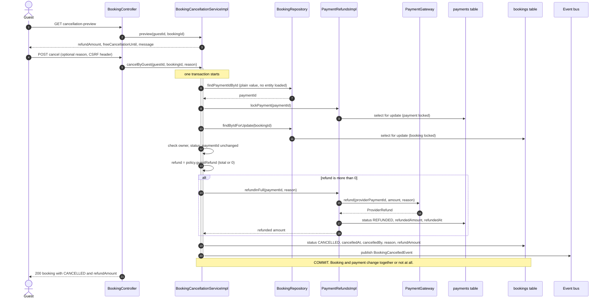

If the gateway call throws, the whole transaction rolls back and the booking stays `CONFIRMED`.

---

## 8. Sequence: host or admin cancels

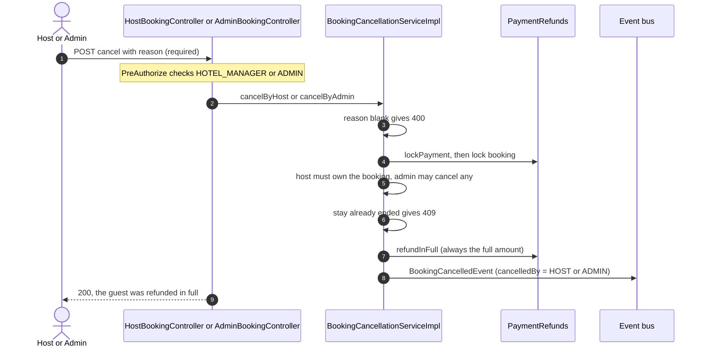

---

## 9. Sequence: cancel racing with a payment

A guest starts a payment, and then cancels before it completes. The payment arrives afterwards.

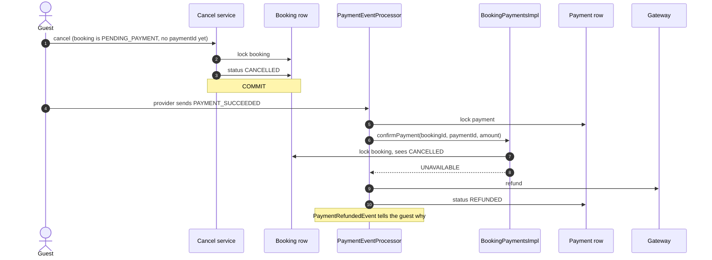

No code was added for this case in B3. It works because B2 already returns `UNAVAILABLE` for a cancelled booking.

---

## 10. Lock order (why there is no deadlock)

Two code paths touch both rows. They must always lock them in the same order.

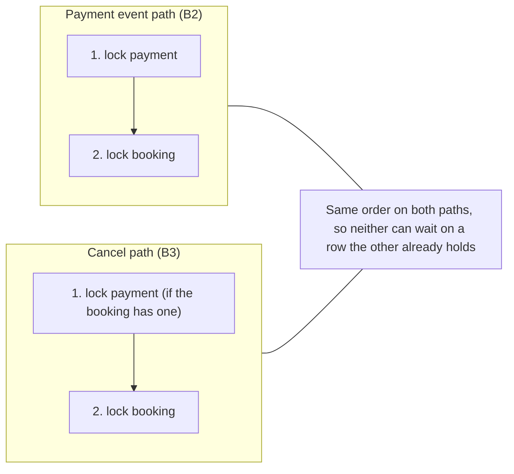

How the cancel service gets there:

1. `findPaymentIdById` is a plain scalar query. It does not load the entity, so the later locked read is not served from a stale cache.
2. `lockPayment` locks the payment row first.
3. `findByIdForUpdate` locks the booking row.
4. The service checks that `paymentId` is still the same. If a payment was confirmed in between, it returns 409 and asks the caller to retry.

When the booking has no payment yet (unpaid hold), there is nothing to lock first. A concurrent payment then waits on the booking row, and sees `CANCELLED` once the cancel commits (section 9).

---

## 11. Sequence: notifications after a cancel

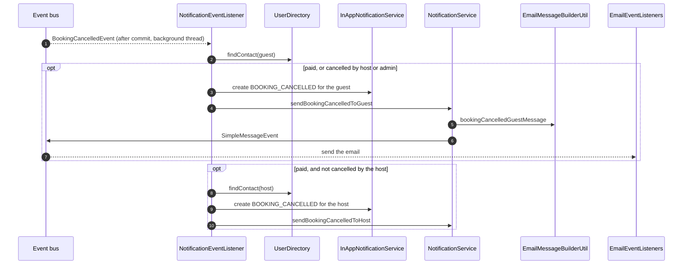

Who is told:

| Cancelled by | Booking was | Guest is told | Host is told |
|---|---|---|---|
| Guest | Unpaid | No | No |
| Guest | Paid | Yes (with the refund result) | Yes |
| Host | Paid | Yes (with reason and refund) | No (they did it) |
| Admin | Unpaid | Yes | No |
| Admin | Paid | Yes (with reason and refund) | Yes (with reason) |

`PaymentRefundedEvent` is **not** published for a cancellation refund. The cancellation message already carries the refund details, so the guest does not get two messages.

---

## 12. Sequence: host and admin lists

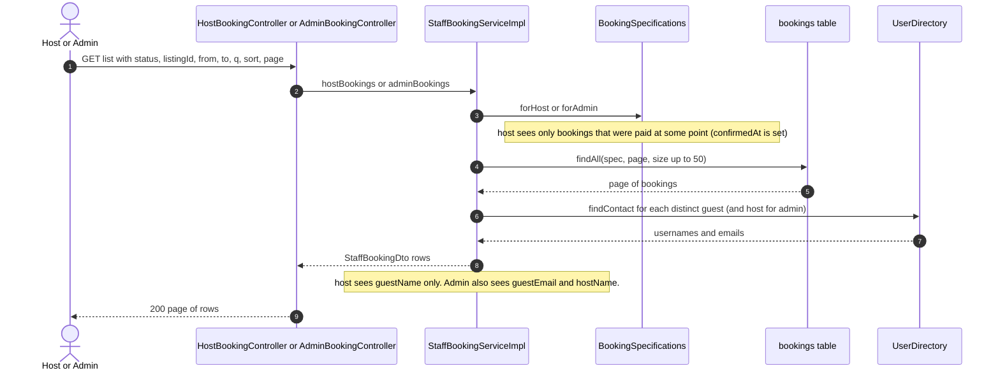

---

## 13. Endpoints

| Method and path | Who | Purpose |
|---|---|---|
| `GET /api/v5/bookings/{id}/cancellation-preview` | Guest (owner) | What happens if I cancel now (refund, message) |
| `POST /api/v5/bookings/{id}/cancel` | Guest (owner) | Cancel. Body optional: `{ "reason" }` |
| `GET /api/v5/host/bookings` | `HOTEL_MANAGER` | Bookings of my listings. Filters: `status`, `listingId`, `from`, `to`, `sort`, `direction`, `page`, `size` |
| `POST /api/v5/host/bookings/{id}/cancel` | `HOTEL_MANAGER` | Cancel with full refund. Body: `{ "reason" }` (required) |
| `GET /api/v5/admin/bookings` | `ADMIN` | All bookings. Extra filters: `q` (reference), `guestId`, `hostId` |
| `POST /api/v5/admin/bookings/{id}/cancel` | `ADMIN` | Cancel any booking. Body: `{ "reason" }` (required) |

All POST calls need the CSRF header (`X-XSRF-TOKEN`). `from` and `to` filter on the check-in date (`YYYY-MM-DD`).

---

## 14. Files added and changed

**New**

| File | Module |
|---|---|
| `PaymentRefunds` | common/payment |
| `BookingCancelledEvent` | common/events |
| `PaymentRefundsImpl` | payment/serviceImpl |
| `CancellationPolicy` | booking/service |
| `CancelActor` | booking/enums |
| `BookingCancellationService` and `Impl` | booking/service, booking/serviceImpl |
| `StaffBookingService` and `Impl`, `BookingFilter` | booking |
| `CancelBookingDto`, `CancellationPreviewDto`, `StaffBookingDto` | booking/dto |
| `HostBookingController`, `AdminBookingController` | booking/controller |

**Changed**

| File | Change |
|---|---|
| `PaymentRepository` | `findByIdForUpdate` |
| `BookingRepository` | `findPaymentIdById` |
| `BookingSpecifications` | `forHost`, `forAdmin`, shared filters |
| `BookingResponseDto` | `cancellable`, `freeCancellationUntil`, `cancelledByRole` |
| `BookingMapper` | injects `CancellationPolicy`, fills the new fields |
| `BookingController` | preview and cancel endpoints |
| `NotificationType` | `BOOKING_CANCELLED` |
| `EmailMessageBuilderUtil`, `NotificationService`, `NotificationServiceImpl` | two cancellation emails |
| `NotificationEventListener` | `on(BookingCancelledEvent)` |

If the `notifications` table still has its old check constraint on `type`, run `ALTER TABLE notifications DROP CHECK notifications_chk_1;` and put `@JdbcTypeCode(SqlTypes.VARCHAR)` on the field. Otherwise `BOOKING_CANCELLED` is rejected in the same way `PAYMENT_REFUNDED` was.

---

## 15. Design decisions and limits

1. **Cancellation lives in its own service.** `BookingServiceImpl` already handles create, read and expiry. Cancellation touches payments and notifications, so it gets its own class.
2. **Booking calls payment through `PaymentRefunds` in `common`.** Booking never imports payment classes, and payment never imports booking classes. This is the same idea as `BookingPayments` in B2, in the opposite direction.
3. **One cancel method for all three actors.** The differences are small: who may touch the booking, which statuses are allowed, and how the refund is computed. They live in one method, so a bug fix applies to all three.
4. **Full refund or none.** There is no partial refund, so the interface has `refundInFull` only. Partial refunds would be a new rule, not a rewrite.
5. **The refund runs inside the database transaction.** That is fine for the mock gateway. A real provider call should happen after commit, so B5 will move it and add a retry or an outbox.
6. **48 hours is measured from the start of the check-in day.** A fixed check-in time such as 14:00 can be added later by changing `freeCancellationUntil` only.
7. **`cancelledByRole` is derived, not stored.** It is computed by comparing `cancelledBy` with the guest and host IDs. Anything else is an admin. No new column is needed.
8. **Hosts never see unpaid holds.** The host list filters on `confirmedAt is not null`, so unpaid, expired and never-paid bookings do not appear.
9. **Hosts see the guest name only.** Email stays admin-only, as decided in B2.
10. **Known gap:** `COMPLETED` is still not set by anything. A past confirmed stay stays `CONFIRMED` until B4. Host and admin cancel return 409 for it ("stay has already ended"), so no harm is done.
11. **Known gap:** blocking or deleting a user does not cancel their bookings yet.

---

## 16. Test checklist

1. **Preview:** more than 48 h ahead gives a full refund. Within 48 h gives refund 0 and the no-refund message. A pending booking says it costs nothing.
2. **Guest cancels unpaid:** `CANCELLED`, `refundAmount` null, rooms free again, no email or bell row.
3. **Guest cancels paid, in time:** `CANCELLED`, full `refundAmount`, payment `REFUNDED`, guest and host both notified, no separate "payment refunded" message.
4. **Guest cancels paid, too late:** `refundAmount` 0, payment stays `SUCCEEDED`, message says no refund was due.
5. **Stay already started:** guest gets 409.
6. **Cancel twice, or an expired or cancelled booking:** 409. Another user's booking: 404.
7. **Host cancels:** reason required (empty gives 400), full refund, `cancelledByRole: HOST`, guest notified with the reason, host not notified. A pending booking gives 409. Another host's booking gives 404.
8. **Admin cancels:** works for unpaid and paid. Guest and host are both notified when paid. A non-admin gets 403.
9. **Host list:** only paid-at-some-point bookings of this host, `guestEmail` null, filters work.
10. **Admin list:** `q=BS-` search, `guestId`, `hostId`, `status` filters, `guestEmail` and `hostName` present.
11. **Cancel vs payment race:** start a payment, cancel the booking, complete the payment with `SUCCESS`. The booking stays `CANCELLED` and the payment becomes `REFUNDED`.
12. **Double cancel race:** two cancels of one paid booking at the same moment. One succeeds, the other gets 409, and the payment is refunded exactly once.
13. **Rollback:** force the gateway refund to throw. The booking must stay `CONFIRMED` and the payment `SUCCEEDED`.
