# BlinkStay B5: Real Payments (Razorpay), Safe Refunds and Reconciliation

B2 built the payment flow around a mock gateway. B5 makes it real, in three stages:

- **Stage 1: Razorpay checkout.** Order creation, the browser checkout, a signed verify call and a signed webhook, all feeding the same `PaymentEventProcessor` the mock used.
- **Stage 2a: refunds outside the database transaction.** A cancel only records "refund pending". A background worker sends the refund after commit, with retries and protection against refunding twice.
- **Stage 2b: things a human must see.** A reconcile job for payments whose confirmation never arrived, plus an admin list with a retry button for refunds that kept failing.

The mock still works. Setting `app.payment.provider=mock` brings back the mock gateway and the mock "complete" endpoint, and removes the Razorpay classes.

---

## Contents

1. [Setup: keys, secrets, webhook, tunnel](#1-setup-keys-secrets-webhook-tunnel)
2. [Use cases](#2-use-cases)
3. [Where B5 sits in the modules](#3-where-b5-sits-in-the-modules)
4. [Class diagram](#4-class-diagram)
5. [Payment status](#5-payment-status)
6. [Sequence: start a payment and open checkout](#6-sequence-start-a-payment-and-open-checkout)
7. [Sequence: verify (the browser path)](#7-sequence-verify-the-browser-path)
8. [Sequence: webhook (the server path)](#8-sequence-webhook-the-server-path)
9. [What the processor decides](#9-what-the-processor-decides)
10. [Sequence: cancel with a refund after commit](#10-sequence-cancel-with-a-refund-after-commit)
11. [The refund worker: claim, call, record](#11-the-refund-worker-claim-call-record)
12. [Sequence: reconcile](#12-sequence-reconcile)
13. [Sequence: admin queue](#13-sequence-admin-queue)
14. [Security and secrets](#14-security-and-secrets)
15. [Idempotency and lock order](#15-idempotency-and-lock-order)
16. [Configuration](#16-configuration)
17. [Endpoints](#17-endpoints)
18. [Files added and changed](#18-files-added-and-changed)
19. [Design decisions and limits](#19-design-decisions-and-limits)
20. [Problems met and how they were fixed](#20-problems-met-and-how-they-were-fixed)
21. [Test checklist](#21-test-checklist)
22. [Later additions and lessons](#22-later-additions-and-lessons)

---

## 1. Setup: keys, secrets, webhook, tunnel

| Item | Where it comes from | Backend variable |
|---|---|---|
| Key Id (`rzp_test_...`) | Razorpay dashboard, Test Mode, API Keys, Generate Test Key | `RAZORPAY_KEY_ID` |
| Key Secret | Same popup. Shown **once**, so copy it at once. | `RAZORPAY_KEY_SECRET` |
| Webhook secret | You invent a long random string, for example `openssl rand -hex 32` | `RAZORPAY_WEBHOOK_SECRET` |

- Set the three as environment variables in the IDE run configuration. Never commit them and never paste the key secret in a chat.
- The webhook secret must be **identical** in the Razorpay webhook form and in the variable. If they differ, every webhook gets 401.
- Webhook form: URL `https://<tunnel>/api/v5/payments/webhook/razorpay`, events `payment.captured` and `payment.failed` only.
- Check Settings, Payment Capture is **automatic**, or `payment.captured` never arrives.
- Local testing: `cloudflared tunnel --url http://localhost:8080`. A quick tunnel gets a new address on every start, so update the webhook URL in the dashboard each time. The tunnel is only needed for the webhook. Order creation and verify work without it.

Test money only: in Test Mode no real money moves. In Live Mode the money goes to the account that owns the keys and is settled to its bank account. BlinkStay does not yet pay hosts (the earnings ledger in B6 prepares for that).

---

## 2. Use cases

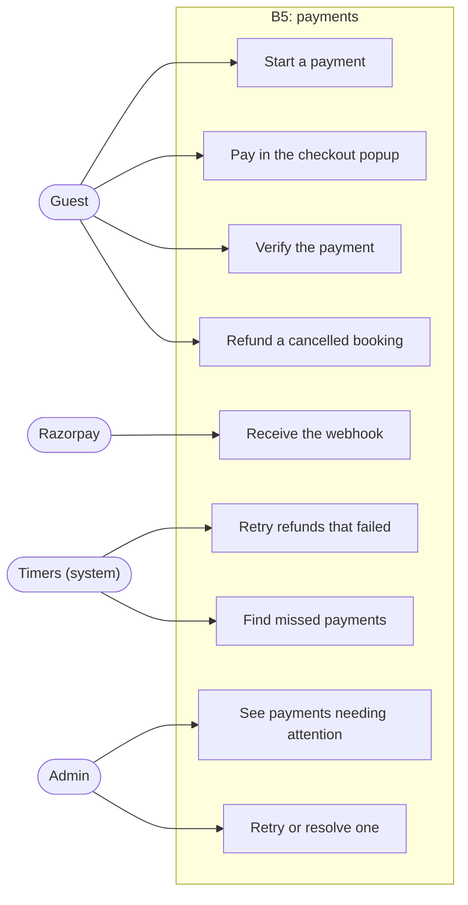

---

## 3. Where B5 sits in the modules

Modules never call each other's classes directly. They use small interfaces in `common`.

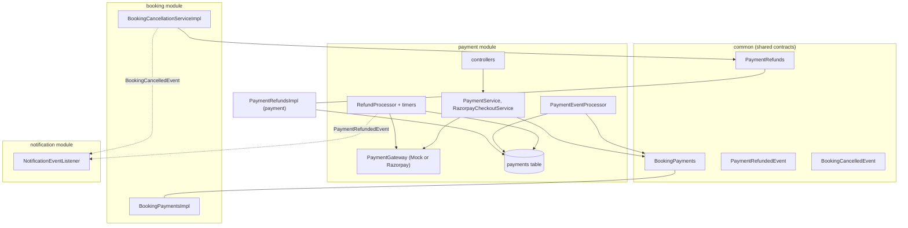

---

## 4. Class diagram

### 4.1 Gateway and entry points

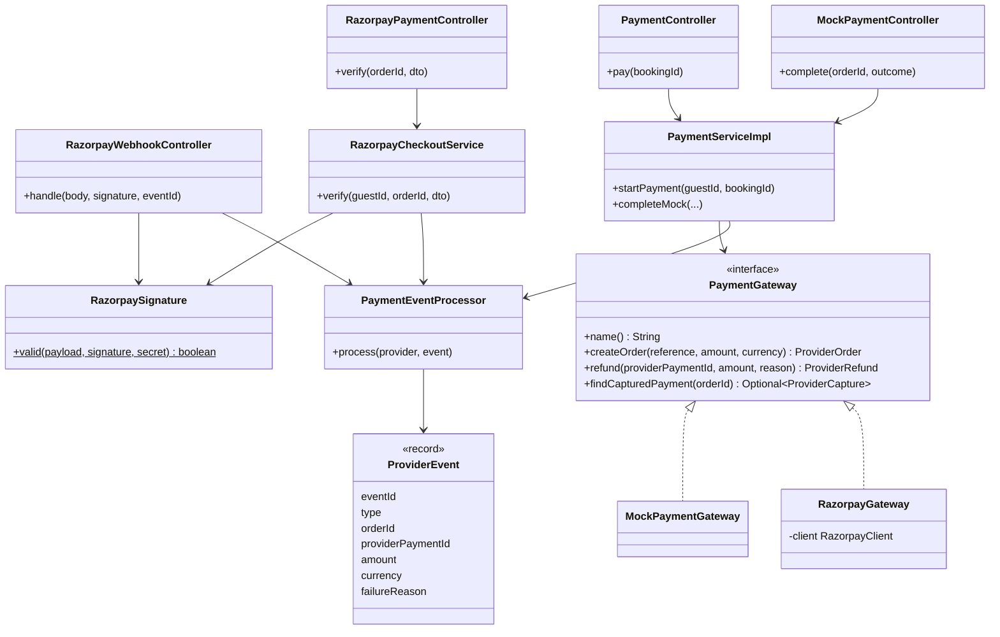

### 4.2 Refunds, reconcile and admin

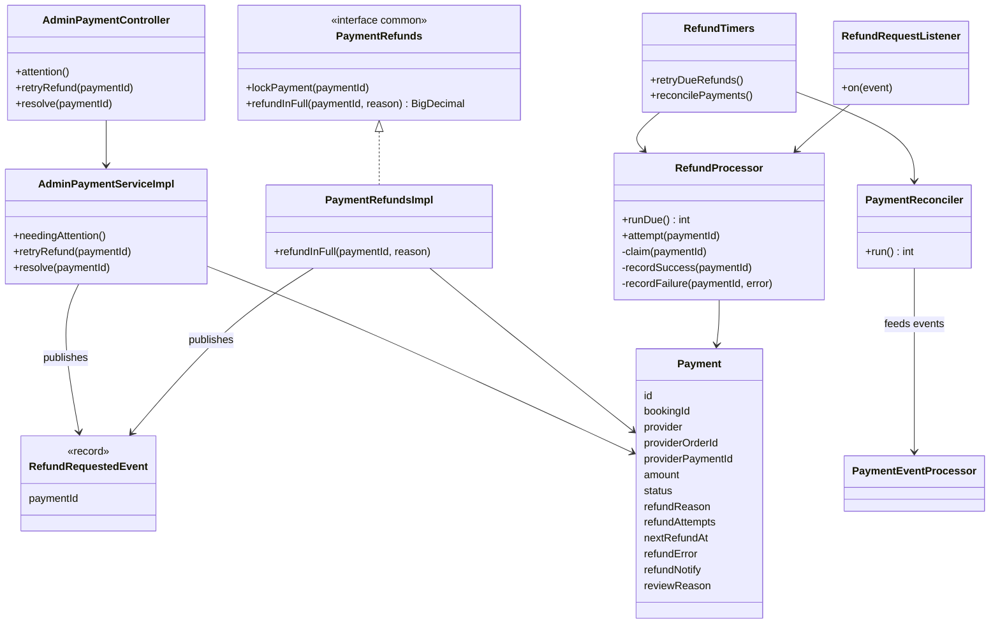

---

## 5. Payment status

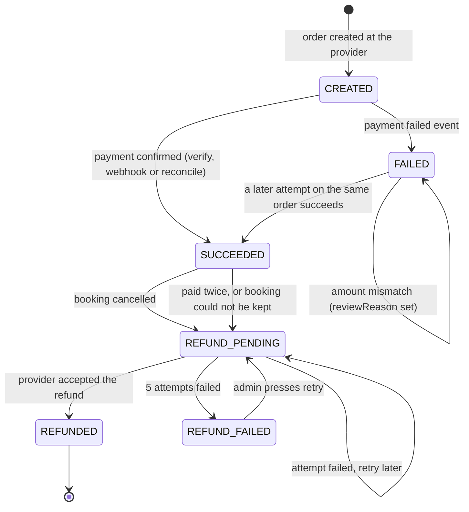

Once a payment is `SUCCEEDED`, `REFUND_PENDING`, `REFUNDED` or `REFUND_FAILED`, the processor ignores any late payment event for it. A payment that was paid twice or could not be kept passes through `SUCCEEDED` and becomes `REFUND_PENDING` inside the same transaction.

| Status | Meaning |
|---|---|
| `CREATED` | Order exists, no payment yet |
| `FAILED` | An attempt failed (the guest can try again), or an amount mismatch was flagged |
| `SUCCEEDED` | Money received and booking confirmed |
| `REFUND_PENDING` | A refund is owed. The worker will send it. |
| `REFUNDED` | The provider accepted the refund |
| `REFUND_FAILED` | 5 attempts failed. A person must act (admin list). |

---

## 6. Sequence: start a payment and open checkout

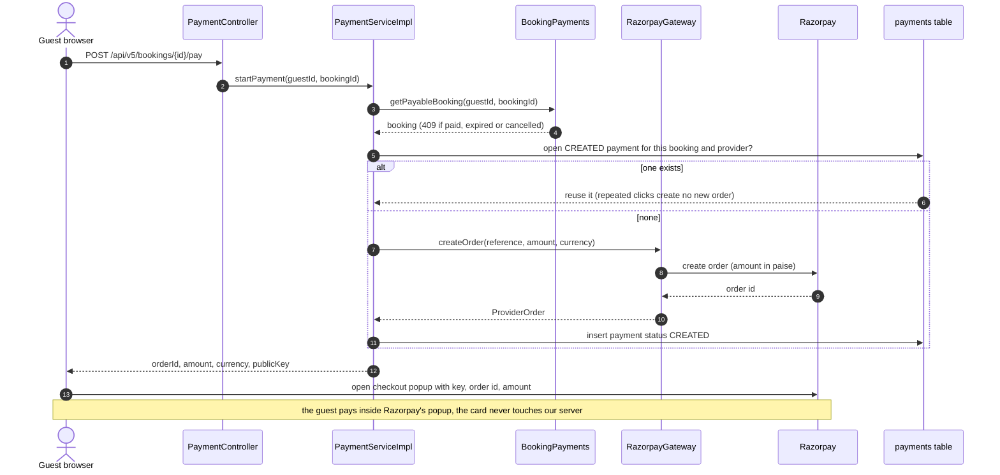

No database transaction is open during the call to Razorpay.

---

## 7. Sequence: verify (the browser path)

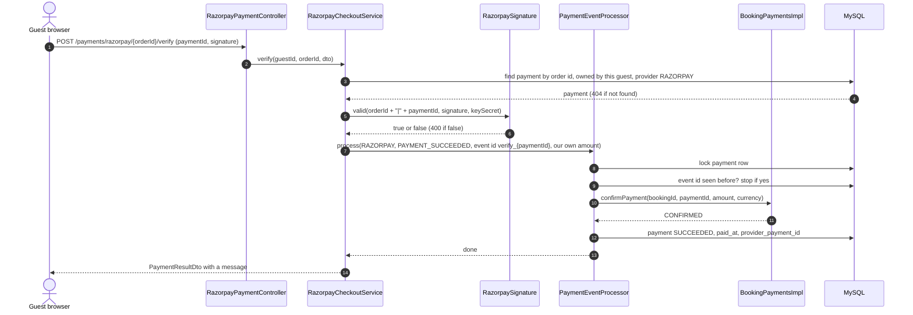

Why the amount comes from our own record here: the order was created with that amount, and Razorpay cannot charge a different one on it. The signature proves that this payment id belongs to this order. The webhook and reconcile paths use the amount the provider reports.

---

## 8. Sequence: webhook (the server path)

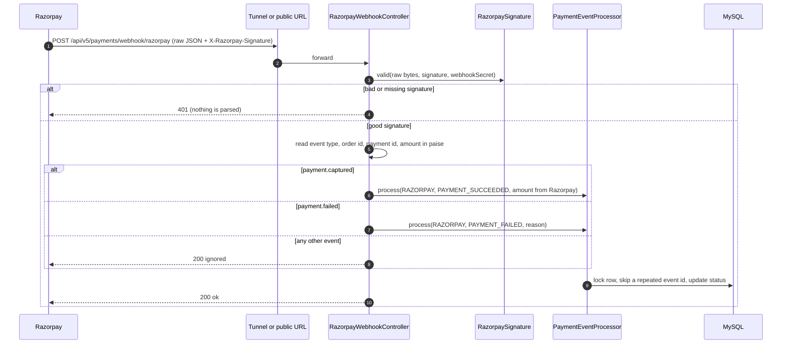

Answers:

- **200** for events we do not use, so Razorpay does not keep retrying them
- **401** for a bad signature
- **500** if processing throws, on purpose. Razorpay retries, and the processor is idempotent.

The webhook path is public and exempt from CSRF (`/api/v5/payments/webhook/**`) because Razorpay has no login or CSRF token. The signature is its proof.

---

## 9. What the processor decides

`PaymentEventProcessor.process` locks the payment row first, ignores events it has already stored, then asks the booking module what happened:

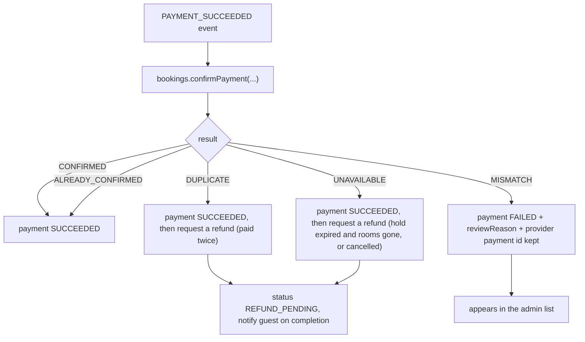

`confirmPayment` checks the amount and currency against the booking first. If the hold has run out, it can **revive** the booking, but only if the rooms are still free (it takes the room lock for that check).

---

## 10. Sequence: cancel with a refund after commit

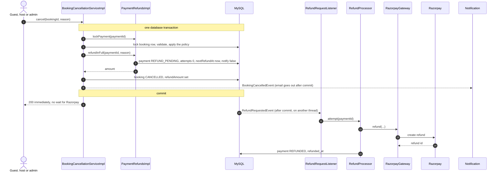

What this fixes compared with refunding inside the transaction:

- a slow or failed Razorpay call can no longer block or roll back a cancellation
- Razorpay accepting the refund and the database then failing to commit can no longer leave a refunded payment on a confirmed booking
- no database lock is held while waiting for the network

---

## 11. The refund worker: claim, call, record

`RefundProcessor.attempt` is not `@Transactional`. It opens three short transactions of its own.

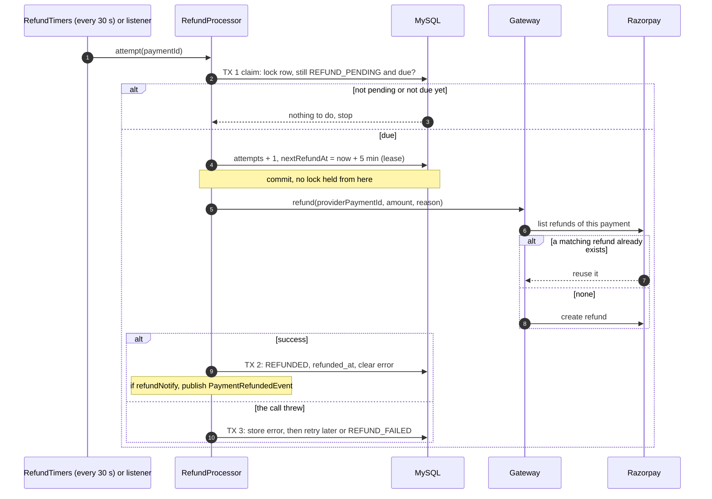

| Item | Value |
|---|---|
| Timer | every 30 seconds, 45 seconds after boot, 20 payments per run |
| Lease | 5 minutes. If the app dies mid-call, the next worker waits for the lease, then retries safely. |
| Back-off after attempt | 1: 1 minute, 2: 5 minutes, 3: 15 minutes, 4: 1 hour |
| Maximum attempts | 5, then `REFUND_FAILED` |
| Double-refund guard | Before creating a refund, the gateway lists the payment's refunds and reuses a matching one that has not failed |
| Wrong-provider guard | If the payment's provider differs from the active gateway, the attempt records an error and never calls the wrong provider |
| Guest email | Sent when the refund finishes, and only when `refundNotify` is true (refunds started by the processor). A cancellation already sent its own email. |

---

## 12. Sequence: reconcile

The safety net for "paid, then the tab closed, and the webhook never arrived" (the normal case on a laptop with no tunnel).

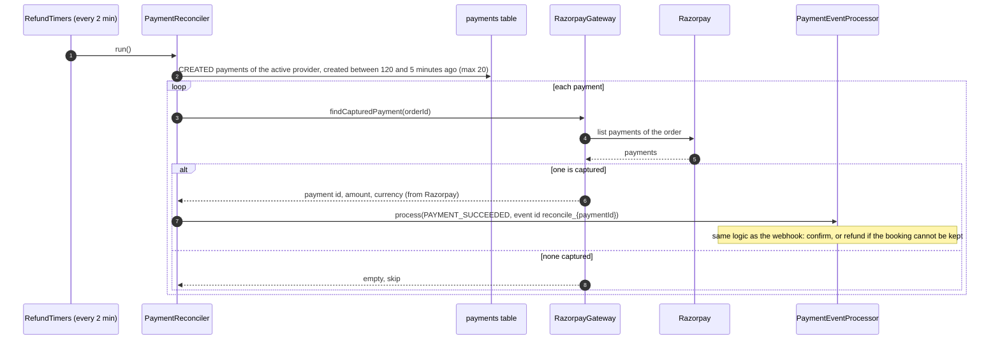

- The window of 5 to 120 minutes (properties `app.payment.reconcile.min-age-minutes` and `max-age-minutes`) keeps unpaid old orders from being polled forever.
- It is safe next to the webhook: if both report the same payment, the second finds the payment already `SUCCEEDED` and stops.
- With the mock gateway, `findCapturedPayment` returns empty, so the job does nothing.

---

## 13. Sequence: admin queue

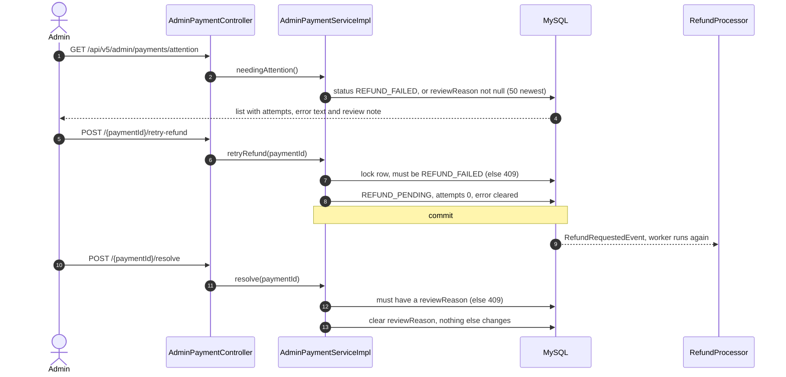

`/resolve` is bookkeeping only. It moves no money and changes no status. Use it after dealing with an amount mismatch in the Razorpay dashboard. If you refund a `REFUND_FAILED` payment by hand in the dashboard, press `/retry-refund` anyway: the gateway finds the existing refund and marks the payment `REFUNDED` without refunding twice.

`reviewReason` is set only for an amount mismatch, which is very rare because orders are created with our own amount. `REFUND_FAILED` is the common reason for a row in the list.

---

## 14. Security and secrets

| Check | How |
|---|---|
| Webhook is really from Razorpay | HMAC-SHA256 of the **raw request bytes** with the webhook secret, compared with `X-Razorpay-Signature` in constant time. Done before parsing. |
| Checkout result is real | HMAC-SHA256 of `orderId|paymentId` with the key secret, compared with the signature the popup returned |
| Only the owner can verify | The payment must belong to the logged-in guest and to provider RAZORPAY |
| Amount cannot be forged by the browser | verify uses our stored amount, webhook and reconcile use Razorpay's. `confirmPayment` compares it to the booking total. |
| Card data | Never touches the server. It is entered in Razorpay's popup. |
| Key secret and webhook secret | Environment variables only. The public key id is sent to the browser on purpose. |
| Admin endpoints | `/api/v5/admin/**` requires `ADMIN` (security config) and the controller also has `@PreAuthorize` |
| Webhook route | Public and CSRF-exempt, protected by the signature |

---

## 15. Idempotency and lock order

Everything here can be delivered twice, in any order. The rules that make that safe:

| Situation | Protection |
|---|---|
| Same event delivered twice (webhook retry, double verify) | The processor locks the payment row, then skips an event id it has stored already |
| Verify and webhook both report one payment | The second sees `SUCCEEDED` and stops |
| Two refund workers pick the same payment | Row lock plus a 5-minute lease on `nextRefundAt` |
| App crashes after Razorpay accepted a refund | The gateway lists existing refunds before creating one |
| Two cancels at once | Row locks. The second finds `REFUND_PENDING` or `REFUNDED` and returns the same amount. |
| Duplicate payment on one booking | `confirmPayment` returns `DUPLICATE` and the extra payment is refunded |

**Lock order, always:** payment row first, then booking row, then room row.

- `PaymentEventProcessor` locks the payment, then `confirmPayment` locks the booking (and the room only if it must revive a booking).
- `BookingCancellationServiceImpl` locks the payment first (`lockPayment`), then the booking.
- The refund worker and the admin actions only lock the payment row.

Because every path takes locks in the same order, two of them can wait for each other but never deadlock.

---

## 16. Configuration

```properties
# mock (default) or razorpay
app.payment.provider=razorpay

app.payment.razorpay.key-id=${RAZORPAY_KEY_ID:}
app.payment.razorpay.key-secret=${RAZORPAY_KEY_SECRET:}
app.payment.razorpay.webhook-secret=${RAZORPAY_WEBHOOK_SECRET:}

# reconcile window (minutes), defaults shown
app.payment.reconcile.min-age-minutes=5
app.payment.reconcile.max-age-minutes=120
```

Maven dependency: `com.razorpay:razorpay-java:1.4.8`.

Database notes:

- the `payments` table had a `CHECK` on `status` that only allowed the old four values. It was dropped with `ALTER TABLE payments DROP CHECK payments_chk_1;`
- new columns (`refund_reason`, `refund_attempts`, `next_refund_at`, `refund_error`, `refund_notify`, `review_reason`) were added by `ddl-auto=update`
- all times are stored in UTC

---

## 17. Endpoints

| Method | Path | Who | Purpose |
|---|---|---|---|
| POST | `/api/v5/bookings/{bookingId}/pay` | guest | Start a payment (reuses an open order). Returns order id, amount, `publicKey`. |
| POST | `/api/v5/payments/razorpay/{orderId}/verify` | guest | Verify the popup result and confirm the booking |
| POST | `/api/v5/payments/webhook/razorpay` | Razorpay (signed) | `payment.captured` and `payment.failed` |
| POST | `/api/v5/payments/mock/{orderId}/complete` | guest (mock mode only) | Fake success or failure |
| GET | `/api/v5/admin/payments/attention` | ADMIN | Failed refunds and flagged payments |
| POST | `/api/v5/admin/payments/{paymentId}/retry-refund` | ADMIN | Put a `REFUND_FAILED` payment back in the queue |
| POST | `/api/v5/admin/payments/{paymentId}/resolve` | ADMIN | Clear a review note |

Frontend contract for the checkout:

1. Load `https://checkout.razorpay.com/v1/checkout.js`.
2. Call `POST /bookings/{id}/pay`, then open `new window.Razorpay({ key: publicKey, order_id: orderId, amount: amount * 100, currency, name: "BlinkStay", handler })`.
3. In `handler(r)` call verify with `{ razorpayPaymentId: r.razorpay_payment_id, razorpaySignature: r.razorpay_signature }` and show the returned message.
4. If the guest simply closes the popup, show nothing. The booking stays on hold and paying again reuses the same order.

---

## 18. Files added and changed

`+` new, `~` changed.

| File | Change |
|---|---|
| `pom.xml` | ~ `razorpay-java` |
| `payment/enums/PaymentStatus` | ~ `REFUND_PENDING`, `REFUND_FAILED` |
| `payment/entities/Payment` | ~ six refund and review fields, index `idx_payment_refund` |
| `payment/gateway/RazorpayGateway` | + createOrder, refund (with duplicate check), findCapturedPayment |
| `payment/gateway/RazorpaySignature` | + HMAC check |
| `payment/gateway/ProviderCapture` | + |
| `payment/gateway/PaymentGateway` | ~ default `findCapturedPayment` |
| `payment/dto/RazorpayVerifyDto` | + |
| `payment/dto/PaymentSessionDto` | ~ `publicKey` |
| `payment/dto/AdminPaymentDto` | + |
| `payment/serviceImpl/PaymentServiceImpl` | ~ `publicKey`, new `messageFor` cases |
| `payment/serviceImpl/RazorpayCheckoutService` | + |
| `payment/controller/RazorpayPaymentController` | + verify |
| `payment/controller/RazorpayWebhookController` | + webhook |
| `payment/service/PaymentEventProcessor` | ~ repeated-event check, final states, refund request, mismatch review |
| `payment/repository/PaymentEventRepository` | ~ `existsByProviderAndProviderEventId` |
| `payment/repository/PaymentRepository` | ~ `findDueRefundIds`, `findNeedingAttention`, `findStaleCreated` |
| `payment/serviceImpl/PaymentRefundsImpl` | ~ records the request only |
| `payment/event/RefundRequestedEvent` | + |
| `payment/listener/RefundRequestListener` | + |
| `payment/serviceImpl/RefundProcessor` | + |
| `payment/serviceImpl/PaymentReconciler` | + |
| `payment/timer/RefundTimers` | + retry timer and reconcile timer |
| `payment/service/AdminPaymentService` and `serviceImpl/AdminPaymentServiceImpl` | + |
| `payment/controller/AdminPaymentController` | + |
| `auth/config/SpringSecurityConfiguration` | webhook path was already CSRF-exempt and public |

---

## 19. Design decisions and limits

| Decision | Why |
|---|---|
| Three entry points, one processor | Verify, webhook and reconcile all run `PaymentEventProcessor`, so there is one set of rules |
| The webhook is the source of truth, verify is a fast path | The browser can vanish, and the webhook still confirms the booking |
| Refund recorded in the transaction, sent after it | Money and booking state cannot disagree, and a slow provider cannot hold locks |
| Raw-bytes signature check | Re-serialising JSON would change it and fail the check |
| Official Razorpay SDK for orders and refunds, own code for signatures | Less code to get wrong, while the security check stays visible |
| Wrapper types (`Integer`, `Boolean`) for new columns | Existing rows have NULL there, and primitives would fail to load them |

Known limits:

- refunds are confirmed when the API call succeeds. Refund webhook events (`refund.processed`, `refund.failed`) are not used yet
- the guest sees no "refund processing" state. They get the cancellation email, and the refund email only for refunds the processor starts
- no payouts to hosts. The earnings ledger in B6 will record what is owed
- Live Mode needs Razorpay KYC. Everything here is tested in Test Mode
- the quick cloudflared URL changes on every start, so the webhook address has to be updated each time
- the amount-mismatch review case is only reachable through the webhook and reconcile paths and is very rare
- refunds are always full. A partial refund policy would need an amount on the request

---

## 20. Problems met and how they were fixed

| Problem | Cause | Fix |
|---|---|---|
| App would not start: no `ObjectMapper` bean | The newer Spring Boot uses a different JSON library, so no Jackson 2 bean existed | The webhook controller creates its own `ObjectMapper` (a `static` field) |
| `refund` would not compile | Guessed the return type as `void`, but the interface returns `ProviderRefund` | Return `new ProviderRefund(refundId)` |
| Verify returned 500 with "No static resource" | `@PostMapping` was missing, so Spring never registered the method | Add `@PostMapping("/{orderId}/verify")` |
| 500 for an unknown URL | The catch-all exception handler turned a missing-URL error into a 500 | Added 404 and 405 handlers in `GlobalExceptionHandler` |
| `POST /` rejected with "Invalid CSRF token" | The Razorpay webhook URL pointed at the bare tunnel address, without the path | The URL must end with `/api/v5/payments/webhook/razorpay` |
| New status values rejected by MySQL | The `payments_chk_1` `CHECK` allowed only the old four statuses | `ALTER TABLE payments DROP CHECK payments_chk_1;` |
| Refund job: `Lock wait timeout exceeded` | A SQL console in manual-commit mode held a lock on the payment row after a manual `UPDATE` | `COMMIT;` and switch to auto-commit |
| A mock payment in the admin list with a 502 error | The refund job sent a `mock_pay_...` id to Razorpay | Guard: a payment from another provider than the active gateway records a clear error and never calls the wrong provider |
| Booking time looked 5h30 behind in the database | Times are stored in UTC | Not a bug. The page converts to local time. |

---

## 21. Test checklist

Stage 1: checkout (no tunnel needed)

1. The app starts with `app.payment.provider=razorpay`, and `/api/v5/payments/mock/...` returns 404.
2. `POST /bookings/{id}/pay` returns an `orderId` starting `order_` and a `publicKey` starting `rzp_test_`. The order shows in the Razorpay dashboard.
3. Pay with test card `4111 1111 1111 1111` (any future expiry, any CVV). Verify returns SUCCEEDED, the booking is `CONFIRMED`, and `payment_events` has a `verify_...` row.
4. Call verify a second time with the same body. Same result, no error, no second event.
5. Change one character of the signature. 400, and the booking stays unpaid.
6. Close the popup without paying, or fail a payment. The booking stays on hold and paying again reuses the same order.
7. Pay for a booking whose hold already expired while its rooms are still free. It is confirmed. If the rooms are gone, the payment is refunded.

Webhook (cloudflared on, or the signed `curl` recipe)

8. With the tunnel on, pay once. `payment_events` has both the `verify_...` row and the webhook row, and the booking is confirmed once.
9. `curl -X POST <backend>/api/v5/payments/webhook/razorpay -d '{}'` returns 401.
10. A correctly signed `payment.captured` returns `ok`. The same event id sent again returns `ok` and changes nothing.

Stage 2a: refunds

11. Cancel a paid booking. The API answers at once, the payment goes `REFUND_PENDING` then `REFUNDED` within seconds, and the refund shows in the dashboard.
12. Use a wrong `RAZORPAY_KEY_SECRET` and cancel a paid booking. The cancel succeeds, the payment stays `REFUND_PENDING` with `refund_attempts` rising and `refund_error` filled. Speed it up with
    `UPDATE payments SET next_refund_at = UTC_TIMESTAMP(6) WHERE status = 'REFUND_PENDING';`
    After 5 attempts it becomes `REFUND_FAILED`.
13. Restore the key. Reset the row with
    `UPDATE payments SET status='REFUND_PENDING', refund_attempts=0, next_refund_at=UTC_TIMESTAMP(6) WHERE status='REFUND_FAILED';`
    It becomes `REFUNDED` within 30 seconds.
14. Restart the app with a `REFUND_PENDING` row in the table. The timer picks it up.
15. Click cancel twice quickly. There is only one refund.

Stage 2b: admin and reconcile

16. As admin, `GET /api/v5/admin/payments/attention` is empty normally, and 403 for a non-admin.
17. After test 12, the failed payment appears in the list. `POST .../retry-refund` makes it `REFUNDED` and removes it from the list. On a payment that is not `REFUND_FAILED` it returns 409.
18. Set a review note with `UPDATE payments SET review_reason='Test' WHERE booking_reference='BS-XXXX';`. It appears in the list. `POST .../resolve` clears it. A second call returns 409.
19. Reconcile: set `app.payment.reconcile.min-age-minutes=1`, turn the webhook off, and block the `verify` request in the browser developer tools. Pay in the popup. Within about 3 minutes the log shows `Reconciled payment ...` and the booking is `CONFIRMED`.
20. A payment from the mock gateway in the admin list shows a clear "made with MOCK but the active provider is RAZORPAY" error and is never sent to Razorpay.

---

## 22. Later additions and lessons

Added after the first real refunds in Razorpay Test Mode. Nothing above was wrong, but these things were learned or changed.

### 22.1 The gateway now reports Razorpay's real error

Before, `RazorpayGateway.refund` caught every `RazorpayException` and threw a generic `502 "Refund could not be sent to the provider"`. The real reason was lost, so the admin list showed nothing useful.

Now the `catch` block logs the provider's message with the stack trace and puts a short version into the exception, which the refund worker stores in `payments.refund_error`:

```java
} catch (RazorpayException e) {
    log.warn("Razorpay refund failed for payment {} (amount {}): {}", providerPaymentId, amount,
            e.getMessage(), e);
    String hint = e.getMessage() != null && e.getMessage().contains("invalid request sent")
            ? " (Razorpay gave no reason; in test mode try the refund from the Razorpay dashboard)" : "";
    throw new ResponseStatusException(HttpStatus.BAD_GATEWAY,
            "Refund rejected by provider: " + shorten(e.getMessage()) + hint);
}
```

`shorten` cuts the message at 150 characters so it fits the 255-character `refund_error` column. The same logging was added to `createOrder` and `findCapturedPayment`. Their messages to the guest stay generic.

### 22.2 The "invalid request sent" refund failure (Test Mode)

Symptom: a refund failed 5 times and the payment became `REFUND_FAILED` with `BAD_REQUEST_ERROR: invalid request sent`.

| Check | Result | Conclusion |
|---|---|---|
| `GET /v1/payments/{id}` with curl | `status: captured`, amount `1000000` paise, `amount_refunded: 0`, keys accepted | Keys, mode and capture are fine |
| Our request amount | `10000.00` becomes `1000000` paise | Amount is right |
| `POST /v1/payments/{id}/refund` with curl, with `notes` | Same vague 400 | Our code and the SDK are not the cause |
| Same without `notes` | `The payment has been fully refunded already` on the first payment, vague 400 on the second | `notes` is not the cause |
| Refund from the Razorpay dashboard | Worked | The payment is refundable |

What is known: the request is valid, and the API answers with a generic 400 in some situations in Test Mode. Developer reports (razorpay-node issues 438 and 454) link this message to a low account balance, because Razorpay deducts its fee and GST from each test payment.

What is **not** proven: the balance explanation fits the first payment (balance about 9,764 against a 10,000 refund, then it worked after newer payments added funds) but not the second (the dashboard balance of 3,864.88 was above the 2,100 refund). Razorpay's documentation does not describe a reset for test data or balance.

How the system behaved: correctly. The refund was retried with back-off, then went to the admin list. Nothing was lost or refunded twice.

### 22.3 Syncing our row after a refund was made by hand

If a refund is made in the Razorpay dashboard while our row is still `REFUND_PENDING`, make the worker pick it up immediately:

```sql
UPDATE payments SET next_refund_at = UTC_TIMESTAMP(6)
WHERE id = '<payment id>' AND status = 'REFUND_PENDING';
```

The gateway lists the payment's existing refunds, finds one with the same amount that is not `failed`, reuses its id, and the row becomes `REFUNDED` with no second refund. If the row is already `REFUND_FAILED`, use `retry-refund` or `resolve` from the admin list. Run the SQL with auto-commit on (or `COMMIT;`), otherwise the open transaction blocks the worker (the 1205 lock timeout from section 20).

### 22.4 Fees, balance and what a refund costs

- Each payment adds its amount minus Razorpay's fee and GST to the account balance. Example from Test Mode: ₹10,000 with a fee of ₹236 added ₹9,764.
- A refund subtracts the **full** amount. Razorpay keeps the fee, so a pay-then-refund cycle costs the fee (about 2.36% in the test data).
- Older funds leave the balance when they settle (the dashboard showed a settlement of ₹15,450.26), so the balance is not a lifetime total.
- BlinkStay owns the account, so the platform absorbs the fee on a refund. The host is not affected: a fully refunded booking becomes `REVERSED` in the earnings ledger. Other policies (a non-refundable processing fee, or charging the host) would be a business decision.
- A later improvement: store Razorpay's actual fee per payment, so the admin overview can show true profit.

### 22.5 Mock and Razorpay on the frontend

`PaymentSessionDto` carries `provider`, `orderId`, `amount`, `currency`, `mock`, `holdExpiresAt` and `publicKey`. The frontend decides the flow from `session.mock`:

- `mock === true`: show a test screen with "simulate success" and "simulate failure" buttons. Each calls `POST /api/v5/payments/mock/{orderId}/complete` with `{ "outcome": "SUCCESS" }` or `{ "outcome": "FAILURE" }`. Razorpay checkout is never opened, because the order id is fake.
- otherwise: the normal Razorpay checkout, then the verify call.

Before changing `app.payment.provider`, let pending refunds finish. A payment made with one provider cannot be refunded while the other is active (the guard in `RefundProcessor` records `Payment was made with X but the active provider is Y`). Mock mode needs no tunnel, keys, balance or fees, so it is the better setting for everyday development.

### 22.6 Problems met later

| Problem | Cause | Fix |
|---|---|---|
| Refund shows `502 Refund could not be sent to the provider` | The gateway hid Razorpay's message | Log it and store a short version (22.1) |
| `invalid request sent` on a refund | A generic Test Mode 400, cause not fully proven (22.2) | Refund from the dashboard, then sync (22.3), or `resolve` |
| Test card `4111 1111 1111 1111` refused: "international card not allowed" | The account accepts only domestic cards by default | Use a domestic test card from Razorpay's test-card page, for example Visa credit `4718 6091 0820 4366` or Mastercard debit `5104 0600 0000 0008` (any future expiry, any CVV, any OTP of 4 to 10 digits) |
| Razorpay checkout fails to open in mock mode | The order id is fake | The frontend must branch on `session.mock` (22.5) |

### 22.7 Extra tests

22. Cancel a paid booking and watch `payments.refund_error` while a refund fails. It shows `Refund rejected by provider: ...` with Razorpay's text, and the log has the full stack trace.
23. Make a refund by hand in the Razorpay dashboard for a `REFUND_PENDING` payment, then run the SQL in 22.3. Within about a minute the row is `REFUNDED`, and the dashboard shows only one refund.
24. Set `app.payment.provider=mock` with a pending Razorpay refund. The row records the provider-mismatch message and no call goes to Razorpay. Switch back and retry.
25. With `provider=mock`, the payment screen shows the two simulate buttons, and success confirms the booking. With `razorpay`, the normal checkout opens.
