# BlinkStay Notification Module: Email and In-App Notifications

How BlinkStay sends emails and how the in-app bell works: classes, flows, threads, failure behaviour, and how to add a new notification.

---

## Contents

1. [The idea in plain words](#1-the-idea-in-plain-words)
2. [Classes and what each one does](#2-classes-and-what-each-one-does)
3. [Where notification sits in the modules](#3-where-notification-sits-in-the-modules)
4. [Class diagram](#4-class-diagram)
5. [Two ways a notification starts](#5-two-ways-a-notification-starts)
6. [Email: how it is sent](#6-email-how-it-is-sent)
7. [In-app notifications: how the bell works](#7-in-app-notifications-how-the-bell-works)
8. [Both together: one domain event](#8-both-together-one-domain-event)
9. [Threads and transactions](#9-threads-and-transactions)
10. [Failure behaviour](#10-failure-behaviour)
11. [Who gets what (catalogue)](#11-who-gets-what-catalogue)
12. [Endpoints and frontend contract](#12-endpoints-and-frontend-contract)
13. [How to add a new notification](#13-how-to-add-a-new-notification)
14. [Configuration](#14-configuration)
15. [Test checklist](#15-test-checklist)
16. [Known limits and next steps](#16-known-limits-and-next-steps)

---

## 1. The idea in plain words

Other modules never send emails or write bell rows. They only say what happened (an event) or give a short command ("send this code"). The notification module decides **who** is told, **what** the message says, and **how** (email, bell, or both).

There are two kinds of input:

| Input | Example | Why |
|---|---|---|
| **Domain event** (many possible listeners) | `UserBlockedEvent`, `BookingConfirmedEvent` | The publisher does not know or care who reacts |
| **Command** (one clear receiver) | registration OTP, forgot-password OTP, welcome, password changed | Auth knows exactly who must get this email |

Both end in the same place: `SimpleMessageEvent`, then `EmailEventListeners`, then `MailService`.

---

## 2. Classes and what each one does

| Class | Package | Job |
|---|---|---|
| `NotificationEventListener` | `eventListeners` | Receives domain events after the commit, in the background. Decides recipients, saves bell rows and calls the email methods. |
| `UserDirectory`, `UserContact` | `common/directory` (implemented by `UserDirectoryImpl` in auth) | Gives username and email for a user ID, and the list of active admins. Notification never reads the users table. |
| `NotificationService`, `NotificationServiceImpl` | `service`, `serviceImpl` | One method per kind of email. Builds the text, then publishes a `SimpleMessageEvent`. |
| `EmailMessageBuilderUtil` | `util` | All email texts in one place. |
| `SimpleMessageEvent` | `event` | A small message: receiver, subject, body. |
| `EmailEventListeners` | `eventListeners` | Receives that message after the commit, in the background, and calls `MailService`. |
| `MailService`, `MailServiceImpl` | `service`, `serviceImpl` | Prints the email to the console, or sends it through SMTP. Never throws. |
| `InAppNotificationService`, `InAppNotificationServiceImpl` | `service`, `serviceImpl` | Saves, lists, counts, marks read, deletes and cleans up bell rows. |
| `Notification`, `NotificationType`, `NotificationRepository` | `entities`, `enums`, `repository` | The `notifications` table. |
| `NotificationController` | `controller` | The bell endpoints. A user only ever sees their own rows. |
| `NotificationDto`, `NotificationApiResponse` | `dto` | Response shapes. The module has its own wrapper so it does not depend on auth. |
| `AsyncConfig` | `config` | Turns on `@Async` and `@Scheduled`. |

---

## 3. Where notification sits in the modules

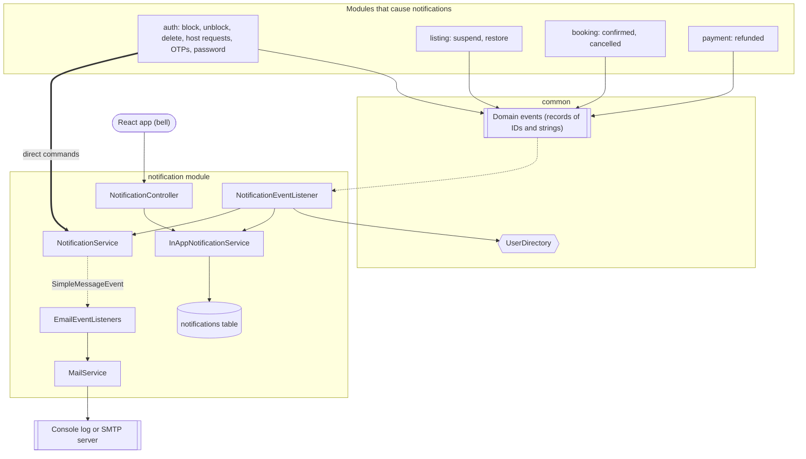

Notification depends only on `common`. It never imports auth, listing, booking or payment classes.

---

## 4. Class diagram

### 4.1 Email side

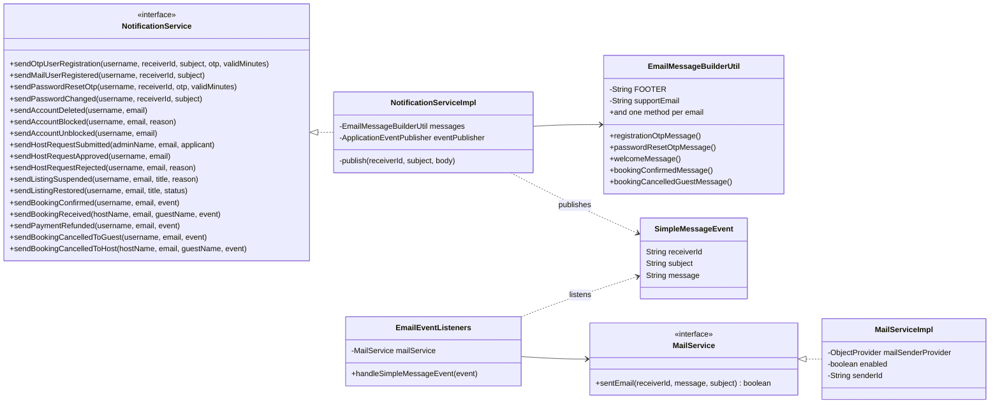

### 4.2 In-app side

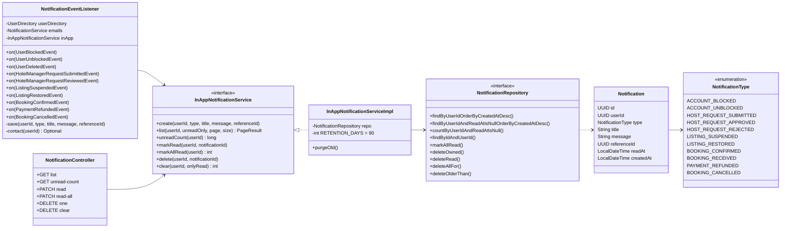

### 4.3 The table

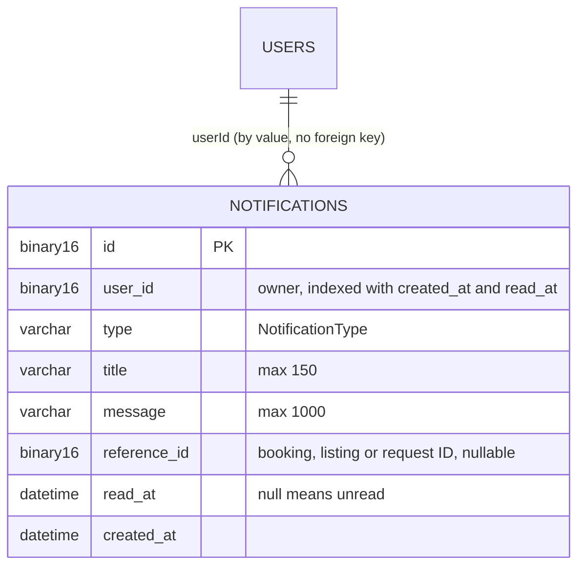

The notification stores a **type and a reference ID, not a URL**. The frontend decides which page each type opens, so renaming a route never breaks stored data.

---

## 5. Two ways a notification starts

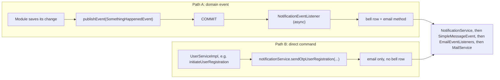

Why commands exist: a registration code is sent to someone who may not have an account yet, so there is no domain event and no bell to put it in. Commands are email only.

---

## 6. Email: how it is sent

### 6.1 The two hops

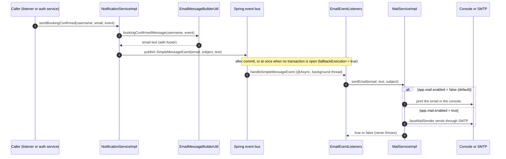

Why two hops: `NotificationService` owns **what** to say. `MailService` owns **how** to deliver. To switch to a real provider (SendGrid, SES), only `MailServiceImpl` changes.

### 6.2 Console mode versus SMTP mode

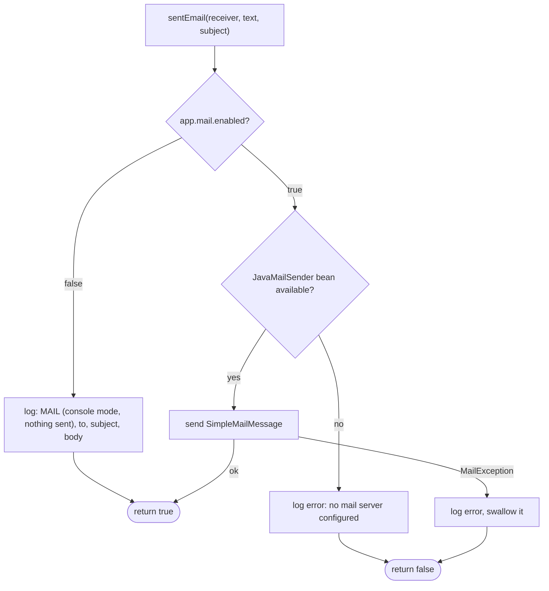

`ObjectProvider<JavaMailSender>` is used so the application still starts when no SMTP settings exist.

### 6.3 Email path for commands (no domain event)

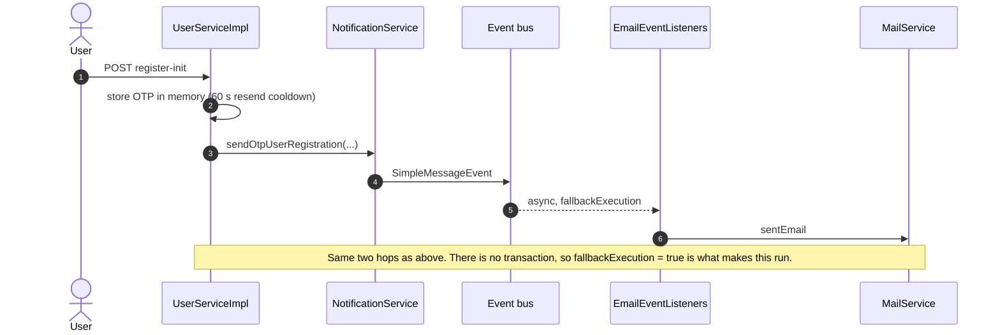

---

## 7. In-app notifications: how the bell works

### 7.1 Creating a row

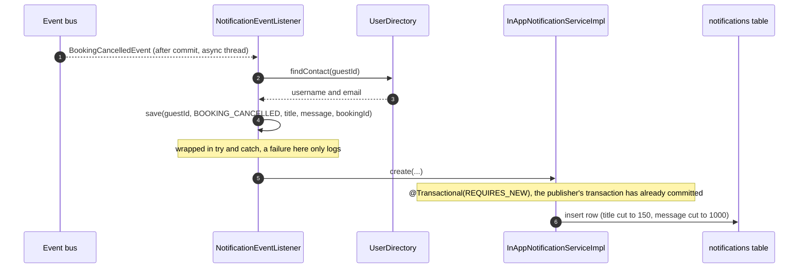

`REQUIRES_NEW` matters: the row is written after the publisher's transaction ended. Without a transaction of its own the insert would never be committed.

### 7.2 What the user does with it

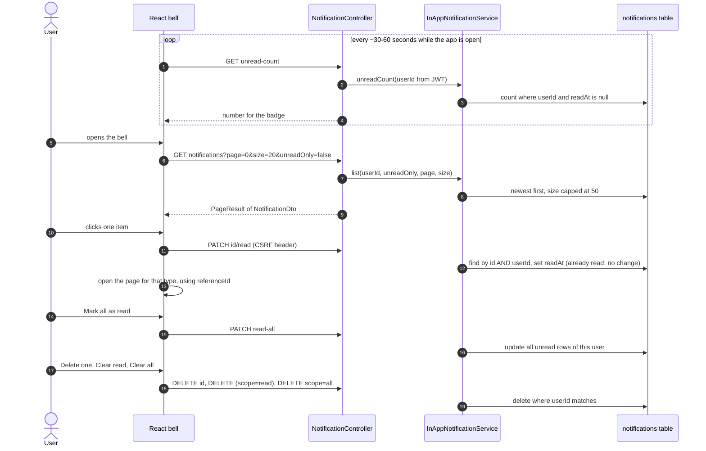

A user can only ever reach their own rows. Every query includes the user ID taken from the JWT. Another user's ID returns 404, not 403, so row IDs are not revealed.

### 7.3 Life of one notification

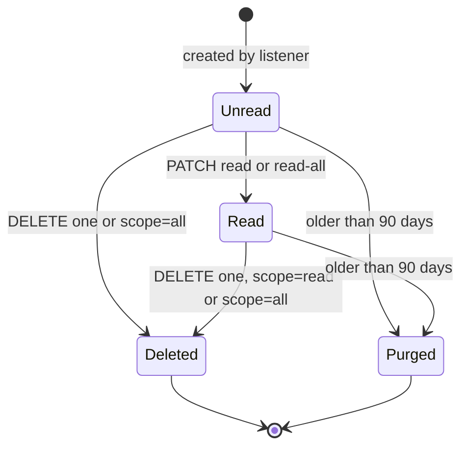

The cleanup job `purgeOld` runs every day at 03:30 and removes rows older than 90 days.

---

## 8. Both together: one domain event

One event produces a bell row and an email for each recipient. This is the whole path for a confirmed booking:

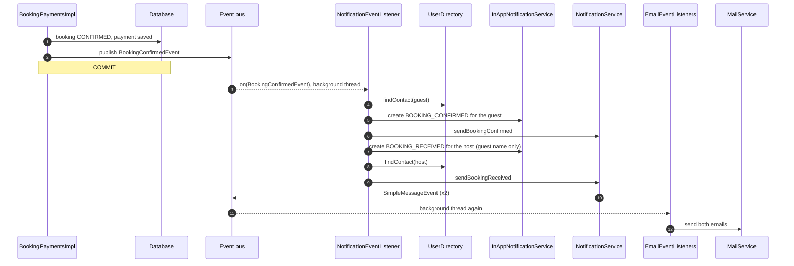

Bell and email always stay in step because the **same listener method** does both.

---

## 9. Threads and transactions

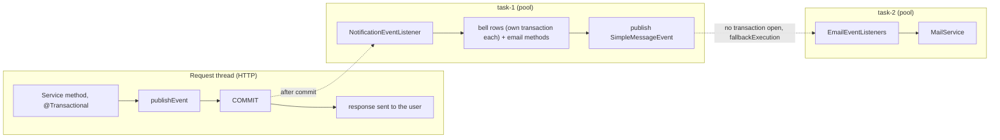

| Setting | Why |
|---|---|
| `@TransactionalEventListener(phase = AFTER_COMMIT)` | Nothing is announced for an action that rolled back. |
| `@Async` | The user's request does not wait for emails or bell rows. |
| `fallbackExecution = true` | `EmailEventListeners` receives its event while no transaction is open. Without this flag Spring silently skips the listener. |
| `@EnableAsync` in `AsyncConfig` | Without it, `@Async` quietly runs on the request thread. |
| Pool: `core-size=2`, `max-size=4`, `queue-capacity=100` | A small, bounded pool for notification work. |

The domain listeners in other modules (for example suspending listings on a block) are **not** async. They run inside the publisher's transaction on purpose. Only notifications are after-commit.

---

## 10. Failure behaviour

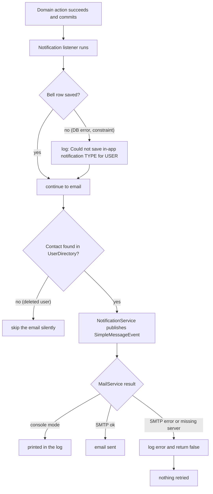

Summary of guarantees:

1. **A notification failure can never undo a block, a payment or a cancellation.** The action is already committed.
2. **A bell failure cannot skip the email**, because the save is wrapped in try and catch.
3. **An email failure cannot skip the bell**, because the bell row is saved first.
4. **Nothing is retried.** A failed email is only logged (see limits below).

---

## 11. Who gets what (catalogue)

| Trigger | Event or command | Bell (type) | Email | Recipient |
|---|---|---|---|---|
| Register: code | command | none | OTP | the new user |
| Register: verified | command | none | welcome | the user |
| Forgot password | command | none | reset OTP | the user |
| Password changed or reset | command | none | password changed | the user |
| Admin blocks a user | `UserBlockedEvent` | `ACCOUNT_BLOCKED` | yes, with the reason | the user |
| Admin unblocks | `UserUnblockedEvent` | `ACCOUNT_UNBLOCKED` | yes | the user |
| Account deleted | `UserDeletedEvent` | none (the account can never open the app) | yes | the user |
| User applies as host | `HotelManagerRequestSubmittedEvent` | `HOST_REQUEST_SUBMITTED` | yes | every active admin (not the applicant) |
| Admin approves | `HotelManagerRequestReviewedEvent` | `HOST_REQUEST_APPROVED` | yes | the applicant |
| Admin rejects | `HotelManagerRequestReviewedEvent` | `HOST_REQUEST_REJECTED` | yes, with the reason | the applicant |
| Admin suspends a listing | `ListingSuspendedEvent` | `LISTING_SUSPENDED` | yes | the owner |
| Admin unsuspends | `ListingRestoredEvent` | `LISTING_RESTORED` | yes | the owner |
| Booking paid | `BookingConfirmedEvent` | `BOOKING_CONFIRMED` | yes | the guest |
| Booking paid | `BookingConfirmedEvent` | `BOOKING_RECEIVED` | yes (guest name only) | the host |
| Duplicate or late payment refunded | `PaymentRefundedEvent` | `PAYMENT_REFUNDED` | yes, with the reason | the guest |
| Booking cancelled | `BookingCancelledEvent` | `BOOKING_CANCELLED` | yes | see below |

Booking cancellation recipients:

| Cancelled by | Booking was | Guest | Host |
|---|---|---|---|
| Guest | Unpaid | no | no |
| Guest | Paid | yes | yes |
| Host | Paid | yes (with reason) | no |
| Admin | Unpaid | yes | no |
| Admin | Paid | yes | yes |

Privacy rule: a host sees the guest's **username only**, never email or phone.

---

## 12. Endpoints and frontend contract

All need login. PATCH and DELETE need the `X-XSRF-TOKEN` header. Base path: `/api/v2/notifications`.

| Method and path | Returns (`data`) |
|---|---|
| `GET /?page=&size=&unreadOnly=` | `{ content, page, size, totalElements, totalPages }` |
| `GET /unread-count` | a number |
| `PATCH /{id}/read` | `null` (calling again is harmless) |
| `PATCH /read-all` | number of rows updated |
| `DELETE /{id}` | `null` (404 if not yours) |
| `DELETE /` (default `scope=read`) | number of rows deleted |
| `DELETE /?scope=all` | number of rows deleted |

`NotificationDto`: `id`, `type`, `title`, `message`, `referenceId`, `read`, `readAt`, `createdAt`.

Suggested type to page mapping on the frontend:

| Type | Opens |
|---|---|
| `ACCOUNT_BLOCKED`, `ACCOUNT_UNBLOCKED` | profile |
| `HOST_REQUEST_SUBMITTED` | admin host-request queue |
| `HOST_REQUEST_APPROVED`, `HOST_REQUEST_REJECTED` | become-a-host page |
| `LISTING_SUSPENDED`, `LISTING_RESTORED` | `/listings/{referenceId}` |
| `BOOKING_CONFIRMED`, `PAYMENT_REFUNDED`, `BOOKING_CANCELLED` (guest) | my bookings, booking `{referenceId}` |
| `BOOKING_RECEIVED`, `BOOKING_CANCELLED` (host) | host bookings page |

UI tips: poll `unread-count` with a timer, fetch the list only when the bell opens, remove an item locally right after delete and re-fetch the count (deleting an unread item lowers the badge), and ask for a confirm on "Clear all".

---

## 13. How to add a new notification

Example: "price drop alert".

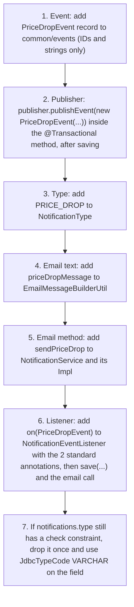

The listener method always has this shape:

```java
@Async
@TransactionalEventListener(phase = TransactionPhase.AFTER_COMMIT, fallbackExecution = true)
public void on(PriceDropEvent e) {
    save(e.userId(), NotificationType.PRICE_DROP, "Price dropped", "...", e.listingId());
    contact(e.userId()).ifPresent(c -> emails.sendPriceDrop(c.username(), c.email(), e));
}
```

Rules to keep:

- Publish `new Event(...)`, never a Lombok builder without `.build()` (that bug silently sent no email once).
- Events carry IDs and strings only.
- Do not use `@Transactional` on these listeners.
- The notification module must not import another module's entities. Use `UserDirectory` or a new small interface in `common`.

---

## 14. Configuration

```properties
# false = emails are printed to the console, true = sent through SMTP
app.mail.enabled=false

# used in suspension and support emails
app.support.email=support@blinkstay.local

# background pool for @Async listeners
spring.task.execution.pool.core-size=2
spring.task.execution.pool.max-size=4
spring.task.execution.pool.queue-capacity=100

# needed only when app.mail.enabled=true
spring.mail.host=...
spring.mail.port=...
spring.mail.username=...
spring.mail.password=...
```

`AsyncConfig` carries `@EnableAsync` and `@EnableScheduling` (the daily purge needs the second one).

---

## 15. Test checklist

1. **Console mode:** trigger a block and watch the log. A `MAIL (console mode, nothing sent)` block appears from a background thread (`task-N`), only after the commit.
2. **Rollback:** force the block to fail. No email and no bell row appear.
3. **Empty state:** `GET unread-count` gives `0` and the list is empty for a new user.
4. **Each event:** host request (admins notified, applicant not), approve and reject (applicant), suspend and unsuspend (owner), block and unblock (the user sees the rows after being unblocked), booking confirmed (guest and host), refund (guest), cancellation (see the recipient table).
5. **Mark read:** the count drops by one and calling it again changes nothing. `read-all` returns the number updated.
6. **Isolation:** another user's notification ID returns 404 on read and delete. A list shows only your own.
7. **Filters and paging:** `unreadOnly=true`, `size` above 50 is capped to 50.
8. **Delete:** one, `scope=read` (only read rows removed), `scope=all`. A bad `scope` gives 400.
9. **Deleted account:** only the console email, no bell row.
10. **Bell failure:** break the insert (for example a missing enum value). The log shows `Could not save in-app notification ...` and the email still prints.
11. **Cleanup:** temporarily set the cron to every minute and the retention to 0 days. The log shows `Notification cleanup removed N rows`. Put both back.
12. **SMTP off by mistake:** set `app.mail.enabled=true` with no host. The log shows the "no mail server" error and nothing crashes.

---

## 16. Known limits and next steps

- **No retry.** A failed email is logged and lost. A real provider needs a retry queue or an outbox table.
- **Polling, not push.** The bell polls `unread-count`. Server-sent events or WebSocket would make it instant.
- **Texts are English strings in code.** Translations would need templates and a locale.
- **No user preferences.** Everyone gets every email. A settings table (per type, per channel) is the next feature.
- **One instance only.** Pending OTPs and caches live in process memory. With several instances you would need Redis or a shared store.
- **`notifications.type` column.** If the table was created before newer types existed, MySQL's check constraint rejects the new values. Use `@JdbcTypeCode(SqlTypes.VARCHAR)` on the field and drop the old constraint once.
- **Moving to microservices:** the event records and listener methods stay as they are. The Spring event bus becomes a message broker, `UserDirectory` becomes a call or a local copy of contact data, and the listener needs to be idempotent because an event can arrive twice.
