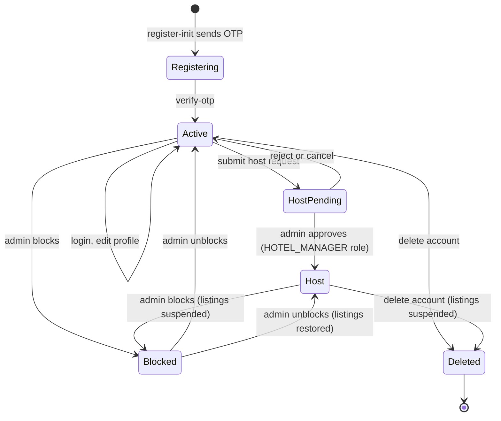
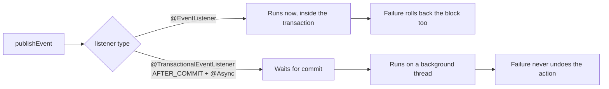
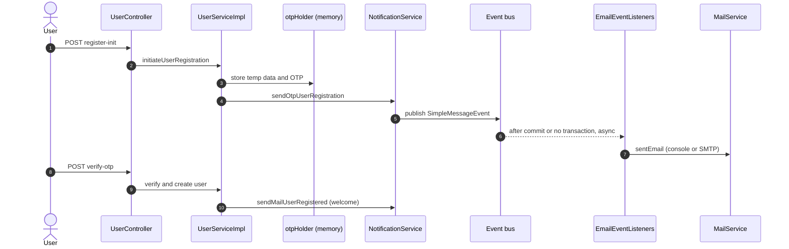
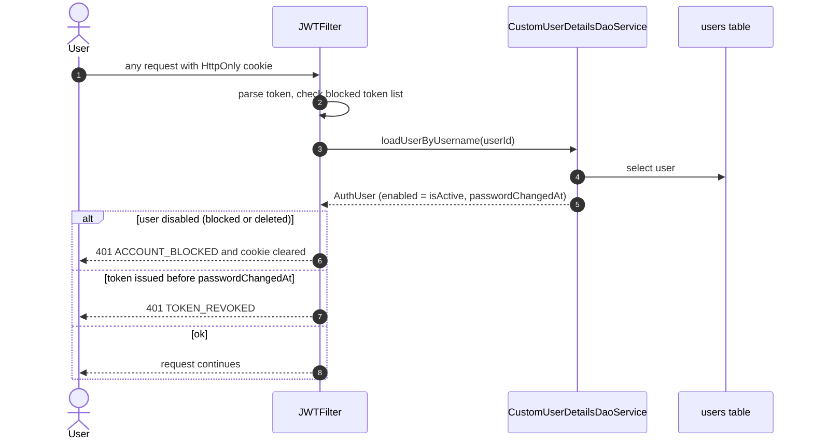
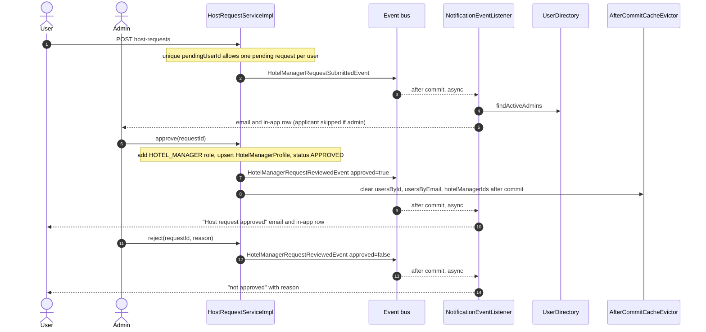
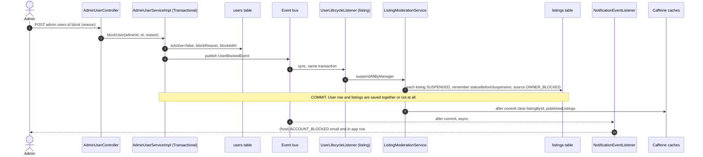
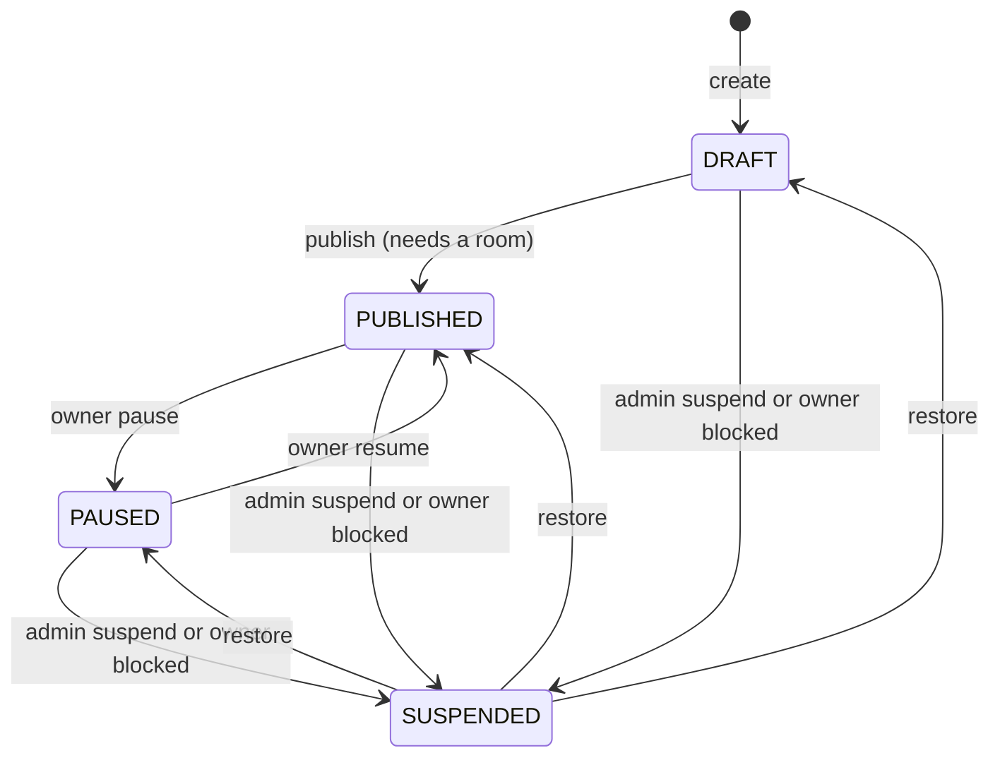
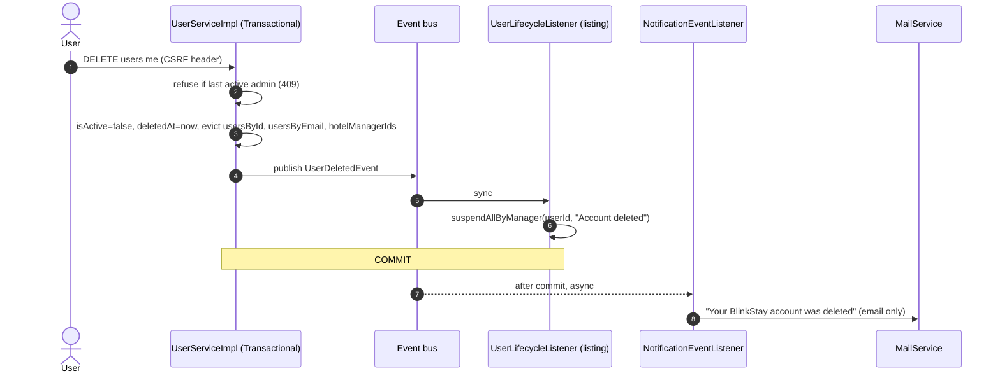
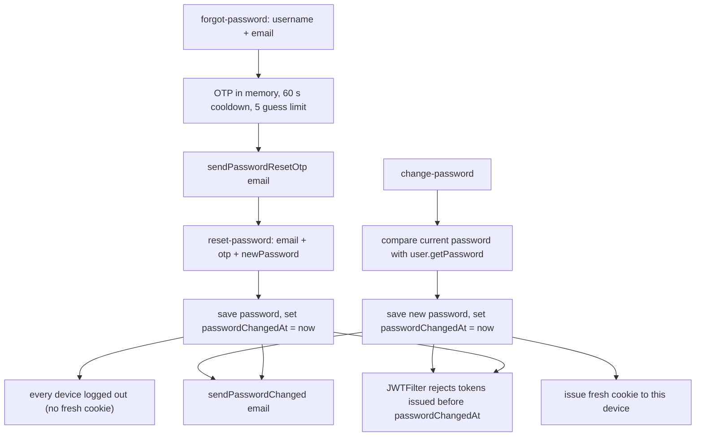
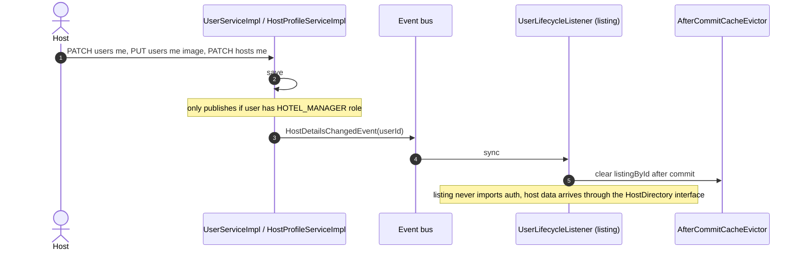

# BlinkStay: User Lifecycle and Events

How a user's life in BlinkStay is managed (register, login, host request, block, delete, password change), which **event** each step publishes, who **listens**, and how an event is created.

---

## Contents

1. [Events in plain words](#1-events-in-plain-words)
2. [Lifecycle at a glance](#2-lifecycle-at-a-glance)
3. [Event catalogue](#3-event-catalogue)
4. [How an event is created (5 steps)](#4-how-an-event-is-created-5-steps)
5. [Two kinds of listener (sync vs after-commit async)](#5-two-kinds-of-listener)
6. [Lifecycle flows with diagrams](#6-lifecycle-flows-with-diagrams)
   - 6.1 Registration and welcome
   - 6.2 Login and per-request check (no event)
   - 6.3 Host request: submit, approve, reject
   - 6.4 Block and unblock
   - 6.5 Delete account
   - 6.6 Password change, forgot and reset
   - 6.7 Host profile changes
7. [Commands vs events](#7-commands-vs-events)
8. [Rules and pitfalls](#8-rules-and-pitfalls)
9. [Test checklist](#9-test-checklist)
10. [Known limits and next steps](#10-known-limits-and-next-steps)

---

## 1. Events in plain words

An **event** is a small message that says "this happened". The code that makes it happen does not need to know who cares.

Without events, auth would call listing code to suspend a blocked host's listings, and the two modules would be glued together. With events:

1. Auth blocks the user and publishes `UserBlockedEvent(userId, reason)`.
2. Spring delivers it to every listener of that type.
3. Listing suspends the listings. Notification sends the email and saves the in-app row.

Auth never imports listing or notification. The only thing modules share is the event class in `blinkstay.common.events`.

---

## 2. Lifecycle at a glance



| State | How it is stored |
|---|---|
| Registering | OTP and temp data in memory (`otpHolder`), no DB row yet |
| Active | `isActive = true`, `deletedAt = null` |
| Blocked | `isActive = false`, `blockReason`, `blockedAt` set |
| Deleted | `isActive = false`, `deletedAt` set |
| Host | `roles` contains `HOTEL_MANAGER` plus a `HotelManagerProfile` row |

---

## 3. Event catalogue

All events are Java **records** in `blinkstay.common.events`. They carry only IDs and strings, never entities or enums from another module.

| Event | Fields | Published by | Where | Listeners |
|---|---|---|---|---|
| `UserBlockedEvent` | `userId, reason` | `AdminUserServiceImpl.blockUser` | auth | **listing** `UserLifecycleListener` (sync) suspends listings; **notification** (after commit, async) emails and saves in-app row |
| `UserUnblockedEvent` | `userId` | `AdminUserServiceImpl.unblockUser` | auth | **listing** (sync) restores listings; **notification** emails and saves in-app row |
| `UserDeletedEvent` | `userId` | `UserServiceImpl.deleteUserById` | auth | **listing** (sync) suspends listings with reason "Account deleted"; **notification** sends email only (the account can never open the app) |
| `HotelManagerRequestSubmittedEvent` | `requestId, userId, username` | `HostRequestServiceImpl.submit` | auth | **notification**: every active admin (except the applicant) gets email and in-app row |
| `HotelManagerRequestReviewedEvent` | `requestId, userId, approved, reason` | `approve` and `reject` | auth | **notification**: applicant gets approved or rejected email and in-app row |
| `HostDetailsChangedEvent` | `userId` | `UserServiceImpl` (profile, image) and `HostProfileServiceImpl` | auth | **listing** (sync) clears the `listingById` cache after commit |
| `ListingSuspendedEvent` | `listingId, managerId, title, reason` | `ListingServiceImpl.suspendListing` | listing | **notification**: owner email and in-app row |
| `ListingRestoredEvent` | `listingId, managerId, title, restoredStatus` | `ListingServiceImpl.unsuspendListing` | listing | **notification**: owner email and in-app row |
| `SimpleMessageEvent` | `receiverId, subject, message` | `NotificationServiceImpl` | notification | `EmailEventListeners` calls `MailService` (console or SMTP) |

---

## 4. How an event is created (5 steps)

Example: `UserBlockedEvent`.

### Step 1. Define the record in `common`

```java
package blinkstay.common.events;

import java.util.UUID;

public record UserBlockedEvent(UUID userId, String reason) {}
```

Why a record: immutable, no boilerplate, and it carries only IDs and strings so it can later travel through a message broker unchanged.

### Step 2. Inject the publisher in the module that owns the action

```java
@Service
@RequiredArgsConstructor
public class AdminUserServiceImpl implements AdminUserService {
    private final ApplicationEventPublisher publisher;
    // ...
}
```

### Step 3. Publish it inside the transaction, after the state change

```java
@Override
@Transactional
public void blockUser(UUID adminId, UUID targetId, String reason) {
    // validations, then:
    user.setIsActive(false);
    user.setBlockReason(reason);
    user.setBlockedAt(LocalDateTime.now());
    userRepository.save(user);

    publisher.publishEvent(new UserBlockedEvent(targetId, reason));
}
```

Always pass a **built object** (`new Event(...)` or `builder.build()`), not the builder. We had a bug where a Lombok builder without `.build()` was published, so no listener matched and no email was sent.

### Step 4. Listen in the module that cares

Synchronous (same thread, same transaction):

```java
@Component
@RequiredArgsConstructor
public class UserLifecycleListener {
    private final ListingModerationService moderation;

    @EventListener
    public void on(UserBlockedEvent e) {
        moderation.suspendAllByManager(e.userId(), e.reason());
    }
}
```

After commit and async:

```java
@Component
@RequiredArgsConstructor
public class NotificationEventListener {
    @Async
    @TransactionalEventListener(phase = TransactionPhase.AFTER_COMMIT, fallbackExecution = true)
    public void on(UserBlockedEvent e) {
        save(e.userId(), NotificationType.ACCOUNT_BLOCKED, "Your account was blocked", "Reason: " + e.reason(), null);
        contact(e.userId()).ifPresent(c -> emails.sendAccountBlocked(c.username(), c.email(), e.reason()));
    }
}
```

### Step 5. Make sure async is enabled

```java
@Configuration
@EnableAsync
public class AsyncConfig {}
```

Without `@EnableAsync`, `@Async` silently runs on the request thread.

### Checklist for any new event

1. Record in `common/events` (IDs and strings only).
2. `ApplicationEventPublisher` injected in the publisher class.
3. `publishEvent(new ...)` inside the `@Transactional` method, after saving.
4. Listener in the interested module. Decide sync or after-commit (section 5).
5. Never call another module's repository or entity. Use the event, or a small interface in `common` such as `UserDirectory`.

---

## 5. Two kinds of listener

| | `@EventListener` | `@TransactionalEventListener(AFTER_COMMIT)` + `@Async` |
|---|---|---|
| Runs | Immediately, same thread | After the DB commit, on a background thread |
| Inside publisher's transaction | Yes | No |
| If listener throws | Whole transaction rolls back | Publisher is unaffected (the error is only logged) |
| Use for | Must succeed together with the action (suspend listings when blocking) | Side effects that must never undo the action (emails, in-app rows) |
| Needs `fallbackExecution = true` | n/a | Yes, so it still runs when there is no transaction |



Why this split: a blocked host must never keep public listings, so suspension is synchronous and atomic with the block. An email server hiccup must never undo a block, so notifications run after commit.

---

## 6. Lifecycle flows with diagrams

### 6.1 Registration and welcome

No domain event. Auth calls `NotificationService` directly, because "send this code" is a command with one clear receiver.



Register-init and verify-otp can answer **429** (60 s resend cooldown).

### 6.2 Login and per-request check (no event)

Blocking takes effect immediately without any event. The JWT filter re-reads the user on **every request**.



### 6.3 Host request: submit, approve, reject



Rules enforced in `loadReviewable`: request must be `PENDING` (else 409), and an admin cannot review their own request (403). On approve, the applicant must still be active and not deleted.

### 6.4 Block and unblock



Unblock mirrors it with `UserUnblockedEvent`. Only listings with `source = OWNER_BLOCKED` come back, each to its previous status. A listing that was `PUBLISHED` but lost its last room while suspended returns as `DRAFT`. Listings suspended by an admin stay suspended.

The listing statuses involved:



Safety rules in `blockUser`: an admin cannot block an admin or themselves, and the reason is required (max 500 characters).

### 6.5 Delete account



Deletion is a soft delete. Delete used to reuse `UserBlockedEvent`; it now has its own `UserDeletedEvent` so the message reads "deleted", not "blocked", and no in-app row is saved.

### 6.6 Password change, forgot and reset

Commands to `NotificationService`, plus a timestamp that invalidates old sessions.



So: change-password logs out **other** devices, reset-password logs out **all** devices.

### 6.7 Host profile changes

When a host edits their name, bio, photo or business profile, the public listing page shows host details. The details are cached, so an event clears the cache.



---

## 7. Commands vs events

Both exist in the notification pipeline on purpose.

| | Event | Command |
|---|---|---|
| Meaning | "Something happened" | "Do this" |
| Who knows the receiver | Many listeners, publisher does not know them | One clear receiver |
| Examples | `UserBlockedEvent`, `HotelManagerRequestReviewedEvent` | Registration OTP, forgot-password OTP, welcome, password-changed |
| Path | Domain event, then `NotificationEventListener`, then `NotificationService` and `InAppNotificationService` | Auth calls `NotificationService` directly |
| End of both paths | `SimpleMessageEvent`, then `EmailEventListeners`, then `MailService` | same |

---

## 8. Rules and pitfalls

1. **Events carry IDs and strings only.** No entities, no other module's enums.
2. **Publish `new Event(...)`, never a builder.** A missing `.build()` means no listener fires.
3. **Do not add `@Async` to the listing listener methods.** That would move them out of the transaction, and a blocked user could keep public listings.
4. **Do not use `@Transactional` on a listener that should never undo the action.** Notification listeners are after-commit for that reason.
5. **Enable async.** Without `@EnableAsync`, `@Async` quietly runs on the request thread.
6. **Self-invocation bypasses Spring proxies** (`@Cacheable`, `@Transactional`). Call across beans, not `this.method()`.
7. **Clear caches after commit** with `AfterCommitCacheEvictor`, otherwise a concurrent request can re-cache old data before the commit lands.
8. **Cache names must be registered.** An unregistered name in `CacheManager` creates an unbounded cache silently. Names used here: `listingById`, `publishedListings`, `usersById`, `usersByEmail`, `hotelManagerIds`, `blockedTokens`.
9. **In-app save is wrapped in try/catch** so a database problem there cannot skip the email.
10. **Cross-module reads go through small interfaces in `common`** (`UserDirectory`, `HostDirectory`, `BookingGuard`), not repositories.

---

## 9. Test checklist

1. **Block a host** with a published, a draft and a paused listing: all become `SUSPENDED`. The host's next request returns 401 `ACCOUNT_BLOCKED`. Console shows the blocked email.
2. **Unblock**: each listing returns to its own status. An admin-suspended listing stays suspended.
3. **Rollback**: force `suspendAllByManager` to throw. The user must stay unblocked.
4. **Delete a host account**: listings suspended, email printed from a background thread (`task-1`). Deleting the last active admin returns 409.
5. **Host request**: applicant submits (admins notified, applicant not). A second submit returns 409. Approve gives the role and a notification. A user cannot review their own request (403).
6. **Reject** shows the reason to the applicant.
7. **Password change** on device A: device B gets 401 `TOKEN_REVOKED`, device A keeps working. **Reset** logs out all devices.
8. **Host edits bio**: `GET listing` shows the new bio right away (cache cleared), with no 10-minute wait.
9. **Email failure** (SMTP off): block still succeeds, the error is only logged.

---

## 10. Known limits and next steps

- A deleted user's email stays taken, so they cannot register again with it. Anonymising the email on delete is a possible follow-up.
- Registration data and OTPs live in memory. A restart loses them, and several instances would not share them. The registration password is also held in plain text in memory until verification, which should be fixed.
- No per-IP rate limit on OTP paths yet (the 60 s cooldown and 5-guess limit are per account).
- The module graph has a known `listing <-> room` cycle.
- Booking and payment: when a user is blocked or deleted, their bookings are not touched yet. A `BookingGuard`-style check or a `UserBlockedEvent` listener in booking is the natural next step.
- If BlinkStay is split into services, the event records and listener methods stay the same. The transport changes from Spring's in-process bus to a broker, which needs an outbox table and idempotent listeners.
